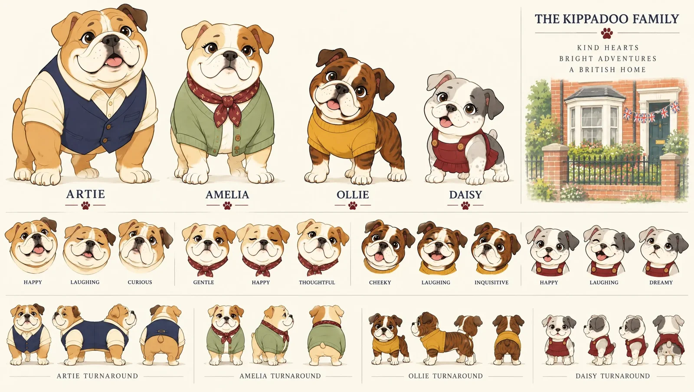

# British Bulldog Family Storybook Character Lineup

**中文标题：** 英国斗牛犬一家·绘本角色排排站  
**ID:** `gi25-x-1426` · **Mode:** `generate`  
**Categories:** `character-consistency`  
**Tags:** `x-twitter`, `community`, `gpt-image-2.5`, `x-direct`, `en`



### British Bulldog Family Storybook Character Lineup

```text
Draw a 2D storybook lineup of four upright British bulldogs on cream. Dad Artie wears a navy waistcoat. Mum Amelia wears a sage cardigan. Ollie is brindle with a white forehead stripe and mustard jumper. Daisy is silver-grey with a dark ear patch and burgundy pinafore.
```

- **Recommended model:** `gpt-image-2.5-sunburst`
- **Settings:** _(defaults)_
- **Source:** [community](https://x.com/Heliosastra/status/2118372838390292515) — @Heliosastra
- **License note:** Original public X post; quoted with attribution — remix with attribution
- **Notes:** Collected directly from X; original post https://x.com/Heliosastra/status/2118372838390292515; post text names GPT Image 2.5; discovered via X search, prompt re-verified against the original X post via api.fxtwitter.com; verified=True; step 1 of a Higgsfield GPT Image 2.5 + Seedance workflow; only the character-sheet prompt is quoted
- **Preview:** `previews/gi25-x-1426.webp`
