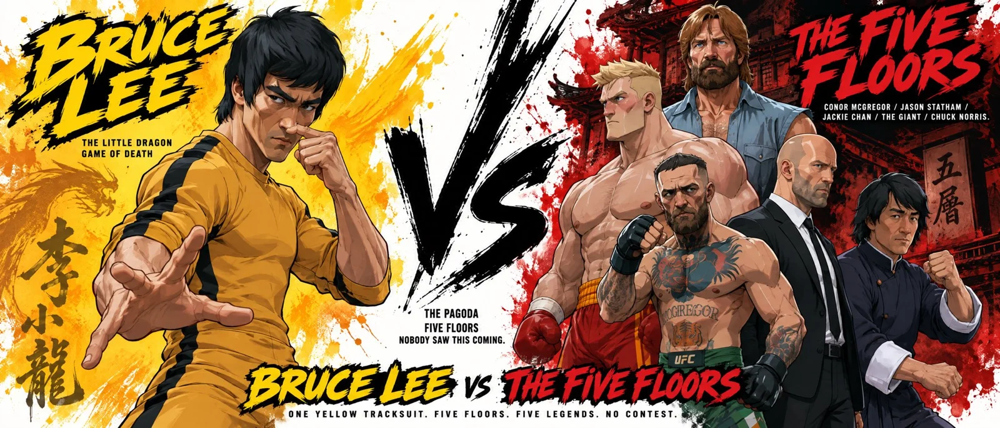

# Bruce Lee vs the Pagoda Character Bible Sheet

**中文标题：** 李小龙对宝塔·角色设定表  
**ID:** `gi25-x-1429` · **Mode:** `generate`  
**Categories:** `character-consistency`  
**Tags:** `x-twitter`, `community`, `gpt-image-2.5`, `x-direct`, `en`



### Bruce Lee vs the Pagoda Character Bible Sheet

```text
Create a premium cinematic character bible sheet for BRUCE LEE VS THE PAGODA. Use uploaded character sheets as strict visual reference for all characters. Do not change any character's appearance.
LAYOUT: Split screen VS format. Two halves divided by a bold dramatic dividing element in the center.
LEFT SIDE — BRUCE LEE: Bold dramatic bright yellow watercolor splash bleeding into golden orange, radiating behind him and filling the entire left side. Large bold brushstroke text BRUCE LEE top left in bright yellow with a black outline. Below small text: THE LITTLE DRAGON / GAME OF DEATH. One massive dramatic cropped hero image of Bruce Lee from mid-thigh up — yellow tracksuit with black stripes down the sides, lean muscular build, short black hair, in a fighting stance with one hand forward and the other flicking his thumb across his nose, calm focused expression.
CENTER: Bold dramatic VS in deep black. Below it small text: THE PAGODA / FIVE FLOORS / NOBODY SAW THIS COMING.
RIGHT SIDE — THE FIVE FLOORS: Bold dramatic multi-color watercolor splash radiating behind them and filling the entire right side — deep crimson red bleeding into black, with dark wooden pagoda beams and lattice windows faintly visible in the splash. Large bold brushstroke text THE FIVE FLOORS top right in deep crimson red. Below small text: CONOR MCGREGOR / JASON STATHAM / JACKIE CHAN / THE GIANT / CHUCK NORRIS. A dramatic group composition of all five opponents stacked and overlapping from mid-thigh up, arranged like a tower with the biggest at the top: Chuck Norris at the top center in his tan cowboy hat, denim shirt and reddish-brown beard as the final boss; the very tall blond giant boxer in red shorts and red gloves towering behind; Jackie Chan in his loose navy blue kung fu outfit; Jason Statham in his dark suit and white shirt; and Conor McGregor in green shorts and black MMA gloves with his tattoos and full beard at the front. All five facing left toward Bruce Lee with calm, intense expressions.
BOTTOM CENTER: Bold text BRUCE LEE VS THE FIVE FLOORS, with BRUCE LEE in bright yellow and THE FIVE FLOORS in deep crimson red. Tagline: ONE YELLOW TRACKSUIT. FIVE FLOORS. FIVE LEGENDS. NO CONTEST.
OVERALL: Clean white background, bold dramatic bright yellow and golden orange watercolor explosion left side, bold dramatic deep crimson and black watercolor explosion right side, dramatic deep black center divider, bold flat color blocking, chunky simplified forms, hard edge shadows, thick black outlines, cinematic cel-shaded 3D anime, hand-painted textures, not cartoon not Disney not Pixar, print ready.
```

- **Recommended model:** `gpt-image-2.5-sunburst`
- **Settings:** _(defaults)_
- **Source:** [community](https://x.com/TechieBySA/status/2118387230930526236) — @TechieBySA
- **License note:** Original public X post; quoted with attribution — remix with attribution
- **Notes:** Collected directly from X; prompt posted as the author's own reply https://x.com/TechieBySA/status/2118387230930526236 to https://x.com/TechieBySA/status/2118387218108596544, which carries the images; GPT Image 2.5 is named in the parent post; discovered via X search, prompt re-verified against the original X post via api.fxtwitter.com; verified=True; GPT Image 2.5 sheet from a Seedance 2.5 + GPT Image 2.5 workflow; Seedance video prompt in the thread is not quoted; needs uploaded character sheets; preview from the reply photo
- **Preview:** `previews/gi25-x-1429.webp`
