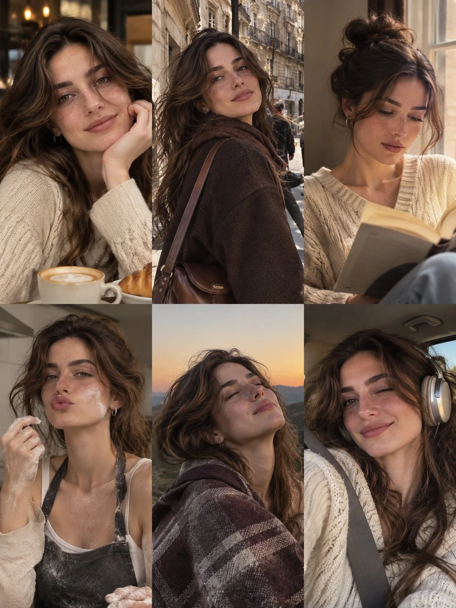

# Six-Photo Lifestyle Collage of One Woman (3×2 Grid)

**中文标题：** 同一女性六格生活拼贴（3×2）  
**ID:** `gi25-x-1437` · **Mode:** `generate`  
**Categories:** `character-consistency`, `general`  
**Tags:** `x-twitter`, `community`, `gpt-image-2.5`, `x-direct`, `en`



### Six-Photo Lifestyle Collage of One Woman (3×2 Grid)

```text
Create an ultra-realistic 6-photo lifestyle collage arranged in a vertical 3-column × 2-row grid, featuring the same naturally beautiful young European woman in her early 20s. She has warm olive skin, delicate freckles, captivating hazel-green eyes, long voluminous chocolate-brown hair with natural waves, full eyebrows, and soft glossy lips. Preserve her exact facial identity across all six photographs.

Six Different Scenes and Poses:

1. Coffee Shop: Sitting at a cozy café table in an oversized cream knit sweater, resting her cheek against one hand with a gentle smile. A cappuccino and croissant sit in front of her.
2. City Stroll: Walking through a charming European street wearing a dark brown wool coat, carrying a leather shoulder bag and looking back toward the camera.
3. Reading Moment: Sitting beside a bedroom window in a cream cable-knit cardigan, reading a book with her hair tied in a loose messy bun.
4. Baking Afternoon: Preparing something in a kitchen, wearing a white top and dark floral apron, playfully making a pout with a little flour on her cheek.
5. Sunset Escape: Wrapped in a dark brown patterned blanket outdoors, eyes closed and face tilted toward the warm sunset.
6. Car Selfie: Sitting in the passenger seat wearing a cream knit sweater and silver over-ear headphones, giving the camera a relaxed, playful smile.

Photography Style: Authentic Instagram photo dump, Canon PowerShot G7 X Mark III aesthetic, natural lighting, occasional direct flash, realistic skin pores, subtle film grain, candid expressions, warm cinematic tones, and imperfect framing.

Consistency: Maintain the same face, freckles, hazel-green eyes, skin tone, and recognizable facial features in every photograph. Each frame should have a different outfit variation, hairstyle, expression, pose, and environment.

Output: Vertical 3:4 aspect ratio, exactly six equally sized photographs in a clean 3-column × 2-row grid, seamless alignment, no gutters, no borders, no text, no watermark. Photorealistic, cozy, youthful, spontaneous, and effortlessly stylish.
```

- **Recommended model:** `gpt-image-2.5-sunburst`
- **Settings:** _(defaults)_
- **Source:** [community](https://x.com/john_my07/status/2118597801588248656) — @john_my07
- **License note:** Original public X post; quoted with attribution — remix with attribution
- **Notes:** Collected directly from X; original post https://x.com/john_my07/status/2118597801588248656; post text names GPT Image 2.5; discovered via X search, prompt re-verified against the original X post via api.fxtwitter.com; verified=True
- **Preview:** `previews/gi25-x-1437.webp`
