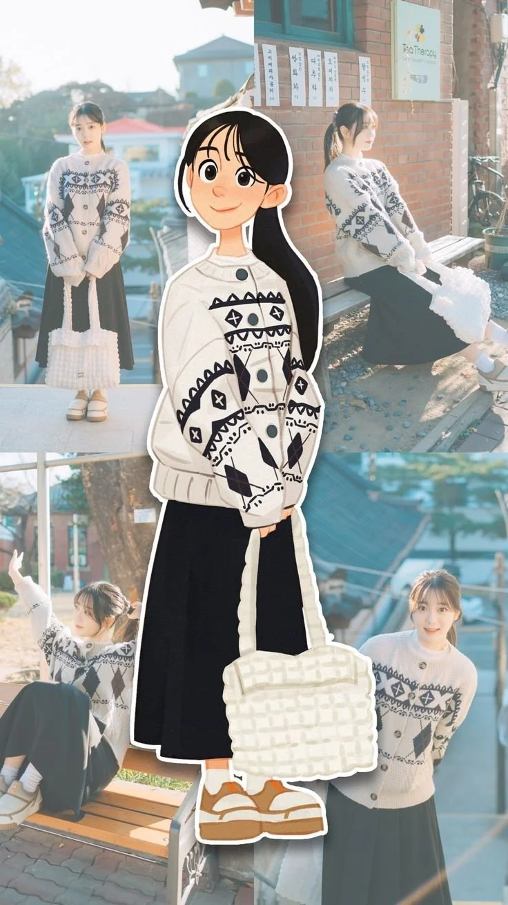

# Sticker-Border Cartoon over a 2×2 Photo Collage (9:16)

**中文标题：** 贴纸描边卡通人物+2×2写真拼贴（9:16）  
**ID:** `gi25-x-1438` · **Mode:** `edit`  
**Categories:** `character-consistency`, `edit-change-preserve`  
**Tags:** `x-twitter`, `community`, `gpt-image-2.5`, `x-direct`, `en`



### Sticker-Border Cartoon over a 2×2 Photo Collage (9:16)

```text
Create a vertical 9:16 photorealistic aesthetic collage using the uploaded reference image as the layout guide.

Main Concept:
A stylish character collage featuring the same young woman appearing in five different scenes. Arrange four realistic photographs in a 2×2 collage background, with one large illustrated cartoon version of the woman standing in the center.

Character Consistency:
Use the same person's face, hairstyle, facial features, and skin tone across all five appearances. The central character should be a cute 2D anime-style illustration with large expressive eyes, a gentle smile, clean outlines, and a thick white sticker border.

Outfit:
A cream-colored oversized knitted cardigan with black geometric patterns and buttons, a long black skirt, white socks, beige sandals, and a cream woven shoulder tote bag. Keep the outfit identical in every scene.

Background Scenes:

1. Standing outdoors on a sunny rooftop terrace, holding the woven tote bag.
2. Sitting sideways on a wooden bench beside a brick building.
3. Sitting casually on a wooden bench, raising one hand.
4. Standing near a traditional Korean-style rooftop with a gentle smile.

Central Character:
A full-body cartoon illustration in the exact same outfit, standing naturally while holding the woven tote bag. Place her prominently over the four background photographs with a thick white die-cut sticker outline.

Visual Style:
Soft golden-hour sunlight, warm film photography, pastel tones, dreamy atmosphere, natural shadows, subtle vintage aesthetic, realistic photography combined with cute anime illustration.

Important:
Preserve the original collage composition, clothing, accessories, poses, and background details. Maintain consistent facial identity across every appearance. High-quality details, clean composition, vertical 9:16 aspect ratio.
```

- **Recommended model:** `gpt-image-2.5-sunburst`
- **Settings:** _(defaults)_
- **Source:** [community](https://x.com/Ziha_ai/status/2119691900894773400) — @Ziha_ai
- **License note:** Original public X post; quoted with attribution — remix with attribution
- **Notes:** Collected directly from X; original post https://x.com/Ziha_ai/status/2119691900894773400; post text names GPT Image 2.5; discovered via X search, prompt re-verified against the original X post via api.fxtwitter.com; verified=True; needs an uploaded reference image used as the layout guide
- **Preview:** `previews/gi25-x-1438.webp`
