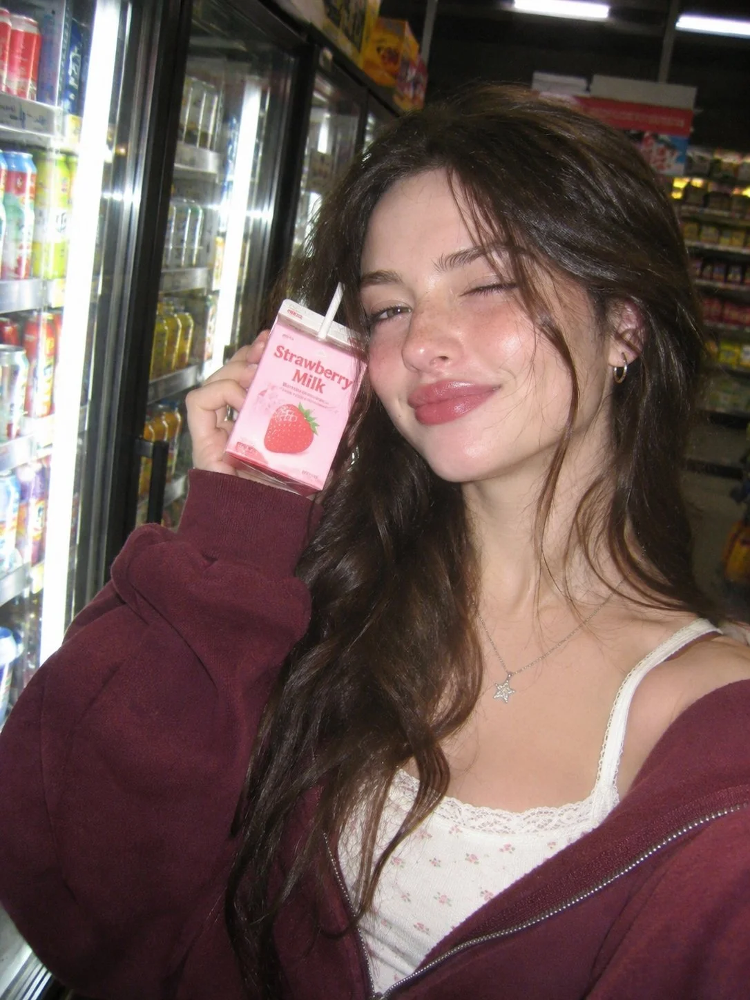

# 2000s CCD Flash Convenience-Store Portrait Pair

**中文标题：** 2000年代CCD闪光·便利店人像双图  
**ID:** `gi25-x-1440` · **Mode:** `generate`  
**Categories:** `character-consistency`, `general`  
**Tags:** `x-twitter`, `community`, `gpt-image-2.5`, `x-direct`, `en`



### 2000s CCD Flash Convenience-Store Portrait Pair

```text
PROMPT image 1: A nostalgic 2000s CCD digital camera flash portrait of a beautiful 23-year-old American woman inside a late-night convenience store, 9:16 vertical format. Close-up waist-up framing, slightly tilted angle. Long, naturally voluminous dark brown hair, soft facial features, hazel eyes and rosy lips. Wearing an oversized burgundy zip-up hoodie over a cream top, small silver hoop earrings and a delicate necklace. Holding a strawberry milk carton beside her cheek while giving the camera a sleepy, playful smile. Bright convenience store refrigerators and colorful shelves blurred in the background. Direct frontal camera flash, slightly overexposed skin highlights, soft shadows, visible digital noise, muted colors, authentic early-2000s CCD photography aesthetic, realistic skin texture, candid imperfect composition.

PROMPT IMAGE 2: Same 23-year-old woman, identical face, hair, burgundy hoodie, cream top, silver jewelry and same late-night convenience store background. 9:16 vertical 2000s CCD flash photography. New pose: She turns slightly sideways, looks back at the camera over her shoulder, holding the strawberry milk carton near her chest with one hand while gently touching her hair with the other. Playful natural smile, direct camera flash, realistic skin texture, nostalgic digital grain, candid composition
```

- **Recommended model:** `gpt-image-2.5-sunburst`
- **Settings:** _(defaults)_
- **Source:** [community](https://x.com/chandrapie/status/2119497070910599436) — @chandrapie
- **License note:** Original public X post; quoted with attribution — remix with attribution
- **Notes:** Collected directly from X; original post https://x.com/chandrapie/status/2119497070910599436; post text names GPT Image 2.5; discovered via X search, prompt re-verified against the original X post via api.fxtwitter.com; verified=True; two-image prompt set (image 1 + image 2) quoted together; preview is image 1
- **Preview:** `previews/gi25-x-1440.webp`
