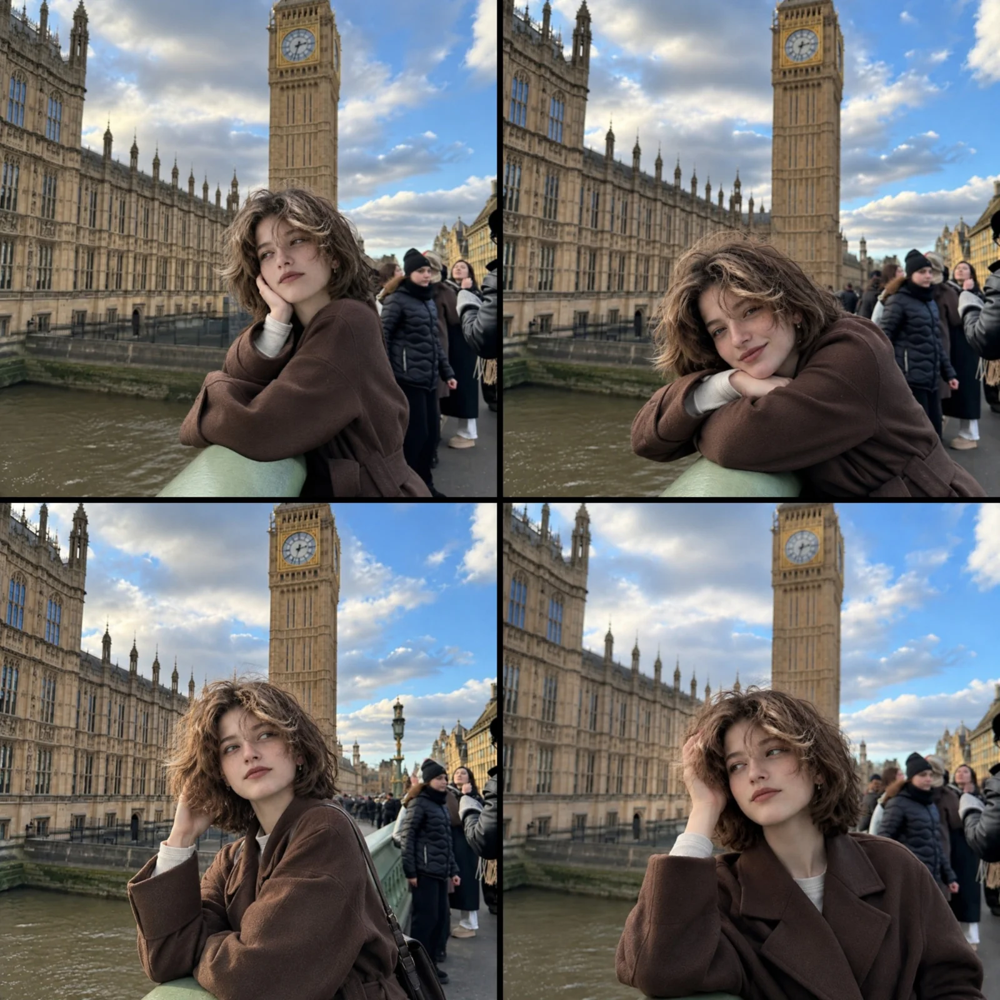

# Westminster Bridge 2×2 Winter Travel Collage (1:1)

**中文标题：** 威斯敏斯特桥冬日旅拍 2×2 拼贴（1:1）  
**ID:** `gi25-x-1443` · **Mode:** `generate`  
**Categories:** `character-consistency`, `general`  
**Tags:** `x-twitter`, `community`, `gpt-image-2.5`, `x-direct`, `en`



### Westminster Bridge 2×2 Winter Travel Collage (1:1)

```text
Create a realistic 2×2 photo collage featuring the same young woman in all four panels, photographed at Westminster Bridge in London, with Big Ben and the Houses of Parliament in the background.

Character consistency: Maintain the exact same facial identity, facial features, freckles, short tousled light-brown hair, hairstyle, skin tone, and body proportions across all four photos.

Outfit: Oversized dark chocolate-brown wool coat, cream knit sweater underneath, and small silver earrings.

Panel 1, Top Left: The woman leans against the green bridge railing, resting her cheek on one hand while looking slightly away from the camera.

Panel 2, Top Right: She rests her chin on her folded arms over the railing, looking directly at the camera with a subtle smile.

Panel 3, Bottom Left: She sits or leans sideways against the railing, gently touching her hair while gazing into the distance.

Panel 4, Bottom Right: She stands beside the railing with one hand running through her hair, looking thoughtfully to the side.

Environment: Iconic Big Ben, detailed Gothic architecture of the Palace of Westminster, River Thames, green bridge railing, and naturally blurred tourists in winter clothing.

Photography style: Ultra-realistic travel photography, natural facial expressions, authentic skin texture, soft winter daylight, partly cloudy blue sky, realistic colors, candid editorial photography, subtle depth of field.

Layout: Perfect 2×2 square collage, four equally sized photographs, thin black dividing lines, consistent color grading and lighting. No text, no watermark, no extra panels.

Aspect ratio: 1:1, high resolution, photorealistic.
```

- **Recommended model:** `gpt-image-2.5-sunburst`
- **Settings:** _(defaults)_
- **Source:** [community](https://x.com/Ziha_ai/status/2119396405123186839) — @Ziha_ai
- **License note:** Original public X post; quoted with attribution — remix with attribution
- **Notes:** Collected directly from X; original post https://x.com/Ziha_ai/status/2119396405123186839; post text names GPT Image 2.5; discovered via X search, prompt re-verified against the original X post via api.fxtwitter.com; verified=True
- **Preview:** `previews/gi25-x-1443.webp`
