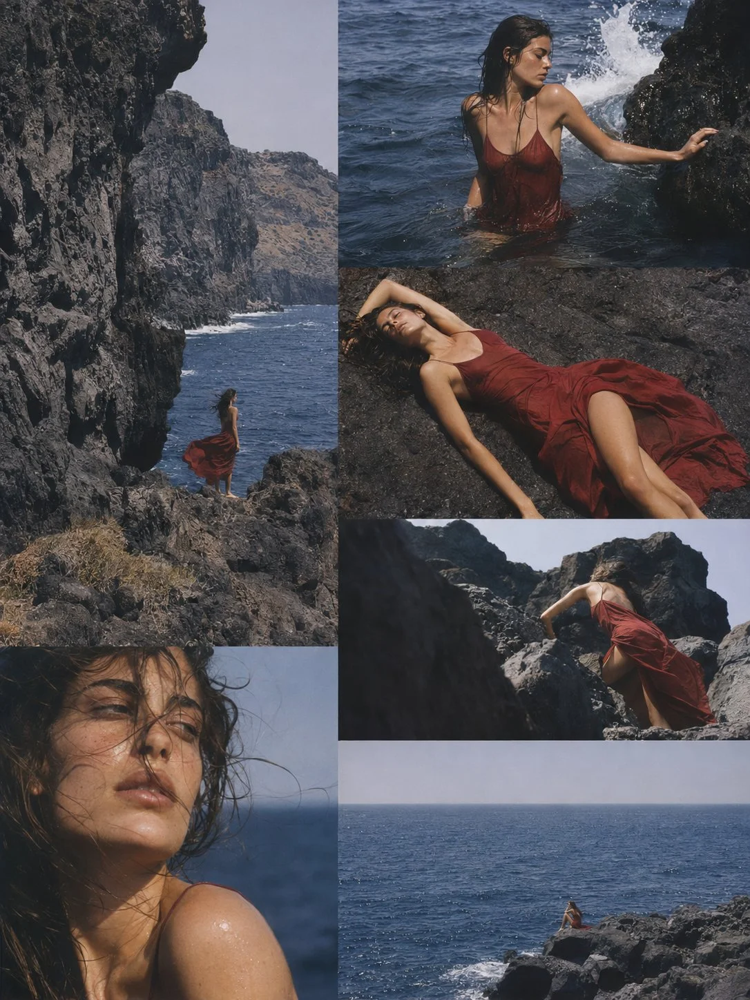

# SICILIAN SIREN 6-Photo Analog Fashion Editorial

**中文标题：** 「SICILIAN SIREN」六图胶片时尚大片  
**ID:** `gi25-x-1475` · **Mode:** `generate`  
**Categories:** `character-consistency`, `general`  
**Tags:** `x-twitter`, `community`, `gpt-image-2.5`, `x-direct`, `en`



### SICILIAN SIREN 6-Photo Analog Fashion Editorial

```text
Create ONE sophisticated 6-photo analog fashion editorial titled:

“SICILIAN SIREN”

A single continuous photography session featuring the EXACT SAME young Mediterranean woman on a remote volcanic coastline in southern Italy.

This is NOT vacation photography.
This is NOT Pinterest lifestyle photography.
This is NOT a soft romantic white-dress photoshoot.

It must feel like a high-end 1990s European fashion editorial photographed on real medium-format film.

VISUAL CONCEPT:

A solitary woman spending a brutally hot summer afternoon on a remote Sicilian volcanic coast.

She feels almost elemental — connected to the sea, black volcanic stone, salt, wind and heat.

The woman should feel as though she belongs to the landscape rather than simply posing in front of it.

The visual tension comes from:

soft human skin
against hard volcanic rock,

deep red fabric
against cobalt-blue water,

wet dark hair
against sunlit skin,

small human figure
against monumental Mediterranean landscape.

--------------------------------------------------

SUBJECT

The exact same woman in every photograph.

Young adult Mediterranean / Southern European woman, mid-20s.

Long dark brown naturally wavy hair.

Warm sun-browned skin.

Natural strong facial structure.

Subtle freckles.

Minimal makeup.

Natural eyebrows.

Slim but realistic figure.

She is beautiful but not polished like a commercial model.

Quiet.
Self-contained.
Sensual without deliberately posing sexually.
Slightly mysterious.

Her identity must remain completely consistent across all six frames.

--------------------------------------------------

WARDROBE

ONE continuous wardrobe concept.

A deep muted oxblood-red / dark crimson lightweight summer dress.

Thin straps.

Simple silhouette.

Soft fabric that reacts dramatically to wind and water.

The dress can become wet in several photographs.

Bare feet.

No jewelry except perhaps one extremely subtle thin ring.

No sunglasses.
No hat.
No bag.

The dark red fabric is the main chromatic anchor of the entire series.

--------------------------------------------------

LOCATION

One remote Sicilian volcanic coastline.

Black and charcoal-gray volcanic rocks.

Large fractured lava formations.

Deep cobalt Mediterranean water.

Sparse sun-dried vegetation.

Pale hazy summer sky.

Occasional white sea foam.

No towns.

No colorful buildings.

No tourist scenery.

No beach umbrellas.

No luxury-resort aesthetic.

The coastline should feel raw, ancient and almost empty.

--------------------------------------------------

COLOR DESIGN

Extremely strong color separation.

The photographs must NOT be covered by one uniform vintage tint.

Use four clearly separated dominant color families:

BLACK / CHARCOAL:
volcanic rock

COBALT / SLATE BLUE:
Mediterranean sea

DARK OXBLOOD RED:
the woman's dress

WARM PEACH / BRONZE:
natural sun-warmed skin

Secondary color:
pale stone-gray / warm off-white sky.

Keep saturation restrained but maintain clear color identity.

The red fabric must remain distinctly red.

The sea must remain distinctly deep blue.

The volcanic rock must remain neutral charcoal rather than brown.

Skin must stay warm and alive.

Do not turn everything beige, olive or orange.

--------------------------------------------------

PHOTOGRAPHIC STYLE

High-end 1990s European fashion editorial.

Vogue Italia summer issue atmosphere.

Shot on a Mamiya RZ67 or Pentax 67 medium-format film camera.

Kodak Portra 160 negative film.

Real medium-format film rendering.

Large negative detail but soft optical texture.

Natural film grain.

Subtle highlight bloom.

Deep but not crushed shadows.

Occasional slightly imperfect focus.

Natural exposure variation.

Soft scanner texture.

No digital HDR.

No hyper-sharp modern mirrorless look.

No Lightroom preset appearance.

No fake film scratches.

No exaggerated vintage overlay.

Skin retains pores, salt, moisture and natural tonal variation.

--------------------------------------------------

LIGHT

One continuous late-afternoon Mediterranean lighting condition.

Strong directional natural sunlight softened slightly by maritime haze.

The light should create sculptural contrast between skin and rock.

Bright sunlight on shoulders and cheekbones.

Deep shadows inside rock formations.

Reflections from the sea illuminate parts of the skin.

Some highlights can slightly overexpose naturally.

No artificial lighting.

No obvious golden-hour orange cast.

--------------------------------------------------

PHOTO 1 — MONUMENTAL LANDSCAPE

Wide environmental photograph.

The woman stands small between enormous black volcanic rock formations.

Deep cobalt sea beyond her.

Her dark red dress moves violently in the wind.

She does not look toward the camera.

The landscape occupies most of the photograph.

The woman is a small but visually powerful red element inside the vast environment.

Strong negative space.

Editorial, monumental, cinematic composition.

--------------------------------------------------

PHOTO 2 — IN THE SEA

Medium environmental photograph.

The same woman stands waist-deep in dark cobalt Mediterranean water beside black volcanic rocks.

The lower half of her red dress is soaked and noticeably darker.

Wet dark hair sticks naturally to her neck and shoulders.

A small wave strikes the nearby rock.

She steadies herself with one hand against the stone.

No posing.

The photograph captures a real physical interaction between body, water and rock.

--------------------------------------------------

PHOTO 3 — RED ON BLACK

High-angle editorial photograph.

She lies directly across a broad charcoal volcanic rock.

Her body creates a soft curved shape against the angular rock surface.

The red fabric spreads irregularly across the black stone.

One bare leg extends naturally.

Her dark hair spreads slightly across the rock.

The composition emphasizes color, shape and texture.

Almost graphic in its simplicity.

Black stone.
Red fabric.
Warm skin.

--------------------------------------------------

PHOTO 4 — SALT PORTRAIT

Tight intimate portrait.

Wet hair blows across part of her face.

Her skin shows natural sunlight, saltwater and subtle moisture.

The background is almost entirely soft out-of-focus deep blue sea.

She looks away from the camera.

Crop the composition imperfectly:
part of the hair, shoulder or forehead may leave the frame.

Natural expression.

No beauty pose.

The image should feel physically close and slightly accidental.

--------------------------------------------------

PHOTO 5 — ASCENT

Low-angle environmental fashion photograph.

She climbs slowly between large volcanic rock formations.

The camera is positioned low behind or beside a dark foreground rock.

Her red dress moves through the black landscape.

Only parts of her body are visible between rocks.

The terrain actively shapes the composition.

The rocks should feel huge.

The woman should not dominate the frame.

Strong sculptural geometry.

--------------------------------------------------

PHOTO 6 — THE RED DOT

Extremely wide final environmental photograph.

A huge expanse of deep blue Mediterranean sea.

Black volcanic coastline occupies part of the foreground.

The woman sits alone on a distant rock close to the water.

She is very small in the photograph.

Her red dress appears only as a tiny deep-red accent against the black rock and blue sea.

The photograph should feel quiet, graphic and monumental.

Large negative space.

No dramatic sunset.

--------------------------------------------------

COLLAGE

Present all six photographs as ONE sophisticated seamless fashion-editorial collage.

No borders.
No white gutters.
No cream spacing.
No contact-sheet frame.
No blank canvas.

All photographs touch edge-to-edge.

Use an asymmetric magazine layout.

Mix:
one dominant environmental vertical image,
two wide landscapes,
one intimate portrait,
one high-angle body composition,
one extreme wide shot.

Do NOT make all six photographs the same size.

Do NOT make a simple symmetrical 2×3 grid.

The layout itself should feel like a fashion magazine spread.

Photography fills the entire vertical 3:4 canvas.

No text.
No title visible.
No logo.
No typography.

--------------------------------------------------

FINAL FEELING

The final image should feel like a forgotten 1990s Italian fashion editorial photographed on medium-format film.

Raw Mediterranean summer.

Black volcanic stone.

Deep blue sea.

Dark red fabric.

Salt.

Wind.

Heat.

Skin.

Large landscapes and intimate human details.

Beautiful, but never pretty.

Sensual, but never glamorous.

Editorial, sculptural and photographic.

Prioritize powerful composition and color relationships over conventional attractiveness.
```

- **Recommended model:** `gpt-image-2.5-sunburst`
- **Settings:** _(defaults)_
- **Source:** [community](https://x.com/veynmotion/status/2117661836032319516) — @veynmotion
- **License note:** Original public X post; quoted with attribution — remix with attribution
- **Notes:** Collected directly from X; original post https://x.com/veynmotion/status/2117661836032319516; post text names GPT Image 2.5; discovered via Bin0754/gpt-image-gallery index, prompt re-verified against the original X post via api.fxtwitter.com; verified=True
- **Preview:** `previews/gi25-x-1475.webp`
