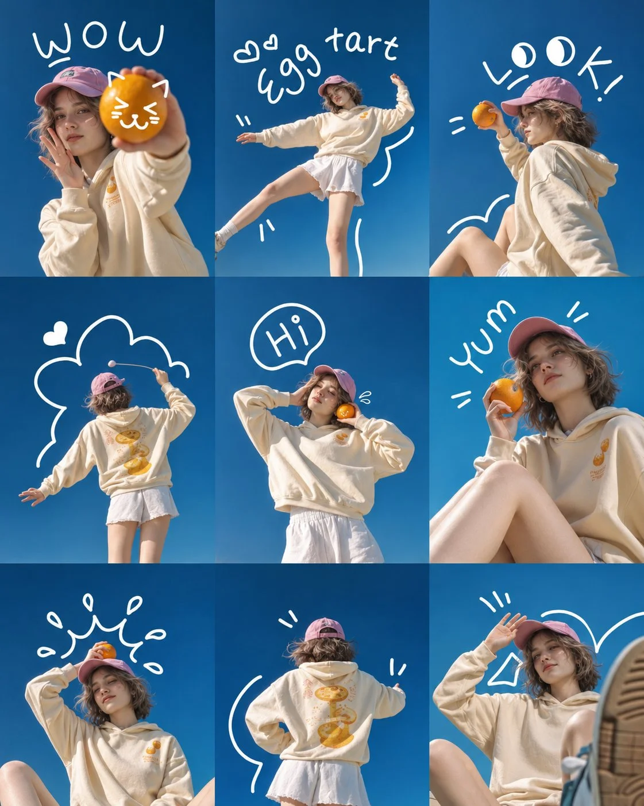

# 3×3 Korean Summer Photoshoot Collage from Your Photo (3:4)

**中文标题：** 照片变 3×3 韩系夏日写真拼图（3:4）  
**ID:** `gi25-x-1478` · **Mode:** `edit`  
**Categories:** `character-consistency`, `edit-change-preserve`  
**Tags:** `x-twitter`, `community`, `gpt-image-2.5`, `x-direct`, `en`



### 3×3 Korean Summer Photoshoot Collage from Your Photo (3:4)

```text
Create a high-quality, ultra-realistic 3×3 photographic collage featuring the person from the uploaded reference image. Preserve the person's exact facial identity, facial features, face shape, hairstyle, hair texture, skin tone, and natural appearance across all nine panels.

Overall Style:
A playful Korean summer fashion editorial photoshoot with a dreamy, youthful and cheerful aesthetic. Bright clear sky-blue background, warm natural sunlight, soft shadows, crisp photography, and subtle film-like color grading.

Outfit:
The subject wears an oversized cream-colored hoodie with small orange food illustrations on the front and a larger yellow-orange egg tart graphic on the back, a white pleated mini skirt or shorts, and a pastel pink baseball cap. Maintain consistent clothing, accessories, and appearance across every panel.

3×3 Collage Composition:

Panel 1 (Top Left):
Close-up portrait. The subject holds a bright orange fruit toward the camera with one hand while making a playful expression. Add cute white cat-face doodles on the fruit and handwritten text "WOW".

Panel 2 (Top Center):
Full-body playful pose against the blue sky, standing on one leg with the other leg stretched sideways and arms spread out. Add handwritten text "egg tart" with small hearts and movement lines.

Panel 3 (Top Right):
Side profile, holding an orange fruit near the face while looking at it. Add playful white doodles, cartoon eyes, and handwritten text "LOOK!".

Panel 4 (Middle Left):
Back view of the subject reaching upward with one hand, showing the large egg tart illustration on the back of the hoodie. Add a large hand-drawn white cloud outline and a small heart.

Panel 5 (Middle Center):
Front-facing portrait with both hands near the head, holding a small orange fruit beside the cheek. Add a white speech bubble containing "Hi".

Panel 6 (Middle Right):
Relaxed sitting pose with one knee raised, holding an orange fruit near the cheek. Looking slightly upward with a cute, confident expression. Add handwritten text "yum" and small decorative lines.

Panel 7 (Bottom Left):
Sitting casually with one hand touching the pink cap and an orange fruit resting above it. Eyes gently closed with a relaxed smile. Add playful crown-like doodles and small decorative hearts.

Panel 8 (Bottom Center):
Full back view, hands on waist, clearly displaying the oversized hoodie and its large yellow-orange egg tart artwork. Add curved white doodle lines around the subject.

Panel 9 (Bottom Right):
Low-angle sitting portrait with one sneaker sole close to the camera. The subject raises one hand toward the pink cap and smiles gently. Add white hand-drawn geometric shapes and playful motion lines.

Visual Details:

- Perfectly aligned 3×3 grid with nine equally sized rectangular panels.
- Consistent facial identity throughout all nine photographs.
- Sky-blue and deep cobalt-blue backgrounds.
- Bright natural summer sunlight.
- Realistic skin texture and natural anatomy.
- Authentic fashion editorial photography.
- White handwritten doodles, hearts, clouds, stars, cartoon eyes, and motion marks.
- Maintain consistent outfit, hairstyle, cap, and accessories in every panel.
- No borders or gaps between panels.

Text and Typography:
Use casual, imperfect, hand-drawn white lettering. Include "WOW", "egg tart", "LOOK!", "Hi", and "yum" in the corresponding panels.

Final Output: A beautiful, cohesive 3×3 Korean-inspired summer fashion photo collage, vertical 3:4 composition, ultra-realistic photography, high detail, vibrant blue skies, and playful editorial storytelling.
```

- **Recommended model:** `gpt-image-2.5-sunburst`
- **Settings:** _(defaults)_
- **Source:** [community](https://x.com/Ziha_ai/status/2120026285753913570) — @Ziha_ai
- **License note:** Original public X post; quoted with attribution — remix with attribution
- **Notes:** Collected directly from X; original post https://x.com/Ziha_ai/status/2120026285753913570; post text names GPT Image 2.5; discovered via X search, prompt re-verified against the original X post via api.fxtwitter.com; verified=True; needs an uploaded reference photo
- **Preview:** `previews/gi25-x-1478.webp`
