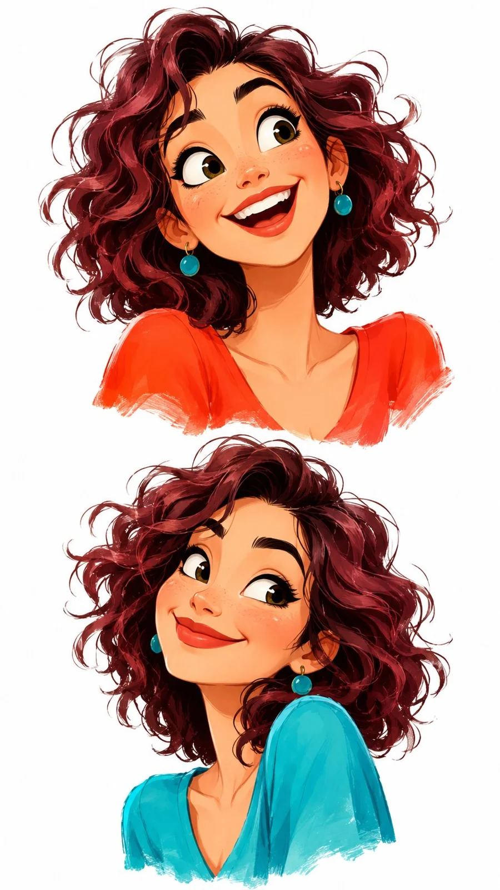

# Two-Expression Painterly Character Design Sheet (JSON, 9:16)

**中文标题：** 同一角色双表情水粉风角色设定（JSON·9:16）  
**ID:** `gi25-x-1479` · **Mode:** `generate`  
**Categories:** `character-consistency`, `general`  
**Tags:** `x-twitter`, `community`, `gpt-image-2.5`, `x-direct`, `en`



### Two-Expression Painterly Character Design Sheet (JSON, 9:16)

```text
{
  "aspect_ratio": "9:16",
  "style": "Premium stylized 2D character illustration, expressive hand-painted animation concept art, painterly digital gouache, soft textured brush strokes, vibrant colors, polished artistic finish",
  "prompt": "Create a visually striking vertical character illustration featuring TWO expressive portraits of the SAME original young woman, arranged vertically with generous white space between them. Design a completely original and memorable character, not resembling any existing animated movie character or reference character.\n\nCHARACTER DESIGN: A beautiful young woman in her early 20s with warm golden-brown skin, distinctive heart-shaped face, slightly upturned nose, big expressive hazel-green eyes, naturally thick eyebrows, subtle freckles across her cheeks, and a charming wide smile. Her signature hairstyle is a voluminous short curly bob with deep burgundy and dark plum tones, a few loose curls framing her face, and subtle copper highlights. Add small turquoise statement earrings. She should have a distinctive, instantly recognizable personality.\n\nTOP PORTRAIT: A large expressive head-and-shoulders portrait. Her head is tilted slightly sideways, eyes looking upward with a playful surprised expression, raised eyebrows and a big natural smile showing her teeth. Her curly hair has beautiful volume and movement. She wears a vibrant coral-orange top with a small visible neckline.\n\nBOTTOM PORTRAIT: The EXACT SAME character, with identical facial structure, skin tone, hairstyle and identity. Show her in a slightly different three-quarter angle, leaning her head gently to one side, giving a mischievous confident smile with one eyebrow slightly raised. Her expression should feel spontaneous, charming and full of personality. She wears a fresh turquoise-blue outfit.\n\nART DIRECTION: Rich vibrant color palette featuring coral orange, burgundy, plum, turquoise, golden peach and warm cream. Beautifully layered painterly brush strokes, expressive facial details, subtle skin shading, delicate highlights in the eyes, naturally flowing curls and artistic hair texture. Exaggerated but beautifully balanced facial expressions, appealing character proportions and sophisticated animation illustration aesthetics.\n\nCOMPOSITION: Two separate floating bust portraits arranged vertically, both large and clearly visible. Keep the background completely clean warm white with no additional objects. Preserve generous negative space around both portraits. The artwork should feel like a premium animated character design sketchbook brought to life.\n\nQUALITY: Extremely attractive character design, distinctive personality, beautiful color harmony, expressive eyes, rich painterly textures, professional illustration quality, visually engaging at first glance."
,
  "negative_prompt": "Exact recreation of reference, Disney character resemblance, Pixar character resemblance, generic cartoon girl, copied hairstyle, identical facial features to reference, photorealism, 3D render, plastic skin, flat colors, dull palette, muddy colors, overly childish proportions, boring expressions, identical poses, inconsistent character identity, different face in second portrait, extra portraits, extra heads, distorted eyes, asymmetrical pupils, deformed facial features, messy composition, background scenery, text, typography, watermark, logo."
}
```

- **Recommended model:** `gpt-image-2.5-sunburst`
- **Settings:** _(defaults)_
- **Source:** [community](https://x.com/Just_Anika_Here/status/2120007952895717808) — @Just_Anika_Here
- **License note:** Original public X post; quoted with attribution — remix with attribution
- **Notes:** Collected directly from X; original post https://x.com/Just_Anika_Here/status/2120007952895717808; post text names GPT Image 2.5; discovered via X search, prompt re-verified against the original X post via api.fxtwitter.com; verified=True; JSON-structured prompt with negative prompt
- **Preview:** `previews/gi25-x-1479.webp`
