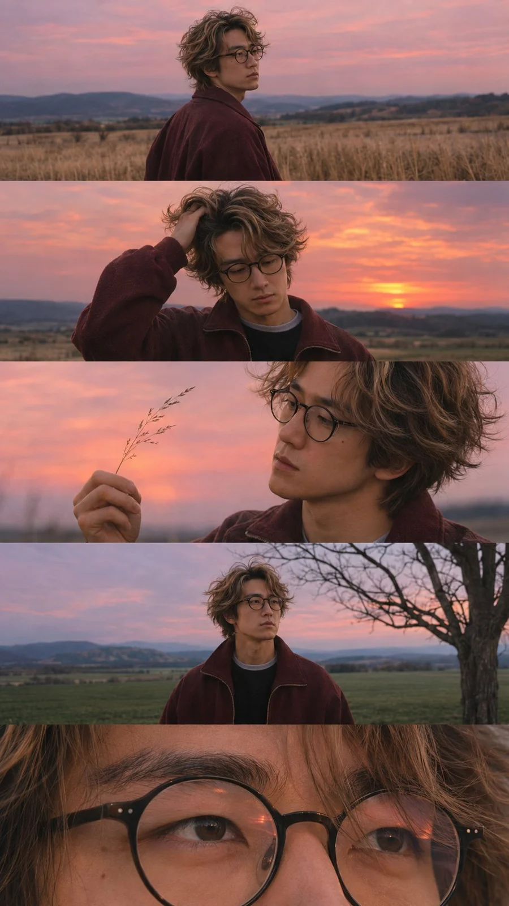

# Five-Frame Cinematic Sunset Portrait Series (9:16)

**中文标题：** 五联电影感日落人像（9:16）  
**ID:** `gi25-x-1499` · **Mode:** `generate`  
**Categories:** `character-consistency`, `general`  
**Tags:** `x-twitter`, `community`, `gpt-image-2.5`, `x-direct`, `zh`



### Five-Frame Cinematic Sunset Portrait Series (9:16)

```text
电影般的日落肖像摄影系列 | 9:16 竖构图

创作一系列电影感十足、逼真写实的竖版编辑摄影构图，包含同一个年轻男子出现在五个无缝堆叠的水平画面中。整个构图捕捉了在开阔乡村景观中、粉橙色美丽日落时分的宁静、内省时刻。

主体与外貌：一位年轻男子，中长度的自然凌乱棕发，圆框黑眼镜，青春的脸庞，沉思的表情。他身穿酒红色超大号拉链夹克，内搭深色衬衫，领口为浅灰色。他的头发在晚风中轻轻飘动。

画面 1：年轻男子站在广阔的干草田中的中广角侧面肖像。他微微转头看向镜头，肩后回眸，神情平静而沉思。柔和的粉色天空延伸至遥远的地平线。

画面 2：年轻男子中景，他轻轻用一只手梳理凌乱的头发，头部微微向下倾斜。他身后，辉映的桃橙与珊瑚色日落照亮开阔乡村，营造出温暖而梦幻的氛围。

画面 3：年轻男子侧面中近景特写，他用手指举起一根细草茎，对着柔和的日落天空观察。他的眼镜捕捉到渐逝光芒的微妙反射。背景柔和虚化。

画面 4：年轻男子站在绿色乡村田野中的中广角正面肖像，若有所思地望向画面右侧。一棵光秃秃的树占据右侧前景，远处是丘陵和柔和的蓝粉色晚空。

画面 5：极端近景特写，聚焦于年轻男子圆框眼镜后的双眼。他的自然皮肤纹理、微妙眼部反射、单根发丝，以及镜片上的细腻反射，都以非凡细节捕捉。

摄影与色彩分级：使用专业全画幅相机拍摄，环境肖像采用 50mm 镜头，近景特写采用 85mm 镜头。自然的环境日落光线，柔和的电影阴影，浅景深，细微的胶片颗粒，柔和的酒红色调，粉桃色天空，凉蓝阴影，逼真的皮肤纹理，以及真实的模拟胶片美学。

构图：精确五个水平电影画面垂直堆叠，每一画面占据总竖构图约 20%。干净的水平过渡，无边框，无文字，无标志，无额外主体。

整体氛围：怀旧、忧郁、私密、青春而诗意。一张宁静的成长电影静帧，捕捉在白昼最后的时刻。

超逼真写实，电影色彩分级，自然瑕疵，逼真摄影，9:16 竖构图，高细节。
```

- **Recommended model:** `gpt-image-2.5-sunburst`
- **Settings:** _(defaults)_
- **Source:** [community](https://x.com/chmilo/status/2117603732481601963) — @chmilo
- **License note:** Original public X post; quoted with attribution — remix with attribution
- **Notes:** Collected directly from X; original post https://x.com/chmilo/status/2117603732481601963; post text names GPT Image 2.5; discovered via Bin0754/gpt-image-gallery index, prompt re-verified against the original X post via api.fxtwitter.com; verified=True; Chinese prompt
- **Preview:** `previews/gi25-x-1499.webp`
