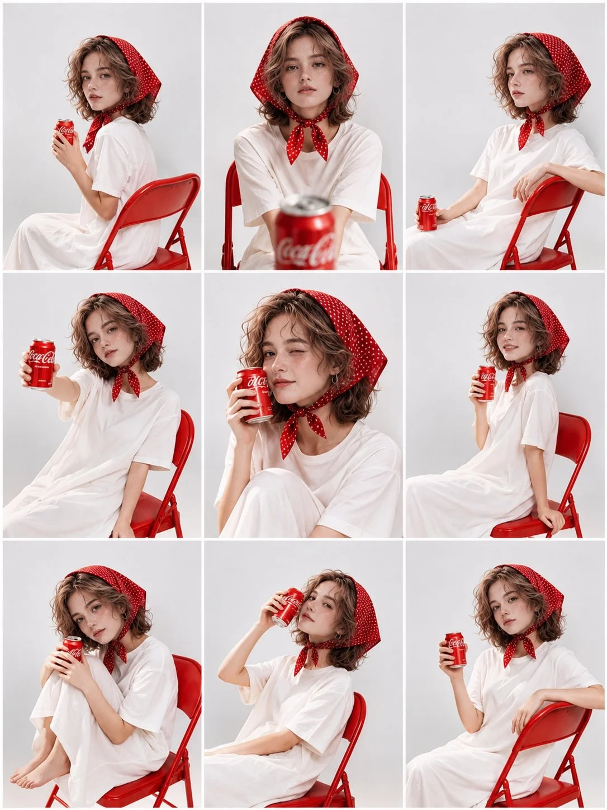

# 3×3 Red-Chair Coca-Cola Editorial Photoshoot from Your Portrait (3:4)

**中文标题：** 照片变 3×3 红椅可乐时装大片拼图（3:4）  
**ID:** `gi25-x-1502` · **Mode:** `edit`  
**Categories:** `character-consistency`, `edit-change-preserve`  
**Tags:** `x-twitter`, `community`, `gpt-image-2.5`, `x-direct`, `en`



### 3×3 Red-Chair Coca-Cola Editorial Photoshoot from Your Portrait (3:4)

```text
Create a high-quality, photorealistic 3×3 fashion editorial photoshoot collage featuring the person from the reference image. Preserve the person's exact facial identity, facial structure, skin tone, hairstyle, and recognizable features across all nine panels.

Outfit & Styling:
The subject wears an oversized plain white T-shirt dress and a red vintage polka-dot headscarf tied neatly under the chin. Natural, slightly messy hair frames the face. Minimal makeup with soft rosy cheeks and natural lips.

Props & Setting:
A bright red folding metal chair and a classic red Coca-Cola can. Clean, seamless light grey studio background with soft, diffused professional lighting.

Nine Different Poses:

1. Side-facing seated pose, looking over the shoulder while holding the Coca-Cola can.
2. Front-facing portrait, hands relaxed, with a Coca-Cola can close to the camera in the foreground.
3. Relaxed side pose, leaning against the red chair with the can beside the body.
4. Extending the Coca-Cola can toward the camera.
5. Close-up portrait, playfully winking while holding the can near the cheek.
6. Smiling gently while holding the can near the face.
7. Sitting with knees pulled up, holding the can with both hands.
8. Tilting the head back slightly while raising the can beside the face.
9. Relaxed seated pose, holding the can in one hand and looking directly at the camera.

Photography Style:
Professional Korean fashion editorial photography, natural candid expressions, realistic skin texture, detailed fabric textures, soft shadows, balanced composition, 85mm portrait lens, premium commercial studio photography.

Composition:
A perfectly aligned 3×3 contact sheet collage with nine equally sized rectangular photographs, separated by thin white borders. Maintain consistent facial identity, outfit, accessories, chair, lighting, and background throughout all nine panels.

Ultra-realistic, high resolution, 4K quality, vertical 3:4 composition.
```

- **Recommended model:** `gpt-image-2.5-sunburst`
- **Settings:** _(defaults)_
- **Source:** [community](https://x.com/Ziha_ai/status/2120392169915826256) — @Ziha_ai
- **License note:** Original public X post; quoted with attribution — remix with attribution
- **Notes:** Collected directly from X; original post https://x.com/Ziha_ai/status/2120392169915826256; post text names GPT Image 2.5; discovered via X search, prompt re-verified against the original X post via api.fxtwitter.com; verified=True; needs an uploaded reference portrait
- **Preview:** `previews/gi25-x-1502.webp`
