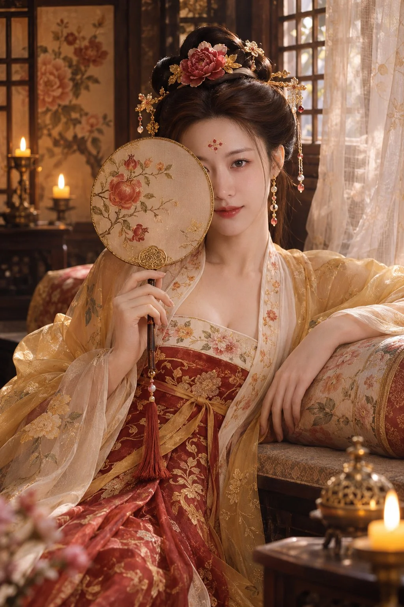

# High-Tang Boudoir Portrait with Round Fan from Reference Face

**中文标题：** 参考脸盛唐闺房团扇写真  
**ID:** `gi25-x-1512` · **Mode:** `edit`  
**Categories:** `character-consistency`, `edit-change-preserve`  
**Tags:** `x-twitter`, `community`, `gpt-image-2.5`, `x-direct`, `zh`



### High-Tang Boudoir Portrait with Round Fan from Reference Face

```text
以参考图作为主要人物的面部身份依据。写实竖幅历史生活写真：明确成年的东亚女性，盛唐风格造型。她斜倚榻边，一手持团扇遮住半侧脸，另一手自然扶在榻边。穿完整盛唐坦领齐胸裙，外搭轻薄披帛，石榴红、郁金黄与米白配色。半翻髻，花钿步摇，酒晕妆。窗边烛光闺房，纱帘屏风与暖烛光交织。真实摄影质感，不要现代物件、文字或水印。
```

- **Recommended model:** `gpt-image-2.5-sunburst`
- **Settings:** _(defaults)_
- **Source:** [community](https://x.com/ft4ht0/status/2120360821729730645) — @ft4ht0
- **License note:** Original public X post; quoted with attribution — remix with attribution
- **Notes:** Collected directly from X; original post https://x.com/ft4ht0/status/2120360821729730645; post text names GPT Image 2.5; discovered via X search, prompt re-verified against the original X post via api.fxtwitter.com; verified=True; the author says this prompt was taken from the OpenZhenZhen prompt library and run there; referral link omitted; needs an uploaded face reference photo
- **Preview:** `previews/gi25-x-1512.webp`
