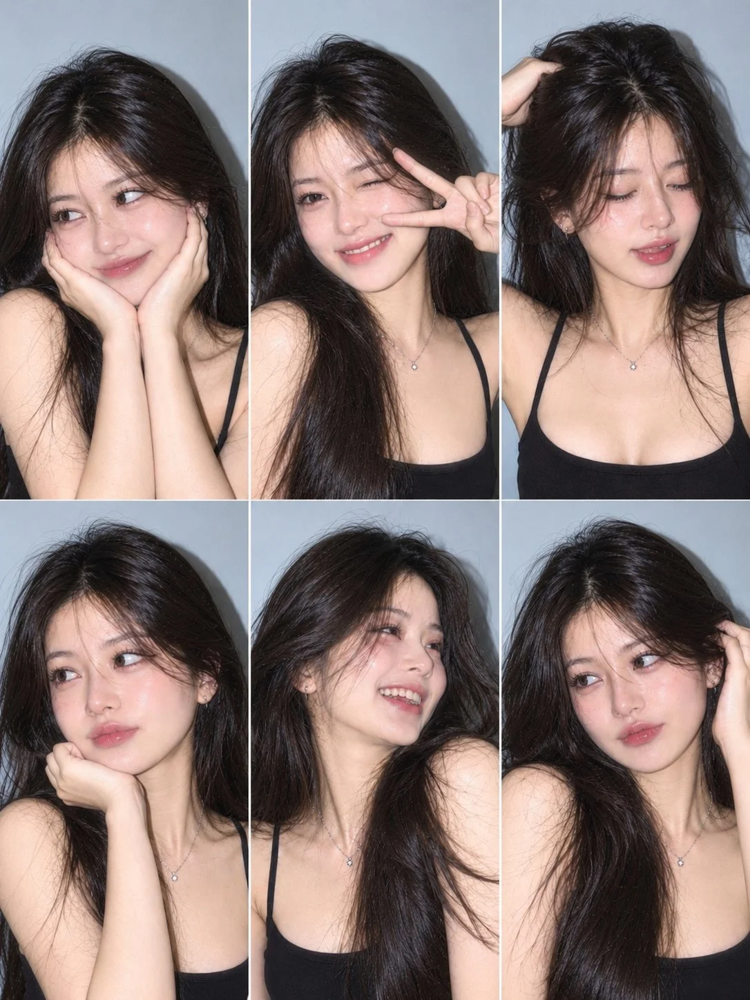

# 6-Photo Flash Collage of the Same Girl from Reference (3×2)

**中文标题：** 参考照同一女孩闪光灯 6 宫格拼图（3×2）  
**ID:** `gi25-x-1514` · **Mode:** `edit`  
**Categories:** `character-consistency`, `edit-change-preserve`  
**Tags:** `x-twitter`, `community`, `gpt-image-2.5`, `x-direct`, `en`



### 6-Photo Flash Collage of the Same Girl from Reference (3×2)

```text
Create an ultra-realistic 6-photo collage (3×2 grid) of the exact same girl from the reference image. Preserve her original face, facial features, skin tone, eye shape and identity 100% in all six photos. Long, voluminous dark brown hair with natural wispy bangs, wearing a simple black spaghetti-strap top and delicate silver necklace. Soft grey-blue wall background, direct Canon G7X Mark III flash photography, realistic skin texture, subtle film grain.

Six different natural poses:
-Both hands gently framing cheeks, looking sideways.
-Cute wink with a peace sign.
-Eyes closed, gently touching her hair.
-Chin resting on one hand, looking sideways.
-Natural laughing pose, looking to the side.
-Soft expression while touching her hair.
```

- **Recommended model:** `gpt-image-2.5-sunburst`
- **Settings:** _(defaults)_
- **Source:** [community](https://x.com/MissDelulu9/status/2120719741753200910) — @MissDelulu9
- **License note:** Original public X post; quoted with attribution — remix with attribution
- **Notes:** Collected directly from X; original post https://x.com/MissDelulu9/status/2120719741753200910; post text names GPT Image 2.5; discovered via X search, prompt re-verified against the original X post via api.fxtwitter.com; verified=True; author used GPT Image 2.5 in ChatGPT; needs an uploaded reference photo
- **Preview:** `previews/gi25-x-1514.webp`
