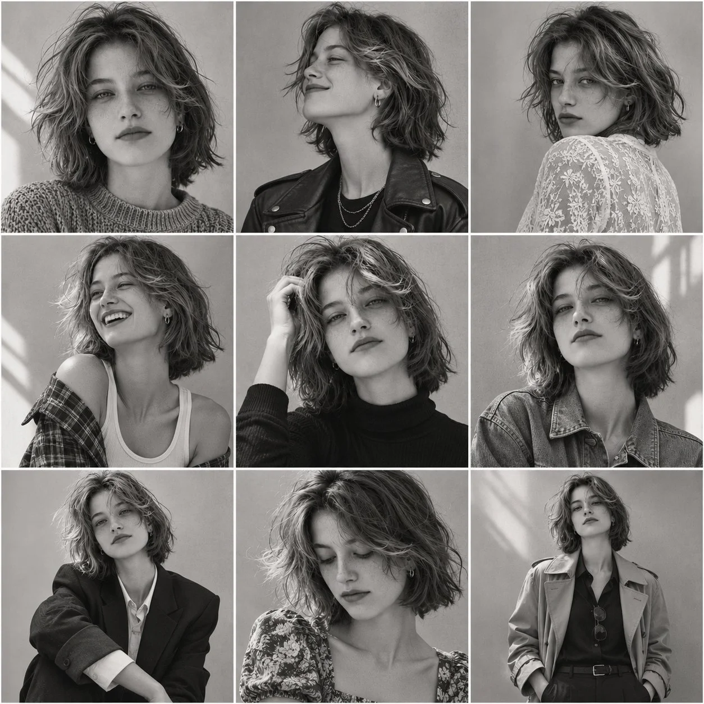

# 3×3 Consistent-Character Editorial Portrait Collage

**中文标题：** 同一人物 3×3 时装大片九宫格  
**ID:** `gi25-x-1515` · **Mode:** `generate`  
**Categories:** `character-consistency`  
**Tags:** `x-twitter`, `community`, `gpt-image-2.5`, `x-direct`, `en`



### 3×3 Consistent-Character Editorial Portrait Collage

```text
Create a 3×3 image collage featuring the same beautiful young adult woman across all nine frames. Maintain perfectly consistent facial identity, hairstyle, skin tone, facial features, and overall appearance in every frame.

Subject: A beautiful 23-year-old woman with long, naturally wavy dark brown hair, expressive eyes, clear natural skin, soft facial features, and an elegant appearance. Wearing a stylish white outfit with minimal jewelry.

Nine different shots:

1. Close-up portrait looking directly into the camera.
2. Side profile with a gentle smile.
3. Three-quarter angle, looking over her shoulder.
4. Natural candid laugh, looking away from the camera.
5. Close-up with one hand gently touching her hair.
6. Serious editorial expression with cinematic lighting.
7. Sitting casually, looking toward the camera.
8. Looking down with a soft, thoughtful expression.
9. Full upper-body portrait with a confident pose.

Visual style: Ultra-photorealistic photography, natural skin texture, realistic facial details, soft cinematic lighting, professional fashion editorial photography, subtle color grading, 85mm portrait lens, shallow depth of field.

Composition: Perfect 3×3 grid, nine equal-sized rectangular frames, clean straight borders, consistent subject identity throughout, no overlapping frames, no text, no logos, no watermarks.

High-end photography quality, realistic proportions, beautifully detailed and visually cohesive collage.
```

- **Recommended model:** `gpt-image-2.5-sunburst`
- **Settings:** _(defaults)_
- **Source:** [community](https://x.com/Ziha_ai/status/2120550400575365243) — @Ziha_ai
- **License note:** Original public X post; quoted with attribution — remix with attribution
- **Notes:** Collected directly from X; original post https://x.com/Ziha_ai/status/2120550400575365243; post text names GPT Image 2.5; discovered via X search, prompt re-verified against the original X post via api.fxtwitter.com; verified=True; author used GPT Image 2.5 in ChatGPT
- **Preview:** `previews/gi25-x-1515.webp`
