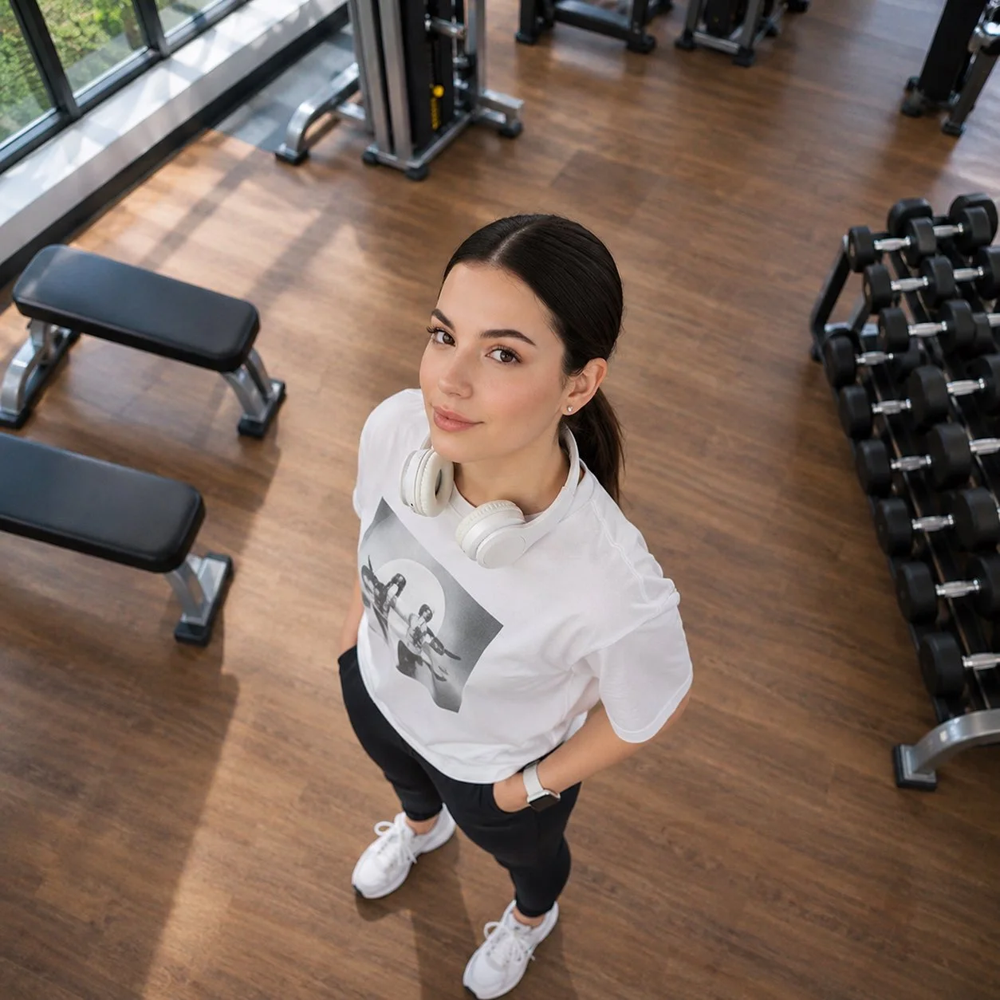

# Cinematic 45° Drone Shot in a Gym from Your Photo

**中文标题：** 照片变健身房 45° 电影感无人机俯拍  
**ID:** `gi25-x-1517` · **Mode:** `edit`  
**Categories:** `character-consistency`, `edit-change-preserve`  
**Tags:** `x-twitter`, `community`, `gpt-image-2.5`, `x-direct`, `en`



### Cinematic 45° Drone Shot in a Gym from Your Photo

```text
Using the uploaded image as the exact identity reference, transform the photograph into an ultra-realistic cinematic drone photograph.

CAMERA ANGLE: A professional drone positioned approximately 4–5 metres above the subject, capturing a dramatic 45-degree downward aerial perspective. The camera looks down toward the woman while she naturally looks up into the lens.

SUBJECT PRESERVATION: Maintain the woman’s original facial features, identity, hairstyle, natural skin texture, expression and proportions. Preserve her white graphic oversized T-shirt, black leggings, white sneakers, white over-ear headphones around her neck and smartwatch.

ENVIRONMENT: A premium modern gym with polished wooden flooring, dumbbell racks, workout benches, strength machines and large glass windows. Natural sunlight creates beautiful geometric shadows across the floor.

PHOTOGRAPHY: Professional drone photography, realistic perspective and proportions, cinematic composition, natural depth, soft daylight, highly detailed textures, realistic shadows, premium editorial fitness photography, 8K photorealism.

IMPORTANT: Make it look like an actual photograph captured by a professional drone, not a selfie or digitally manipulated portrait. Preserve the original person’s identity without changing her face.
```

- **Recommended model:** `gpt-image-2.5-sunburst`
- **Settings:** _(defaults)_
- **Source:** [community](https://x.com/Naiknelofar788/status/2120473810428375255) — @Naiknelofar788
- **License note:** Original public X post; quoted with attribution — remix with attribution
- **Notes:** Collected directly from X; original post https://x.com/Naiknelofar788/status/2120473810428375255; post text names GPT Image 2.5; discovered via X search, prompt re-verified against the original X post via api.fxtwitter.com; verified=True; needs an uploaded reference photo; preview is image 1 of 4
- **Preview:** `previews/gi25-x-1517.webp`
