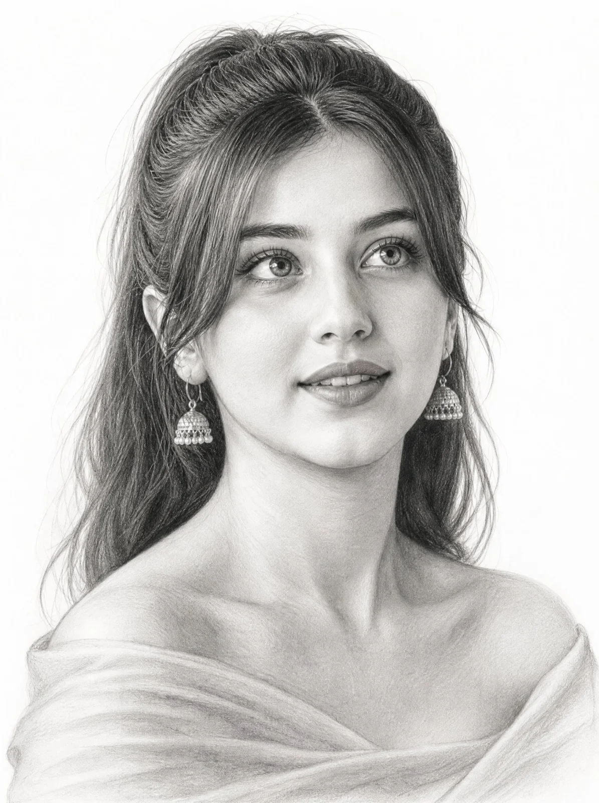

# Selfie to Photorealistic Graphite Pencil Portrait (4:5)

**中文标题：** 自拍转写实铅笔素描肖像（4:5）  
**ID:** `gi25-x-1523` · **Mode:** `edit`  
**Categories:** `character-consistency`, `edit-change-preserve`  
**Tags:** `x-twitter`, `community`, `gpt-image-2.5`, `x-direct`, `en`



### Selfie to Photorealistic Graphite Pencil Portrait (4:5)

```text
Use the uploaded image as the ONLY facial and identity reference. The subject is clearly recognizable as the subject from [image_0.png], respecting her facial structure but adapted to a 3/4 angle view.
Composition:
Chest-up portrait, near-frontal with a subtle three-quarter angle body. The subject occupies approximately 70-80% of the frame area. Head slightly tilted upward, chin gently raised. Gaze directed upward and slightly to the right (not at camera), conveying curiosity and quiet introspection.
Expression:
Natural and soft. Eyes wide but realistic, lips slightly parted with a hint of upper teeth. No forced emotion — calm, observational, and candid.
Eyes (Primary Focus):
Highly detailed irises with natural gradients and soft catchlights from overhead lighting. Defined eyelids, fine irregular eyelashes (non-uniform, non-stylized).
Facial Rendering:
Softly shaded nose, natural lips with volume and subtle inner depth. Smooth graphite blending across skin with delicate tonal transitions. Slight depth under chin and along jawline.
Hair:
Naturally wavy, silky, with a mix of controlled strokes and loose flyaways. Edges remain light and sketchy to keep focus on the face.
Clothing (Subtle Detail):
Soft off-shoulder fabric gently draped below the collarbones, lightly visible and minimally rendered. The clothing should remain understated with smooth, delicate graphite shading, subtle folds, and no heavy texture—kept intentionally low-detail so the focus stays on the face.
Lighting:
Soft top-down (butterfly lighting), evenly diffused. Gentle highlights on forehead, nose bridge, and eyes. No harsh contrast.
Style & Medium:
Photorealistic graphite pencil drawing on clean white paper. Fine line work, subtle hatching, smooth blending, full tonal range.
Background:
Plain white with minimal negative space, no distractions.
Technical:
Ultra-detailed, sharp facial focus, visible pencil texture, 4:5 aspect ratio.
Negative Prompt:
no stylization, no cartoon effect, no over-smoothing, no harsh contrast, no incorrect gaze, no exaggerated expression
```

- **Recommended model:** `gpt-image-2.5-sunburst`
- **Settings:** _(defaults)_
- **Source:** [community](https://x.com/Enaya_ai/status/2121103983720972387) — @Enaya_ai
- **License note:** Original public X post; quoted with attribution — remix with attribution
- **Notes:** Collected directly from X; prompt posted as the author's own reply https://x.com/Enaya_ai/status/2121103983720972387 to https://x.com/Enaya_ai/status/2121103977182085146, which carries the images; GPT Image 2.5 is named in the parent post; discovered via X search, prompt re-verified against the original X post via api.fxtwitter.com; verified=True; needs an uploaded reference photo; the thread is labeled Part 1
- **Preview:** `previews/gi25-x-1523.webp`
