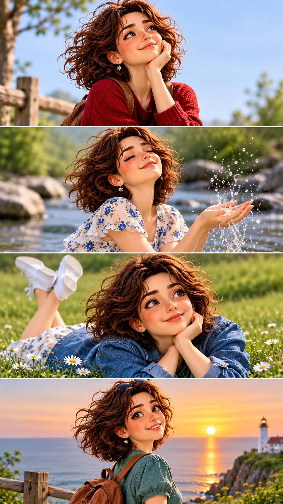

# 4-Panel Animated-Film Storyboard of the Same Girl (3:4 JSON)

**中文标题：** 同一女孩四格动画电影分镜（3:4 JSON）  
**ID:** `gi25-x-1524` · **Mode:** `generate`  
**Categories:** `character-consistency`, `general`  
**Tags:** `x-twitter`, `community`, `gpt-image-2.5`, `x-direct`, `en`



### 4-Panel Animated-Film Storyboard of the Same Girl (3:4 JSON)

```text
{
  "aspect_ratio": "3:4",
  "style": "premium stylized 3D animated movie stills, high-end Pixar-inspired character rendering, cinematic storytelling, beautiful natural environments, soft realistic lighting, detailed textures, expressive character animation",

  "prompt": "Create a beautiful 3:4 vertical cinematic storyboard contact sheet consisting of FOUR wide horizontal scenes stacked vertically, with clean seamless panel divisions. All four scenes must feature exactly the SAME young adult female animated character, maintaining perfectly consistent facial features, hairstyle, clothing and proportions throughout. CHARACTER DESIGN: A charming young woman with short, fluffy chestnut-brown wavy hair, delicate freckles across her cheeks, large warm hazel eyes, soft rounded facial features and a naturally expressive face. She wears an oversized soft butter-yellow knitted sweater, muted sage-green shorts, and carries a small vintage brown canvas backpack. SCENE 1: A beautiful close-up portrait of the girl standing in an enormous wildflower meadow on a bright morning, eyes peacefully closed, a gentle smile on her face, sunlight illuminating individual strands of her hair, distant green mountains and a brilliant blue sky filled with soft clouds. SCENE 2: A low-angle cinematic close-up of her bare feet walking across a narrow stream surrounded by smooth mossy stones, tiny splashes of crystal-clear water, her knitted sweater visible at the top edge, golden sunlight reflecting on the water. SCENE 3: An overhead intimate shot of the same girl lying in incredibly tall emerald-green grass, looking upward with wide curious eyes as dozens of tiny glowing dandelion seeds float above her face, soft wildflowers surrounding her hair, magical sunlight filtering through the grass. SCENE 4: A breathtaking cinematic rear three-quarter portrait of the same girl standing on a grassy coastal cliff at sunset, turning her head toward the camera with a gentle smile, her short curly hair moving in the sea breeze, enormous glowing orange-pink clouds above a deep blue ocean, tiny seaside houses far below. VISUAL DIRECTION: Each panel must have a distinctly different camera angle and composition. Natural human-like expressions, beautifully detailed hair, realistic knitted fabric, delicate skin shading, physically believable lighting, subtle atmospheric depth, rich environmental details, premium animated film quality. Use vibrant but naturally balanced colors, fresh greens, brilliant sky blues, warm golden sunlight and beautiful coral sunset tones. The entire composition should feel like four unforgettable moments from one beautifully animated adventure film. Exceptional character consistency, polished cinematic CGI, breathtaking visual quality.",

  "negative_prompt": "different character in each panel, inconsistent face, changing hairstyle, changing outfit, extra characters, duplicated body parts, distorted hands, deformed feet, bad anatomy, flat lighting, dull colors, oversaturated colors, plastic skin, cheap cartoon rendering, blurry details, random panel layouts, uneven panel divisions, text, captions, logos, watermarks"
}
```

- **Recommended model:** `gpt-image-2.5-sunburst`
- **Settings:** _(defaults)_
- **Source:** [community](https://x.com/Just_Anika_Here/status/2121101518791217475) — @Just_Anika_Here
- **License note:** Original public X post; quoted with attribution — remix with attribution
- **Notes:** Collected directly from X; original post https://x.com/Just_Anika_Here/status/2121101518791217475; post text names GPT Image 2.5; discovered via X search, prompt re-verified against the original X post via api.fxtwitter.com; verified=True; JSON-structured prompt with negative_prompt; preview is image 1 of 2
- **Preview:** `previews/gi25-x-1524.webp`
