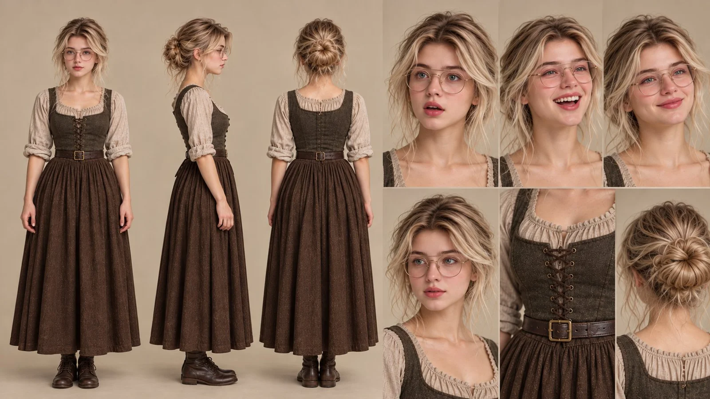

# Photoreal Character Reference Sheet: Medieval Village Girl

**中文标题：** 照片级角色参考设定图：中世纪村庄少女  
**ID:** `gi25-x-1551` · **Mode:** `generate`  
**Categories:** `character-consistency`  
**Tags:** `x-twitter`, `community`, `gpt-image-2.5`, `x-direct`, `zh`



### Photoreal Character Reference Sheet: Medieval Village Girl

```text
角色参考设定图，纯中性米色背景，照片级写实，柔和均匀的电影感光照。一位年轻女性（二十出头），白皙皮肤，柔和且富有表现力的面庞，浅色眼睛，深棕色头发松松地挽成低发髻，几缕碎发垂落。中世纪村庄风格：米灰色亚麻衬衫，袖子挽起，深橄榄灰色系带紧身胸衣马甲，配一个小皮带扣，深棕色长裙，裙摆宽大，简约深色皮鞋。版面：全身正面、侧面和背面视图，外加面部特写，包含 3 种表情（惊讶、大笑、温柔微笑），以及紧身胸衣和腰带的特写。每个视图中均为同一角色、同一套服装，细节清晰，无文字，无其他人物。
```

- **Recommended model:** `gpt-image-2.5-sunburst`
- **Settings:** _(defaults)_
- **Source:** [community](https://x.com/SolhawkGo/status/2121703977364701648) — @SolhawkGo
- **License note:** Original public X post; quoted with attribution — remix with attribution
- **Notes:** Collected directly from X; original post https://x.com/SolhawkGo/status/2121703977364701648; post text names GPT Image 2.5; discovered via X search, prompt re-verified against the original X post via api.fxtwitter.com; verified=True; post names GPT image 2.5 without a variant; the sheet is used as a reference for a Seedance 2.5 video in the thread
- **Preview:** `previews/gi25-x-1551.webp`
