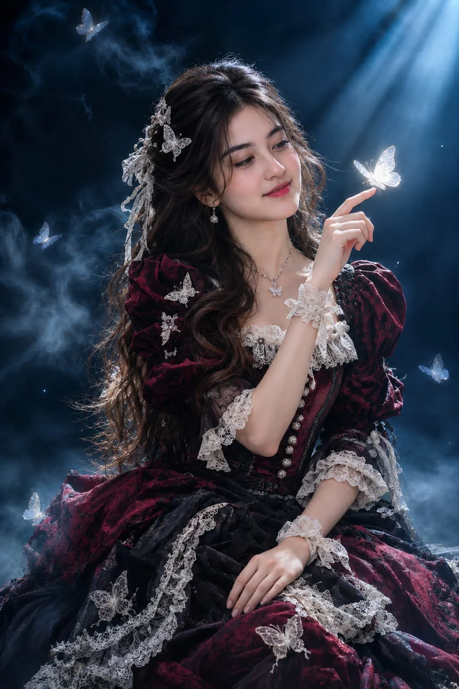

# Dark-Fantasy Portrait with a Glowing Butterfly on the Fingertip (2:3)

**中文标题：** 暗黑童话肖像：指尖停着发光蝴蝶（2:3）  
**ID:** `gi25-x-1552` · **Mode:** `edit`  
**Categories:** `character-consistency`, `edit-change-preserve`  
**Tags:** `x-twitter`, `community`, `gpt-image-2.5`, `x-direct`, `en`



### Dark-Fantasy Portrait with a Glowing Butterfly on the Fingertip (2:3)

```text
Create an ultra-realistic, breathtaking cinematic dark-fantasy portrait of a beautiful young South Asian woman with long, thick, naturally wavy dark brown hair, delicate facial features, flawless soft glowing skin, and a dreamy, peaceful expression.

Pose & Composition: The woman is gracefully seated on the ground, wearing an elegant Victorian-inspired fantasy gown. Her right hand is gently raised in front of her face, with a beautiful glowing white butterfly delicately resting on the tip of her index finger. She gazes at the butterfly with a soft, enchanting smile. Several delicate translucent butterflies are floating around her hair, face, and dress.

Outfit: She wears an exquisite dark burgundy and black Victorian gothic princess dress featuring intricate white lace embroidery, puffed sleeves, a square neckline, delicate ruffled lace trims, decorative buttons, a fitted corset waist, and a voluminous layered skirt adorned with beautiful butterfly patterns. Elegant lace ribbons wrap around her wrists.

Hair & Accessories: Long, loose, naturally wavy dark brown hair cascading over her shoulders, partially styled back with delicate white butterfly hair accessories.

Environment: A mysterious, dreamy dark fantasy atmosphere with a completely dark midnight-blue background, surrounded by soft swirling magical mist and atmospheric smoke. A beautiful soft white-blue beam of light streams diagonally from the upper right corner, illuminating the glowing butterfly, her face, and upper body.

Lighting & Mood: Dramatic cinematic low-key lighting, ethereal blue moonlight, soft volumetric lighting, magical glowing particles, subtle highlights on her hair, realistic skin texture, delicate shadows, mysterious fairytale atmosphere.

Photography Style: Professional fantasy editorial photography, ultra-photorealistic, cinematic composition, 85mm portrait lens, shallow depth of field, extremely detailed fabric textures, realistic facial anatomy, high dynamic range, soft film grain, 8K resolution.

Important: Maintain natural human proportions, realistic hands and fingers, anatomically accurate facial features, detailed butterfly wings, elegant natural pose, and a luxurious magical fairytale aesthetic. Vertical 2:3 portrait composition.
```

- **Recommended model:** `gpt-image-2.5-sunburst`
- **Settings:** _(defaults)_
- **Source:** [community](https://x.com/MysticTrioAi/status/2121465397186850854) — @MysticTrioAi
- **License note:** Original public X post; quoted with attribution — remix with attribution
- **Notes:** Collected directly from X; prompt posted as the author's own reply https://x.com/MysticTrioAi/status/2121465397186850854 to https://x.com/MysticTrioAi/status/2121465390740254861, which carries the images; GPT Image 2.5 is named in the parent post; discovered via X search, prompt re-verified against the original X post via api.fxtwitter.com; verified=True; the parent post tells readers to upload their own photo, open GPT Image 2.5 and paste this prompt; preview is the parent post's image
- **Preview:** `previews/gi25-x-1552.webp`
