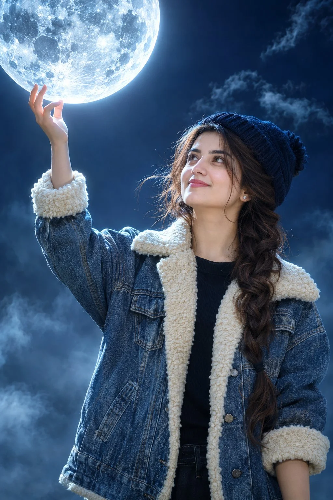

# Touching the Giant Full Moon: Winter Denim Night Portrait (2:3)

**中文标题：** 伸手触碰巨大满月：冬夜牛仔外套肖像（2:3）  
**ID:** `gi25-x-1553` · **Mode:** `edit`  
**Categories:** `character-consistency`, `edit-change-preserve`  
**Tags:** `x-twitter`, `community`, `gpt-image-2.5`, `x-direct`, `en`



### Touching the Giant Full Moon: Winter Denim Night Portrait (2:3)

```text
Create an ultra-realistic, breathtaking cinematic fantasy portrait of a beautiful young South Asian woman with delicate facial features, naturally glowing skin, expressive dark eyes, and long, thick dark brown hair styled in a loose, elegant side braid.

Pose & Composition: The woman is standing gracefully, raising her right arm toward the sky. Her right hand is gently reaching upward, with her fingers delicately positioned beneath a gigantic, luminous full moon, creating the magical illusion that she is touching or holding the moon. She gazes upward at the moon with a peaceful, dreamy smile. Her left arm rests naturally beside her body.

Outfit: She wears a stylish oversized blue denim winter jacket with beautiful thick cream-colored sherpa fleece lining around the collar, front edges, and rolled-up sleeve cuffs. Underneath, she wears a simple fitted black top. The outfit has a cozy, fashionable winter aesthetic.

Hair & Accessories: Her long dark brown hair is styled in a thick loose side braid falling over her right shoulder. She wears a dark navy knitted beanie and tiny elegant stud earrings.

Background & Environment: A breathtaking deep midnight-blue night sky featuring an enormous glowing full moon in the upper-left corner. The moon has highly detailed realistic lunar craters and a brilliant icy-blue glow. Soft layers of atmospheric clouds and mysterious blue mist surround the scene, creating a dreamy celestial environment.

Lighting & Atmosphere: Beautiful icy-blue moonlight illuminates her face, raised hand, hair, and denim jacket. Soft cinematic rim lighting, realistic moon glow, volumetric light, subtle atmospheric fog, dramatic shadows, and a magical winter-night ambiance.

Photography Style: Professional cinematic fantasy photography, ultra-photorealistic, 85mm portrait lens, shallow depth of field, realistic skin texture, anatomically accurate hands and fingers, highly detailed denim and fleece textures, HDR, 8K quality.

Important Details: Preserve natural human anatomy, realistic hand positioning, beautiful facial proportions, accurate moon details, and a seamless magical interaction between the woman's fingertips and the glowing full moon.

Aspect Ratio: Vertical 2:3 portrait composition.
```

- **Recommended model:** `gpt-image-2.5-sunburst`
- **Settings:** _(defaults)_
- **Source:** [community](https://x.com/Arisha_Hoqe/status/2121464988275793951) — @Arisha_Hoqe
- **License note:** Original public X post; quoted with attribution — remix with attribution
- **Notes:** Collected directly from X; prompt posted as the author's own reply https://x.com/Arisha_Hoqe/status/2121464988275793951 to https://x.com/Arisha_Hoqe/status/2121464982906994785, which carries the images; GPT Image 2.5 is named in the parent post; discovered via X search, prompt re-verified against the original X post via api.fxtwitter.com; verified=True; the parent post tells readers to upload their own photo, open GPT Image 2.5 and paste this prompt; preview is the parent post's image
- **Preview:** `previews/gi25-x-1553.webp`
