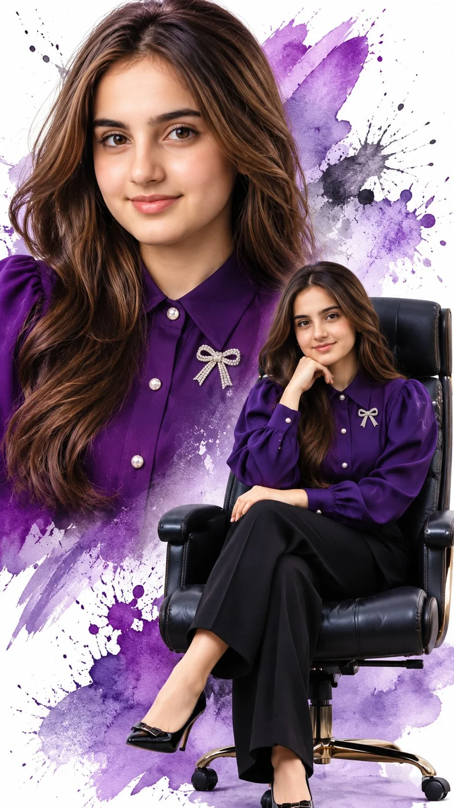

# Double-Exposure Portrait Collage with Purple Watercolor Splashes (9:16)

**中文标题：** 紫色水彩飞溅双重曝光肖像拼贴（9:16）  
**ID:** `gi25-x-1554` · **Mode:** `edit`  
**Categories:** `character-consistency`, `edit-change-preserve`, `poster-typography`  
**Tags:** `x-twitter`, `community`, `gpt-image-2.5`, `x-direct`, `en`



### Double-Exposure Portrait Collage with Purple Watercolor Splashes (9:16)

```text
Create an ultra-realistic, high-end professional artistic portrait collage of a beautiful little girl with long, thick, naturally wavy dark brown hair, big expressive brown eyes, a cute smile, and soft natural facial features.

Composition: Create a stunning double-exposure portrait design. On the left and upper background, feature a large close-up portrait of the girl smiling beautifully, looking directly at the camera. On the right lower side, show the same girl sitting elegantly on a luxurious black leather office chair, with one leg crossed over the other and one hand gently resting under her chin.

Outfit: Both portraits must feature the exact same deep royal purple button-up shirt with puff sleeves, elegant pearl buttons, and a small sparkling silver bow brooch. The seated girl wears stylish black trousers and elegant black shoes.

Background: Pure white artistic background with beautiful purple, lavender, and black watercolor paint splashes, ink splatters, and abstract brush textures surrounding the portraits.

Photography Style: Ultra-realistic professional studio photography, beautiful soft lighting, natural skin texture, sharp facial details, realistic hair strands, premium editorial portrait design, sophisticated composition, high resolution, 8K quality.

Important: Both portraits must feature exactly the same girl, identical face, hairstyle, facial features, outfit, and skin tone. Beautiful seamless artistic blending, perfectly balanced composition, vertical 9:16 poster design. No extra people, no distorted hands, no duplicate facial features, no text, no watermark.
```

- **Recommended model:** `gpt-image-2.5-sunburst`
- **Settings:** _(defaults)_
- **Source:** [community](https://x.com/Arina_hoqe/status/2121457066346954905) — @Arina_hoqe
- **License note:** Original public X post; quoted with attribution — remix with attribution
- **Notes:** Collected directly from X; prompt posted as the author's own reply https://x.com/Arina_hoqe/status/2121457066346954905 to https://x.com/Arina_hoqe/status/2121457062869873124, which carries the images; GPT Image 2.5 is named in the parent post; discovered via X search, prompt re-verified against the original X post via api.fxtwitter.com; verified=True; the parent post tells readers to upload their own photo, open GPT Image 2.5 and paste this prompt; preview is the parent post's image; the same prompt was reposted later by other accounts, this is the earliest copy found
- **Preview:** `previews/gi25-x-1554.webp`
