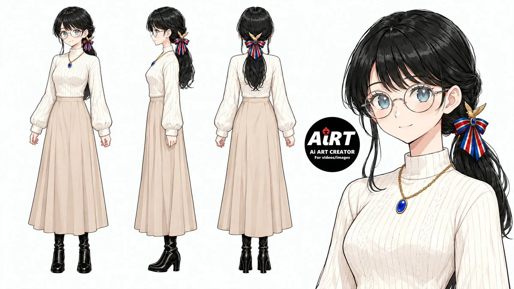

# Photoreal Japanese Actress Character Reference Sheet

**中文标题：** 超写实日本女演员角色设定图  
**ID:** `gi25-x-1595` · **Mode:** `generate`  
**Categories:** `character-consistency`  
**Tags:** `x-twitter`, `community`, `gpt-image-2.5`, `x-direct`, `en`



### Photoreal Japanese Actress Character Reference Sheet

```text
Create an ultra-photorealistic live-action character reference
sheet of the exact same young Japanese woman.

She is a beautiful, gentle-looking Japanese woman in her
early twenties, with a calm, intelligent, modest, and elegant
personality.

FACE AND APPEARANCE:
A naturally beautiful Japanese woman with a soft oval face,
delicate facial features, fair natural skin, and large,
clear, pale blue-gray eyes.
She wears delicate, thin, round silver metal eyeglasses.
Her expression is gentle and shy slightly, with a subtle
natural smile.
Her facial appearance must look completely human and
photographically realistic, not anime or illustration.

HAIRSTYLE:
Long, glossy, naturally black hair.
Her hair is styled in an elegant half-up arrangement with
a softly gathered into a long,
low ponytail positioned behind her right ear.
Her bangs are softly layered, with several loose strands
framing her face.
The ponytail has natural volume and slightly wavy ends.

A distinctive decorative hair ornament is attached to
the ponytail:
a beautiful red, royal blue, and gold striped ribbon bow,
with a small golden wing-shaped ornament and a blue jewel
in the center.
Reproduce this accessory accurately.

CLOTHING:
She wears an elegant ivory-white high-neck cable-knit
sweater with a soft ribbed turtleneck collar.
The sweater has delicate vertical knit patterns,
subtle cable-knit details on the front, long voluminous
balloon sleeves, and fitted ribbed cuffs.

She wears a long, flowing, high-waisted beige pleated skirt,
reaching approximately to her ankles.
The skirt has soft natural fabric folds and a refined,
minimalist appearance.

She also wears glossy black knee-high leather boots
with a modest heels.

ACCESSORIES:
A delicate gold chain necklace with a single oval-shaped
deep sapphire-blue gemstone pendant.

CHARACTER REFERENCE SHEET COMPOSITION:
Create a professional character design reference sheet
on a clean, pure white studio background.

Show the exact same woman in four views:
1. Full-body front three-quarter view.
2. Full-body side profile view.
3. Full-body rear view.
4.Large, detailed portrait close-up of her face and upper body.

All four views must depict exactly the same woman,
with identical facial features, hairstyle, clothing,
body proportions, accessories, and colors.

PHOTOGRAPHIC STYLE:
Extremely realistic live-action photography.
Real human skin texture, natural pores, fine facial details,
realistic individual hair strands, physically accurate
fabric textures, natural lighting, and subtle shadows.

Shot with a professional full-frame DSLR camera,
85mm portrait lens, high resolution, realistic depth
and natural photographic color reproduction.

Soft, bright, diffused studio lighting.
Clean white background.
Full-body views must show her entire outfit and boots.

ABSOLUTELY NO anime, no manga, no illustration,
no 3D rendering, no CGI, no doll-like appearance,
no stylized facial features.

The result must look like a real Japanese actress
photographed for a professional costume and character
reference production sheet.
```

- **Recommended model:** `gpt-image-2.5-flare`
- **Settings:** _(defaults)_
- **Source:** [community](https://x.com/AutoIntelliMode/status/2123251416743772242) — @AutoIntelliMode
- **License note:** Original public X post; quoted with attribution — remix with attribution
- **Notes:** Collected directly from X; original post https://x.com/AutoIntelliMode/status/2123251416743772242; post text names GPT Image 2.5; discovered via X search, prompt re-verified against the original X post via api.fxtwitter.com; verified=True; t2i prompt published in a multi-model comparison that includes GPT Image 2.5 Flare (also i2i vs t2i with Kling Image 4.0 and others); preview is image 1 of 3
- **Preview:** `previews/gi25-x-1595.webp`
