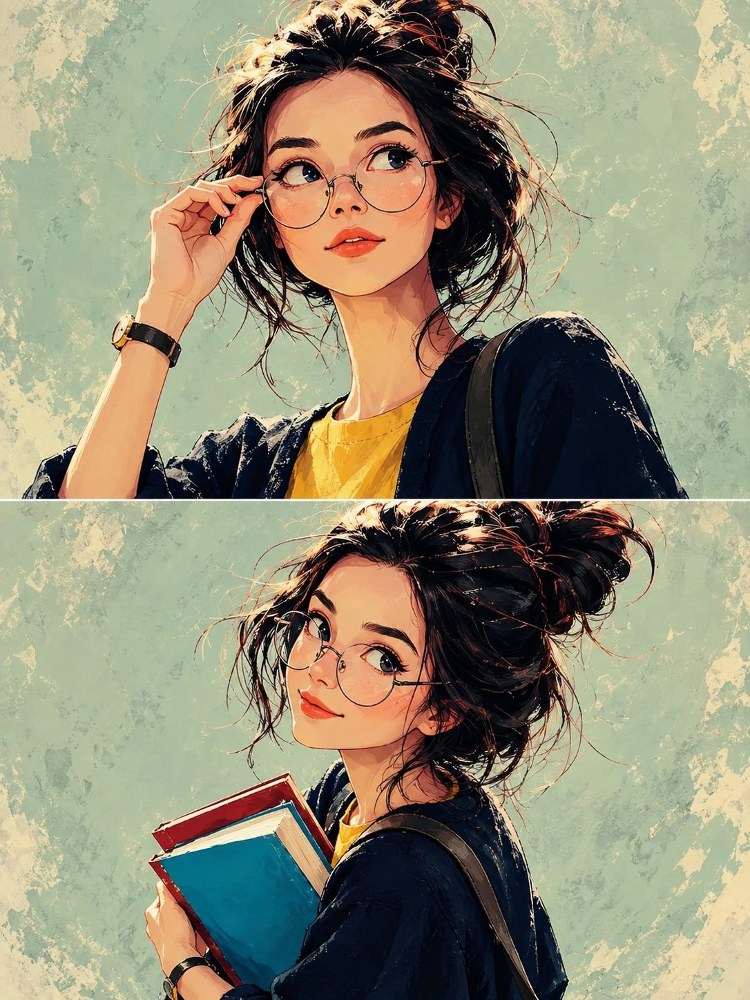

# Two-Panel Anime Editorial: A Woman with Books (JSON, 3:4)

**中文标题：** 双格动漫编辑插画：抱书的女性（JSON·3:4）  
**ID:** `gi25-x-1667` · **Mode:** `generate`  
**Categories:** `character-consistency`, `general`  
**Tags:** `x-twitter`, `community`, `gpt-image-2.5`, `x-direct`, `en`



### Two-Panel Anime Editorial: A Woman with Books (JSON, 3:4)

```text
{
  "aspect_ratio": "3:4",
  "prompt": "Create a beautiful hand-painted anime-inspired editorial illustration using the uploaded reference image as the visual style and character inspiration. The final composition must contain EXACTLY TWO separate horizontal panels stacked vertically, one above the other, within a single 3:4 portrait canvas. Both panels must have equal height and full width, separated by a subtle clean divider.\n\nCHARACTER CONSISTENCY: Show the same beautiful young adult woman in both panels. She has expressive large eyes, round oversized transparent glasses, soft facial features, dark messy hair tied in a loose casual bun with a few strands framing her face. Maintain identical facial identity, hairstyle, and overall artistic style in both panels.\n\nTOP PANEL: A medium close-up portrait from a slightly low camera angle. The woman is looking slightly to her left with a gentle, thoughtful expression. One hand casually touches her glasses. Her face and upper body are clearly visible. Use an interesting three-quarter perspective rather than a straight front-facing pose.\n\nBOTTOM PANEL: Show the same woman from a different camera angle, a slightly elevated side perspective. She is holding two colorful books close to her chest and looking slightly upward toward the camera with a subtle natural smile. Show more of her upper body with a relaxed, candid pose. Her head direction and body positioning must be noticeably different from the top panel.\n\nART STYLE: Beautiful painterly anime illustration, sophisticated hand-painted brush strokes, delicate sketch-like outlines, expressive eyes, warm natural skin tones, soft sunlight, muted sage green textured background, subtle vintage color grading, artistic imperfections, rich navy blue and mustard yellow clothing, cinematic lighting, detailed hair strands and beautiful fabric textures.\n\nIMPORTANT COMPOSITION RULES: Exactly two panels, one on top and one below. Both panels must be clearly distinguishable. Same character in both panels but different poses, facial expressions, framing and camera angles. No repeated composition, no extra panels, no collage elements, no text, no typography, no watermark. High-quality detailed illustration."
}
```

- **Recommended model:** `gpt-image-2.5-flare`
- **Settings:** _(defaults)_
- **Source:** [community](https://x.com/Just_Anika_Here/status/2125649082849128934) — @Just_Anika_Here
- **License note:** Original public X post; quoted with attribution — remix with attribution
- **Notes:** Collected directly from X; original post https://x.com/Just_Anika_Here/status/2125649082849128934; post text names GPT Image 2.5; discovered via X search, prompt re-verified against the original X post via api.fxtwitter.com; verified=True; JSON prompt as posted; post names GPT Image 2.5 without a Flare/Sunburst variant; aspect_ratio in the JSON is 3:4; same character in two stacked panels
- **Preview:** `previews/gi25-x-1667.webp`
