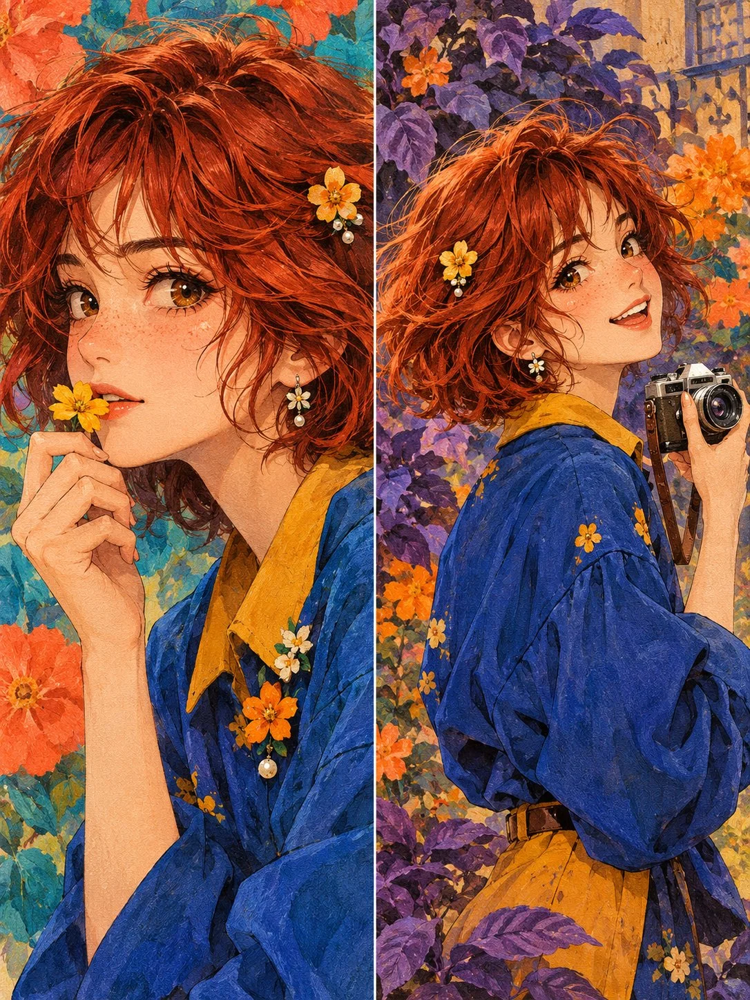

# Two Vertical Panels: Flower and Camera Portraits (JSON, 3:4)

**中文标题：** 左右双格：花朵与相机肖像（JSON·3:4）  
**ID:** `gi25-x-1672` · **Mode:** `generate`  
**Categories:** `character-consistency`, `general`  
**Tags:** `x-twitter`, `community`, `gpt-image-2.5`, `x-direct`, `en`



### Two Vertical Panels: Flower and Camera Portraits (JSON, 3:4)

```text
{
  "aspect_ratio": "3:4",
  "prompt": "Create a beautiful Japanese anime-inspired hand-painted editorial illustration with EXACTLY TWO VERTICAL PANELS placed SIDE BY SIDE, LEFT and RIGHT, inside one single 3:4 portrait canvas. Both panels must have equal width and full height, separated by a thin subtle divider.\n\nCHARACTER: Show the exact same young adult woman in both panels. She has short, slightly wavy copper-red hair with uneven bangs, expressive oversized amber eyes, delicate freckles across her cheeks, and a playful distinctive personality. Maintain identical facial identity, hairstyle and outfit in both panels.\n\nLEFT PANEL: An artistic close-up portrait from a dramatic three-quarter side angle. The woman is leaning slightly forward, holding a tiny yellow flower near her lips while looking sideways toward the viewer. One eyebrow is slightly raised, with a curious mischievous expression. Her face fills most of the panel. Background features oversized turquoise and coral-colored flowers.\n\nRIGHT PANEL: Show the same woman in a completely different pose and camera perspective. A slightly elevated medium shot as she turns her upper body backward, holding a small vintage camera in one hand and giving a cheeky wide smile. Her hair moves naturally as she turns. Show her upper body and more of the environment. Background features deep violet leaves, orange flowers and subtle artistic patterns.\n\nCLOTHING: Unique cobalt-blue oversized blouse with mustard-yellow collar details and small decorative floral accessories.\n\nART STYLE: Exquisite Japanese anime oil painting, expressive hand-painted brushwork, visible canvas texture, delicate imperfect sketch outlines, rich painterly details, beautiful color combinations, warm natural skin tones, vibrant but balanced colors, dreamy artistic atmosphere, sophisticated vintage illustration aesthetic.\n\nCOMPOSITION RULES: EXACTLY TWO VERTICAL PANELS, LEFT AND RIGHT, equal size. Both panels must show the same recognizable woman with different poses, expressions, camera angles and framing. Strong visual contrast between the two scenes. No horizontal stacking, no extra panels, no duplicated poses, no text, no typography, no watermark. Extremely detailed, visually striking professional artwork."
}
```

- **Recommended model:** `gpt-image-2.5-flare`
- **Settings:** _(defaults)_
- **Source:** [community](https://x.com/Just_Anika_Here/status/2125846634601029647) — @Just_Anika_Here
- **License note:** Original public X post; quoted with attribution — remix with attribution
- **Notes:** Collected directly from X; original post https://x.com/Just_Anika_Here/status/2125846634601029647; post text names GPT Image 2.5; discovered via X search, prompt re-verified against the original X post via api.fxtwitter.com; verified=True; JSON prompt as posted; post names GPT Image 2.5 without a Flare/Sunburst variant; aspect_ratio in the JSON is 3:4; same character in two side-by-side panels
- **Preview:** `previews/gi25-x-1672.webp`
