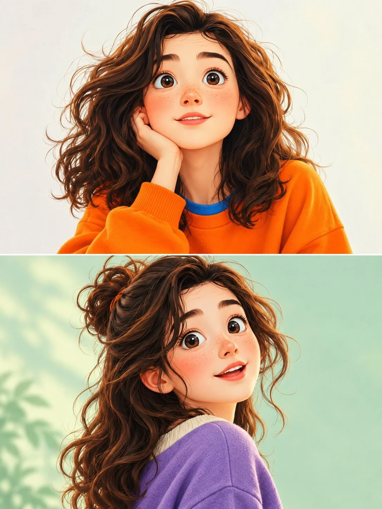

# Stacked Two-Panel Portrait: Orange vs Purple Outfits (JSON, 3:4)

**中文标题：** 上下双格肖像：橙装与紫装（JSON·3:4）  
**ID:** `gi25-x-1674` · **Mode:** `generate`  
**Categories:** `character-consistency`, `general`  
**Tags:** `x-twitter`, `community`, `gpt-image-2.5`, `x-direct`, `en`



### Stacked Two-Panel Portrait: Orange vs Purple Outfits (JSON, 3:4)

```text
{
  "aspect_ratio": "3:4",
  "prompt": "Create a beautiful, high-quality 3D animated character portrait inspired by the uploaded reference image. Use the reference girl as the main character, maintaining her recognizable facial features, big expressive brown eyes, soft freckles, cute facial proportions and voluminous wavy dark brown hair.\n\nCOMPOSITION: EXACTLY TWO horizontal panels stacked vertically, one on top of the other, filling the entire 3:4 canvas. Both panels must have equal height and be clearly separated by a clean horizontal division. No extra panels, no borders, no text.\n\nTOP PANEL: The girl wears a vibrant orange oversized sweatshirt with a royal blue neckline, matching the outfit in the reference image. Camera angle: slightly low-angle close-up, looking gently upward toward her face. Her head is slightly tilted, with a sweet innocent smile and curious sparkling eyes. Her wavy hair falls naturally around her shoulders. Soft warm daylight, clean pale pastel background. Medium close-up composition.\n\nBOTTOM PANEL: Show the SAME girl with a distinctly different visual appearance and styling. Change her outfit to a beautiful lavender-purple oversized sweater with a soft cream collar. Camera angle: dramatic three-quarter side view from slightly above, with her face turned toward the camera. Give her a playful surprised expression, one eyebrow slightly raised and a subtle smile. Her hair is styled in a loose half-up hairstyle with a few natural curls framing her face. Add a soft pastel mint-green background. Slightly wider portrait framing with a different body posture.\n\nART STYLE: Premium Pixar-inspired 3D animated illustration, beautifully detailed expressive eyes, realistic individual hair strands, delicate freckles, soft skin shading, cinematic soft lighting, rich but balanced colors, charming character design, polished professional digital artwork.\n\nIMPORTANT: Both panels must feature the same recognizable girl, but must NOT look like duplicated images. Make the camera angles, facial expressions, poses, hairstyle styling, clothing colors and background noticeably different. Keep the orange outfit ONLY in the upper panel. The lower panel MUST have a completely different outfit. Visually striking composition with strong character appeal."
}
```

- **Recommended model:** `gpt-image-2.5-flare`
- **Settings:** _(defaults)_
- **Source:** [community](https://x.com/Just_Anika_Here/status/2125869669336649832) — @Just_Anika_Here
- **License note:** Original public X post; quoted with attribution — remix with attribution
- **Notes:** Collected directly from X; original post https://x.com/Just_Anika_Here/status/2125869669336649832; post text names GPT Image 2.5; discovered via X search, prompt re-verified against the original X post via api.fxtwitter.com; verified=True; JSON prompt as posted; post names GPT Image 2.5 without a Flare/Sunburst variant; aspect_ratio in the JSON is 3:4; two horizontal panels stacked vertically
- **Preview:** `previews/gi25-x-1674.webp`
