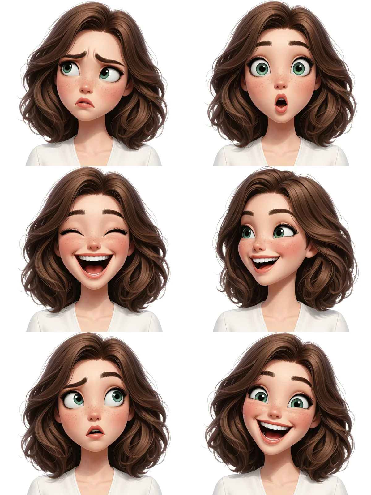

# Six-Portrait Expression Sheet of a Young Woman (JSON, 3:4)

**中文标题：** 年轻女性六宫格表情表（JSON·3:4）  
**ID:** `gi25-x-1677` · **Mode:** `generate`  
**Categories:** `character-consistency`  
**Tags:** `x-twitter`, `community`, `gpt-image-2.5`, `x-direct`, `en`



### Six-Portrait Expression Sheet of a Young Woman (JSON, 3:4)

```text
{
"aspect_ratio": "3:4",
"prompt": "Create an original beautiful animated female character expression sheet featuring EXACTLY SIX portraits arranged in a precise 2-column by 3-row grid.\n\nCHARACTER: A cute young adult woman with large expressive teal-green eyes, beautiful chestnut-brown wavy shoulder-length hair, soft fair skin, naturally rosy cheeks, delicate freckles, expressive eyebrows, a small nose and charming facial features. She wears a simple elegant white V-neck blouse in all six portraits. Maintain consistent facial identity and character design throughout.\n\nSIX DIFFERENT EXPRESSIONS:\n1. TOP LEFT: Confused and worried, looking upward sideways with raised eyebrows and slightly open mouth.\n2. TOP RIGHT: Surprised, wide-open eyes, raised eyebrows and a small round O-shaped mouth.\n3. MIDDLE LEFT: Extremely happy, laughing with mouth wide open, visible teeth and joyful eyes.\n4. MIDDLE RIGHT: Playfully laughing, head turned sideways at a three-quarter angle, big cheerful smile.\n5. BOTTOM LEFT: Curious and uncertain, looking toward the upper side with one eyebrow raised and mouth slightly open.\n6. BOTTOM RIGHT: Excited and delighted, beautiful wide smile, sparkling eyes and slightly tilted head.\n\nCAMERA AND POSES: Every portrait must have a different head direction, slight camera angle, facial expression and natural hair movement. Use close-up and medium close-up framing. Show head, shoulders and upper chest.\n\nART DIRECTION: Premium animated movie character concept art, Pixar-inspired 3D meets soft hand-painted digital illustration, expressive facial anatomy, beautifully detailed brown hair strands, soft skin texture, subtle blush, delicate lighting and clean painterly brushwork.\n\nBACKGROUND AND LAYOUT: Pure clean white background across all six portraits. Equal spacing, balanced composition, clearly separated character illustrations. Exact 2 columns and 3 rows, vertical 3:4 canvas.\n\nSTRICT REQUIREMENTS: Generate all six portraits from scratch without any reference image. Same original character in every portrait. Same white outfit throughout. Six genuinely different emotions and poses. No text, no labels, no extra characters, no watermark."
}
```

- **Recommended model:** `gpt-image-2.5-flare`
- **Settings:** _(defaults)_
- **Source:** [community](https://x.com/Just_Anika_Here/status/2125899874239484157) — @Just_Anika_Here
- **License note:** Original public X post; quoted with attribution — remix with attribution
- **Notes:** Collected directly from X; original post https://x.com/Just_Anika_Here/status/2125899874239484157; post text names GPT Image 2.5; discovered via X search, prompt re-verified against the original X post via api.fxtwitter.com; verified=True; JSON prompt as posted; post names GPT Image 2.5 without a Flare/Sunburst variant; aspect_ratio in the JSON is 3:4; exact 2-by-3 grid
- **Preview:** `previews/gi25-x-1677.webp`
