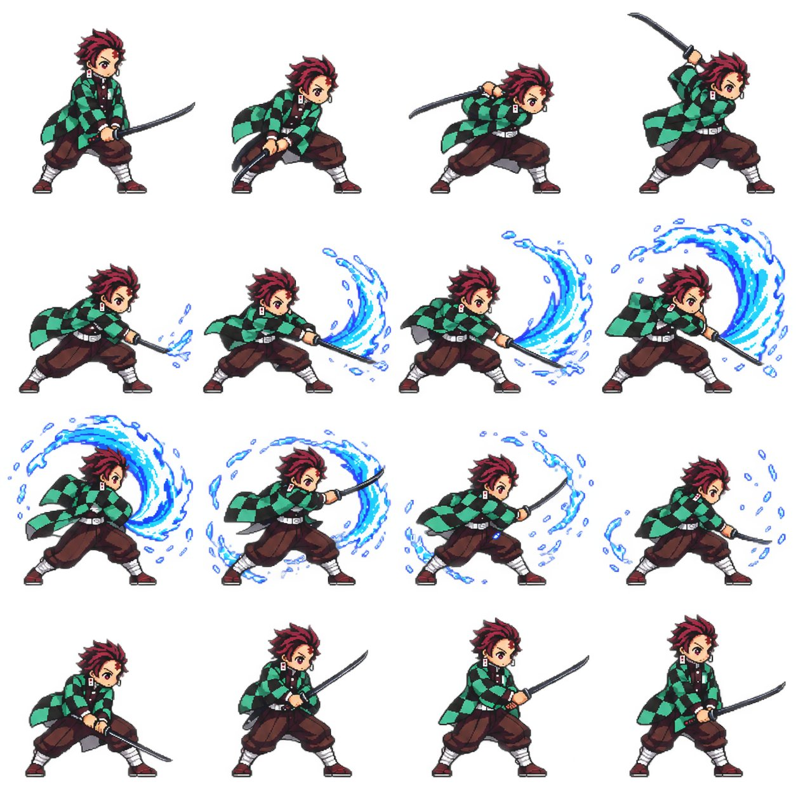

# Character Reference → 4×4 Pixel-Art Battle Sprite Sheet

**中文标题：** 角色参考→4×4 像素风战斗精灵图  
**ID:** `gi25-x-703` · **Mode:** `edit`  
**Categories:** `character-consistency`  
**Tags:** `x-twitter`, `community`, `gpt-image-2.5`, `x-direct`, `en`



### Character Reference → 4×4 Pixel-Art Battle Sprite Sheet

```text
Using the character reference image I upload, create a pixel-art battle animation. Deliver a transparent animated GIF and a 4×4 sprite sheet containing 16 sequential frames.

CHARACTER FIDELITY
Identify the character’s hairstyle, outfit, colors, weapon, proportions, and distinctive features. Translate them into a recognizable chibi pixel-art sprite. Keep the character’s identity, scale, clothing, and equipment consistent across all frames.

BATTLE DESIGN
Automatically design an attack that suits the character:
- If they carry a weapon, build the animation around it.
- If their abilities are clearly identifiable, use the appropriate effects, such as water, fire, or lightning.
- If their abilities are unclear, create a plausible physical attack based on their appearance. Do not invent unrelated powers.

Proceed without asking preliminary questions. Create one coherent battle loop:
Ready stance → Anticipation → Attack → Impact peak → Effects dissipate → Recovery.

Distribute the sequence naturally across 16 frames. The final frame must transition smoothly into the first. Animate actual changes in pose and body mechanics; do not fake movement by merely translating or rotating a static character image.

PIXEL-ART STYLE
Use crisp 16-bit game-style pixel art with readable silhouettes, sharp pixel edges, and a restrained palette. Maintain a consistent pixel scale for both the character and effects. Avoid blur, photorealistic rendering, and style drift.

SPRITE SHEET REQUIREMENTS
- Exactly 4 columns × 4 rows, totaling 16 frames.
- Frames play left to right, then top to bottom.
- All cells must have identical dimensions.
- Use a fixed camera, consistent character scale, a stable ground baseline, and consistent animation registration.
- Each cell contains exactly one character.
- Keep the entire body, weapon, and effects inside its cell.
- Leave sufficient transparent padding on every side. Nothing may cross cell boundaries or be cropped.
- No text, frame numbers, grid lines, watermarks, or background scenery.

TRANSPARENCY AND ANIMATION
Generate a genuinely transparent RGBA PNG. Do not draw a checkerboard pattern to imitate transparency.

Slice the sheet into frames and assemble a transparent, infinitely looping GIF. Adjust frame durations to emphasize anticipation and fast strikes. Aim for a total loop duration of approximately 1.5–2 seconds.

Preserve full alpha transparency in the PNG files. Use a transparent palette index and correct frame disposal in the GIF to prevent trails from previous frames.

DELIVERABLES AND QUALITY CHECK
Create the actual files, not just prompts or instructions:
1. A transparent 4×4 PNG sprite sheet.
2. A playable transparent battle GIF.
3. A ZIP containing all 16 individual transparent PNG frames.

Before delivery, verify that there are exactly 16 frames, transparency is genuine, the character remains consistent, no neighboring frames bleed into the crops, the action plays in the correct order, and the loop has no obvious positional jumps. Fix any issues before presenting the GIF preview and download links.
```

- **Recommended model:** `gpt-image-2.5-sunburst`
- **Settings:** _(defaults)_
- **Source:** [community](https://x.com/Mayz1169/status/2097540160611287452) — @Mayz1169
- **License note:** Original public X post; quoted with attribution — remix with attribution
- **Notes:** Collected directly from X; prompt posted as the author's reply https://x.com/Mayz1169/status/2097540160611287452 to https://x.com/Mayz1169/status/2097539942985728162, which carries the images and names GPT Image 2.5; discovered via Bin0754/gpt-image-gallery index, prompt re-verified against the original X post; verified=True
- **Preview:** `previews/gi25-x-703.jpg`
