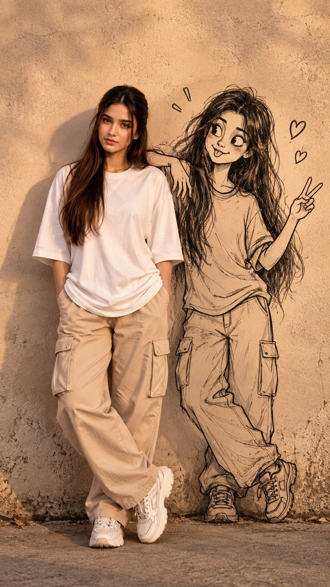

# Real Woman Interacting with Her Giant Hand-Drawn Cartoon Self

**中文标题：** 真人与巨幅手绘卡通自己互动人像  
**ID:** `gi25-x-705` · **Mode:** `edit`  
**Categories:** `character-consistency`  
**Tags:** `x-twitter`, `community`, `gpt-image-2.5`, `x-direct`, `en`



### Real Woman Interacting with Her Giant Hand-Drawn Cartoon Self

```text
Create an ultra-realistic cinematic portrait of a young woman standing against a warm beige textured wall, seamlessly interacting with a large hand-drawn black-and-white cartoon version of herself.
The real woman has long wavy dark auburn hair, natural facial features, soft realistic skin texture, and a calm slightly curious expression. She wears an oversized plain white T-shirt, loose beige cargo pants with multiple pockets, and chunky white sneakers. Full-body composition, relaxed standing pose, hands casually near her pockets.
Beside and slightly behind her, draw a large expressive hand-drawn cartoon character of the same woman, sketched directly onto the wall with rough black ink lines. The cartoon has messy long hair, oversized expressive eyes, a playful confused expression, casual oversized clothing, baggy pants and sneakers. The cartoon character should appear to be interacting with the real woman, with one arm extended outward and the other raised in a playful gesture.
Create a convincing 2D drawing + 3D real-person fusion, where the cartoon is visibly drawn on the wall but feels naturally integrated into the physical environment. Add subtle wall shadows, realistic ambient lighting, natural contact shadows, detailed fabric texture, realistic hair strands, slight imperfections in the wall and floor, and cinematic depth.
Style: photorealistic, surreal mixed-media photography, realistic human + hand-drawn illustration, cinematic lighting, warm muted tones, editorial fashion photography, highly detailed, natural proportions, 8K, sharp focus.
Composition: vertical 9:16, full body, centered subject, camera at eye level, realistic perspective, minimal background, no text, no watermark.
```

- **Recommended model:** `gpt-image-2.5-sunburst`
- **Settings:** _(defaults)_
- **Source:** [community](https://x.com/Alina_with_Ai/status/2100412898363547998) — @Alina_with_Ai
- **License note:** Original public X post; quoted with attribution — remix with attribution
- **Notes:** Collected directly from X; prompt posted as the author's reply https://x.com/Alina_with_Ai/status/2100412898363547998 to https://x.com/Alina_with_Ai/status/2100412893309362669, which carries the images and names GPT Image 2.5; discovered via Bin0754/gpt-image-gallery index, prompt re-verified against the original X post; verified=True; first of several prompts the author posted in the thread
- **Preview:** `previews/gi25-x-705.jpg`
