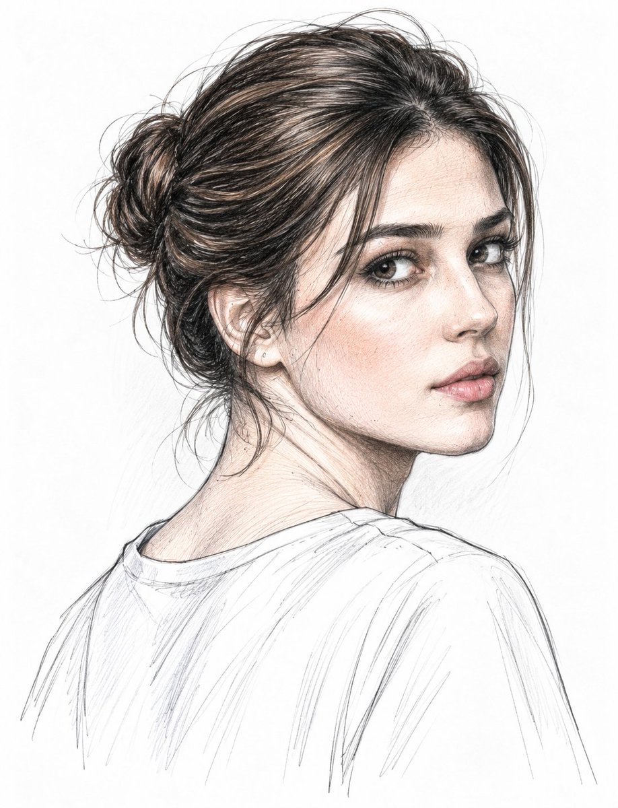

# Graphite & Colored-Pencil Double Portrait with a Celebrity

**中文标题：** 石墨彩铅双人素描（与名人同框）  
**ID:** `gi25-x-706` · **Mode:** `edit`  
**Categories:** `character-consistency`  
**Tags:** `x-twitter`, `community`, `gpt-image-2.5`, `x-direct`, `en`



### Graphite & Colored-Pencil Double Portrait with a Celebrity

```text
Create a highly detailed, realistic graphite and colored-pencil double portrait featuring Cristiano Ronaldo and the young woman from the reference images together, rendered in exactly the same refined hand-drawn sketch aesthetic.
Both subjects should have the same artistic treatment: fine graphite linework, delicate cross-hatching, realistic pencil strokes, subtle warm colored-pencil accents, soft natural shading, detailed individual hair strands, realistic skin texture, expressive eyes, and carefully defined facial features.
Cristiano Ronaldo: show him in a three-quarter back pose, looking over his shoulder toward the viewer, with his recognizable short dark styled hair, strong masculine facial features, defined eyebrows, subtle stubble, natural expression, and a simple light-colored shirt rendered with loose pencil strokes.
Young woman: show her in a matching three-quarter back pose, also looking over her shoulder toward the viewer. Keep her dark-brown hair in a loose messy bun with delicate wispy strands, natural expressive eyes, defined brows, soft pink lips, subtle cheek blush, and a simple light-colored shirt with lightly sketched fabric folds.
Place both portraits together in one balanced composition, side by side with natural spacing, maintaining the same scale, perspective, lighting, pencil texture, and level of detail. Their faces should remain highly recognizable and naturally proportioned.
Use a pure clean white paper background with only very subtle loose pencil marks around the silhouettes. Keep the clothing lightly sketched so the faces and hair remain the main focus.
Premium realistic hand-drawn portrait, elegant editorial sketch, graphite + colored pencil, delicate cross-hatching, ultra-detailed facial features, realistic hair texture, subtle skin tones, soft shading, clean white background, high resolution, artistic yet photorealistic finish, vertical 9:
```

- **Recommended model:** `gpt-image-2.5-sunburst`
- **Settings:** _(defaults)_
- **Source:** [community](https://x.com/Alina_with_Ai/status/2101143224014483618) — @Alina_with_Ai
- **License note:** Original public X post; quoted with attribution — remix with attribution
- **Notes:** Collected directly from X; prompt posted as the author's reply https://x.com/Alina_with_Ai/status/2101143224014483618 to https://x.com/Alina_with_Ai/status/2101143220566872225, which carries the images and names GPT Image 2.5; discovered via Bin0754/gpt-image-gallery index, prompt re-verified against the original X post; verified=True; the original X post text ends abruptly — quoted verbatim as published
- **Preview:** `previews/gi25-x-706.jpg`
