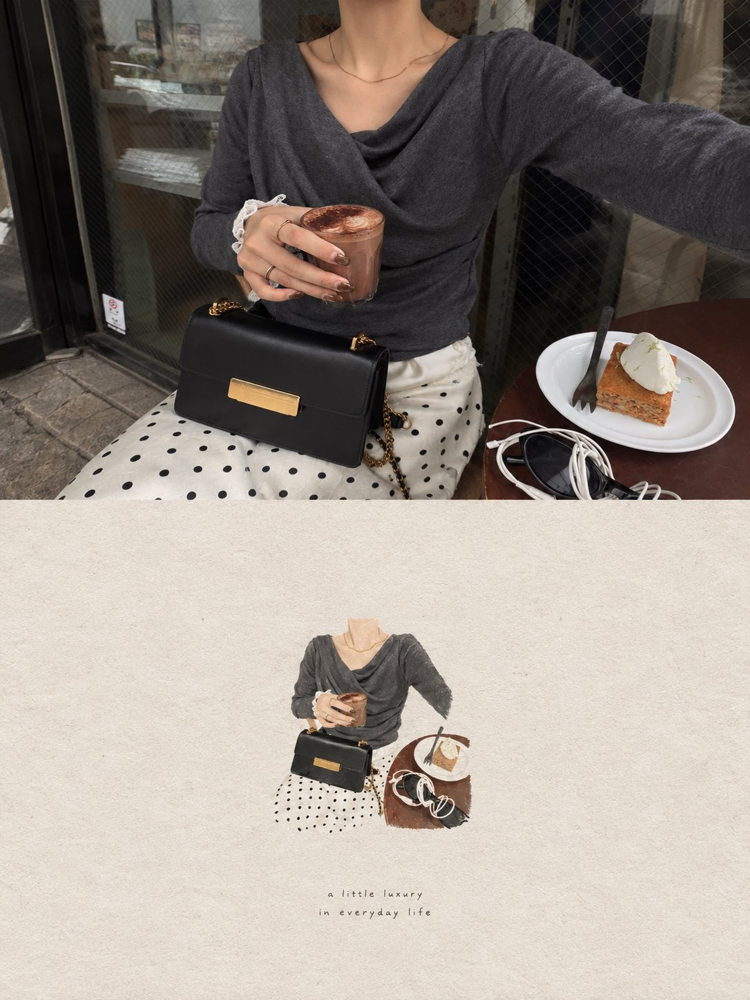

# Face-Locked Dreamy Editorial Scrapbook Portrait

**中文标题：** 锁脸梦幻杂志拼贴手账人像  
**ID:** `gi25-x-707` · **Mode:** `edit`  
**Categories:** `character-consistency`, `edit-change-preserve`  
**Tags:** `x-twitter`, `community`, `gpt-image-2.5`, `x-direct`, `en`



### Face-Locked Dreamy Editorial Scrapbook Portrait

```text
Use the uploaded face reference image ONLY as the identity reference for the woman.

STRICT FACE IDENTITY LOCK:
Preserve her recognizable facial identity exactly from the face reference. Keep the same facial structure, face shape, eyes, eyebrows, nose, lips, jawline, cheek structure, skin tone, and natural facial proportions. Do not beautify, redesign, age, de-age, or replace her face. Do not create a different person.

Use the provided reference images as visual inspiration for the overall composition, photography style, outfit, pose, environment, color palette, and aesthetic, but do NOT copy their facial identity.

Create a photorealistic lifestyle editorial photograph with a soft Japanese/Korean-inspired café and everyday-luxury aesthetic.

The woman is naturally enjoying a quiet café moment with coffee and dessert. Elegant understated styling, soft neutral tones, natural daylight, subtle film grain, warm muted colors, realistic skin texture, delicate details, candid editorial photography.

Outfit should be feminine and sophisticated with a minimalist vintage-inspired feel. Add tasteful accessories such as a small structured handbag, delicate jewelry, and elegant shoes where appropriate.

Composition should feel like a genuine lifestyle photograph rather than an AI-generated portrait. Natural body proportions, realistic hands and fingers, authentic fabric texture, realistic lighting and shadows.

Create the final image as a refined editorial scrapbook-style photograph:
- warm ivory/beige paper-inspired background
- softly isolated central subject
- subtle hand-painted/watercolor edges around the photograph
- slightly imperfect organic cutout effect
- delicate vintage paper texture
- minimal elegant typography area underneath
- calm nostalgic mood
- sophisticated feminine aesthetic
- lots of clean negative space

IMPORTANT:
The face reference controls ONLY the woman's identity.
The scene/reference images control the visual concept.
Do not merge or copy another person's face.
Keep the woman's identity consistent and recognizable throughout the entire image.

High-resolution photography, natural lighting, realistic skin texture, detailed clothing, realistic hands, authentic shadows, premium editorial composition, subtle analog film texture, soft focus falloff, photorealistic.
```

- **Recommended model:** `gpt-image-2.5-sunburst`
- **Settings:** _(defaults)_
- **Source:** [community](https://x.com/MahnoorAi12/status/2102368463713149360) — @MahnoorAi12
- **License note:** Original public X post; quoted with attribution — remix with attribution
- **Notes:** Collected directly from X; prompt posted as the author's reply https://x.com/MahnoorAi12/status/2102368463713149360 to https://x.com/MahnoorAi12/status/2102368459388801390, which carries the images and names GPT Image 2.5; discovered via Bin0754/gpt-image-gallery index, prompt re-verified against the original X post; verified=True; author adds an optional 4-image extension in the same reply thread; base prompt quoted
- **Preview:** `previews/gi25-x-707.jpg`
