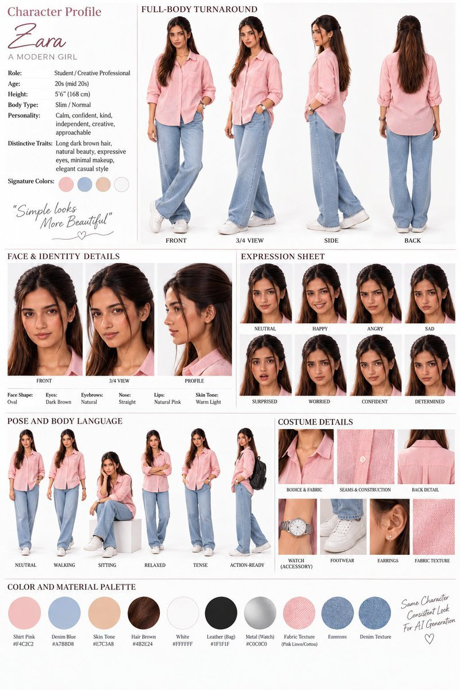

# AI Character Reference Sheet (Adult Female)

**中文标题：** AI 角色设定参考表（成年女性）  
**ID:** `gi25-x-710` · **Mode:** `edit`  
**Categories:** `character-consistency`  
**Tags:** `x-twitter`, `community`, `gpt-image-2.5`, `x-direct`, `en`



### AI Character Reference Sheet (Adult Female)

```text
Create a professional AI Character Reference Sheet for a single adult female character, designed for consistent character generation across images and video.

Layout:
A clean high-end character design presentation board on a white studio background, arranged into clearly labeled sections with multiple reference views.

CHARACTER PROFILE:
Name: [Character Name]
Role: [Role]
Age: [Adult age range]
Height: [Height]
Body Type: [Body type]
Personality: [Personality traits]
Distinctive Traits: [Distinctive facial/body features]
Signature Colors: [3–4 signature colors]

FULL-BODY TURNAROUND:
Show the exact same character in four full-body views:
1. Front view
2. 3/4 front view
3. Side profile
4. Back view

Maintain identical facial identity, hairstyle, body proportions, clothing, accessories, colors, and physical characteristics across every view.

FACE & IDENTITY DETAILS:
Create close-up facial references showing:
- Front face
- 3/4 face
- Side profile

Clearly preserve:
face shape, eyes, eyebrows, nose, lips, skin tone, hairstyle, hair color, distinctive facial details, and accessories.

EXPRESSION SHEET:
Show the same character with consistent identity and hairstyle displaying:
- Neutral
- Happy
- Angry
- Sad
- Surprised
- Worried
- Confident
- Determined

POSE & BODY LANGUAGE:
Show the character in several natural full-body poses:
- Neutral standing
- Walking
- Sitting
- Relaxed
- Tense
- Action-ready

COSTUME DETAILS:
Include detailed close-up panels of:
- Bodice and fabric
- Seams and construction
- Back closure/zipper
- Jewelry/accessories
- Footwear
- Earrings or other accessories

COLOR & MATERIAL PALETTE:
Display circular color swatches and material samples for:
- Clothing/fabric
- Skin
- Hair
- Leather
- Metal
- Accent colors

VISUAL STYLE:
Photorealistic cinematic character design, premium film-production reference sheet, realistic skin texture, natural facial details, accurate anatomy, professional studio photography, soft even lighting, sharp details, clean white background, high-end editorial presentation, consistent character identity.

IMPORTANT:
The same adult female character must remain visually identical throughout the entire sheet. No changes to face, facial proportions, hairstyle, hair color, body shape, age, skin tone, outfit design, or accessories between panels. Make the sheet highly detailed, organized, readable, and suitable as a character reference for future AI image and video generation.
```

- **Recommended model:** `gpt-image-2.5-sunburst`
- **Settings:** _(defaults)_
- **Source:** [community](https://x.com/Alina_with_Ai/status/2101869350366191729) — @Alina_with_Ai
- **License note:** Original public X post; quoted with attribution — remix with attribution
- **Notes:** Collected directly from X; prompt posted as the author's reply https://x.com/Alina_with_Ai/status/2101869350366191729 to https://x.com/Alina_with_Ai/status/2101869345093873968, which carries the images and names GPT Image 2.5; discovered via Bin0754/gpt-image-gallery index, prompt re-verified against the original X post; verified=True; first of several prompts the author posted in the thread
- **Preview:** `previews/gi25-x-710.jpg`
