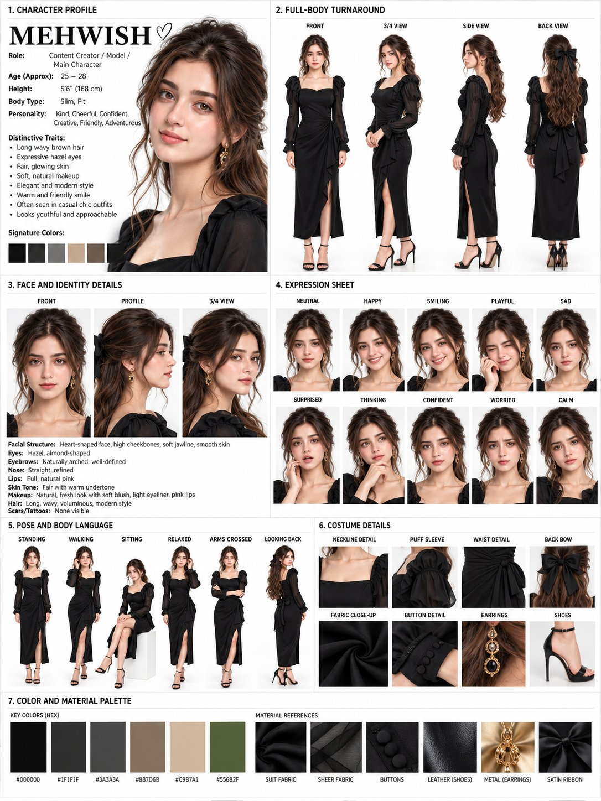

# Content-Creator Character Reference Sheet from Photo

**中文标题：** 照片→博主角色设定参考表  
**ID:** `gi25-x-711` · **Mode:** `edit`  
**Categories:** `character-consistency`  
**Tags:** `x-twitter`, `community`, `gpt-image-2.5`, `x-direct`, `en`



### Content-Creator Character Reference Sheet from Photo

```text
Create a professional, high-end CHARACTER REFERENCE SHEET for a female content creator and main character named “MEHWISH”.

Use the uploaded reference image as the primary visual reference. Preserve the character’s facial identity, facial proportions, hairstyle, skin tone, body proportions, and overall appearance consistently across every panel.

Create a clean professional character-design sheet on a bright white studio background with a premium editorial layout, realistic photography quality, soft studio lighting, sharp details, and consistent identity.

TITLE:
“1. CHARACTER PROFILE”

CHARACTER NAME:
MEHWISH ♡

ROLE:
Content Creator / Model / Main Character

AGE:
25–28

HEIGHT:
5'6" (168 cm)

BODY TYPE:
Slim, fit

PERSONALITY:
Kind, cheerful, confident, creative, friendly, adventurous

DISTINCTIVE TRAITS:
- Long wavy brown hair
- Expressive hazel eyes
- Fair, glowing skin
- Soft natural makeup
- Elegant and modern style
- Warm and friendly smile
- Often seen in casual-chic outfits
- Looks youthful and approachable

SIGNATURE COLORS:
Black, charcoal, gray, beige, taupe, dark olive

2. FULL-BODY TURNAROUND:
Show the exact same female character in four full-body views:
- Front view
- 3/4 view
- Side view
- Back view

She is wearing an elegant black long dress with:
- Square neckline
- Long sheer puff sleeves
- Fitted waist
- Draped/wrapped skirt
- High front slit
- Black high-heel sandals

Maintain identical face, hair, body proportions, clothing, and accessories in all four views.

3. FACE AND IDENTITY DETAILS:
Show three detailed facial views:
- Front
- Profile
- 3/4 view

Facial structure:
Heart-shaped face, high cheekbones, soft jawline, smooth skin

Eyes:
Hazel, almond-shaped, expressive

Eyebrows:
Naturally arched and well-defined

Nose:
Straight and refined

Lips:
Full, natural pink lips

Skin tone:
Fair with a warm undertone

Makeup:
Natural fresh look, soft blush, subtle eyeliner, pink lips

Hair:
Long, wavy, voluminous brown hair with soft face-framing strands

Scars/Tattoos:
None visible

4. EXPRESSION SHEET:
Create 10 consistent close-up portraits of the same character showing:

- Neutral
- Happy
- Smiling
- Playful
- Sad
- Surprised
- Thinking
- Confident
- Worried
- Calm

Keep the facial identity, hairstyle, makeup, earrings, and lighting consistent across every expression.

5. POSE AND BODY LANGUAGE:
Create six full-body poses using the exact same character and outfit:

- Standing
- Walking
- Sitting
- Relaxed
- Arms crossed
- Looking back

Natural elegant body language, realistic anatomy, graceful poses, consistent proportions.

6. COSTUME DETAILS:
Create detailed close-up reference panels showing:

- Neckline detail
- Puff sleeve
- Waist detail
- Back bow
- Fabric close-up
- Button detail
- Earrings
- Shoes

Costume:
Elegant black dress made from premium satin and sheer fabric, fitted waist, puff sleeves, subtle buttons, large satin bow at the back, black high-heeled sandals, elegant gold dangling earrings.

7. COLOR AND MATERIAL PALETTE:
Show the main color palette with HEX codes:

#000000
#1F1F1F
#3A3A3A
#8B7D6B
#C9B7A1
#556B2F

Material references:
- Suit fabric
- Sheer fabric
- Buttons
- Leather shoes
- Gold metal earrings
- Satin ribbon

VISUAL STYLE:
Ultra-realistic professional character design reference sheet, luxury fashion editorial photography, realistic skin texture, detailed facial features, natural proportions, soft diffused studio lighting, clean white background, high-end fashion catalog aesthetic, sharp focus, consistent character identity, photorealistic rendering, premium composition.

LAYOUT:
Organize the entire sheet into 7 clearly separated numbered sections with clean borders, labels, typography, and reference panels. Make it look like a professional Hollywood character bible / fashion character reference sheet.

IMPORTANT:
The same person must appear in every panel.
Do not change her face, identity, eye color, hairstyle, skin tone, body shape, or proportions.
No extra characters.
No distorted anatomy.
No duplicate limbs or fingers.
No random accessories.
No visible tattoos or scars.
Keep the character highly consistent across all views, expressions, poses, and details.
```

- **Recommended model:** `gpt-image-2.5-sunburst`
- **Settings:** _(defaults)_
- **Source:** [community](https://x.com/mehwishkiran07/status/2108024891471761791) — @mehwishkiran07
- **License note:** Original public X post; quoted with attribution — remix with attribution
- **Notes:** Collected directly from X; prompt posted as the author's reply https://x.com/mehwishkiran07/status/2108024891471761791 to https://x.com/mehwishkiran07/status/2108024884752535786, which carries the images and names GPT Image 2.5; discovered via Bin0754/gpt-image-gallery index, prompt re-verified against the original X post; verified=True; first of several prompts the author posted in the thread
- **Preview:** `previews/gi25-x-711.jpg`
