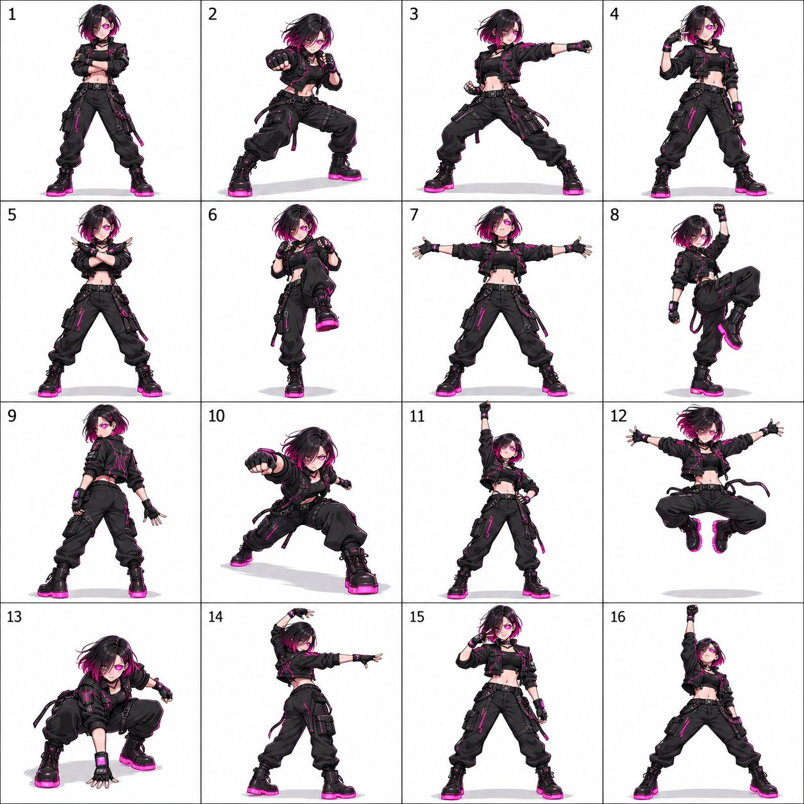

# Cyberpunk Hacker 4×4 Dance Pose Sheet

**中文标题：** 赛博朋克黑客 4×4 舞蹈姿势表  
**ID:** `gi25-x-712` · **Mode:** `generate`  
**Categories:** `character-consistency`  
**Tags:** `x-twitter`, `community`, `gpt-image-2.5`, `x-direct`, `en`



### Cyberpunk Hacker 4×4 Dance Pose Sheet

```text
Create a 4×4 dance pose sheet featuring one original character, with exactly 16 equally sized panels in one square image.

CHARACTER DESIGN
Design a sharp cyberpunk hacker with an asymmetrical black-and-magenta bob, one glowing cybernetic eye, a fitted black tactical jacket with circuit-pattern accents, fingerless tech gloves with small screen displays, cargo pants, and chunky boots with neon soles. Keep her exact face, hairstyle, colors, proportions, outfit, and accessories fully consistent across all 16 panels — no redesigns, recolors, or costume changes between panels.

ART STYLE
Render in 2D anime, high-contrast cel-shading with neon rim light, with crisp outlines and consistent lighting across every panel.

CHOREOGRAPHY
Design a cohesive 16-pose dance sequence with a clear beginning, build-up, climax, and ending, ordered left to right, top to bottom. Include: an opening pose that establishes personality; a small rhythmic step with a coordinated arm gesture; a side step with one arm extended; a compact expressive gesture near the face; a grounded stance with arms crossing or sweeping inward; a knee lift or weight shift; an open expansive pose with arms spread; a playful balance pose; a turning pose showing a three-quarter rear view; a forward-reaching diagonal lean; a strong upward-reaching accent; a climactic jump (or full-body extension if jumping doesn't suit the character); a lowered stance with a forward gesture; a dynamic side-facing transition; a signature gesture unique to the character; and a confident final pose with a clear finishing silhouette.

COMPOSITION
Use a clean white background, thin grid lines, and small readable numbers 1–16 in the upper-left corner of each panel. One full-body depiction of the character per panel, consistent scale, camera distance, lighting, and rendering style throughout. Fixed camera angle while the character turns naturally. Keep the entire character — hair, hands, feet, wings, tails, and accessories — inside each panel with comfortable margins, with subtle ground shadows and natural secondary movement in hair and fabric.

AVOID
Repeated or near-identical poses, identity drift, costume changes, inconsistent proportions, extra or missing limbs, malformed hands, cropped body parts, overlapping panels, additional characters, motion trails, background scenery, unlisted props, speech bubbles, and watermarks.

Final output: one polished square image, a clearly organized 4×4 grid of 16 distinct, character-appropriate dance poses.
Video Prompt (Seedance)
Copy
Use this sheet for character appearance and choreography. Follow poses 1→16 from left to right, top to bottom, connecting them into one continuous dance.

Create a continuous 2D anime, high-contrast cel-shading with neon rim light animation of the character from the reference sheet, dancing in a plain white space. Preserve her exact face, hairstyle, colors, proportions, outfit, and accessories, matching the reference precisely in every frame. Keep her identity fully consistent throughout.

Her performance is sleek, controlled, and quietly intense, like every move is calculated.

Use a fixed front-facing camera in one uninterrupted full-body shot. Start immediately in pose 1. Keep her entire silhouette — including hands, hair, wings/tail if present, and feet — inside the frame with comfortable white margins. A soft light-gray oval shadow grounds her on the floor and remains during jumps.

The grid defines choreography order only. Show one character in one continuous space. No reference sheet, split screens, borders, numbers, captions, duplicate figures, afterimages, cuts, or camera movement.

Each numbered pose occupies 0.5 seconds (16 poses = 8 seconds total). Clearly articulate each pose's silhouette, then transition through natural movement into the next. Maintain continuous anatomy and weight transfer: feet push off and land, joints absorb impact, hips and shoulders guide turns. Hair, clothing, and accessories follow with slightly delayed motion. Avoid slideshow transitions, morphing, foot sliding, or sudden changes in limb position.

0.0–0.5s — Pose 1: She stands tall with feet shoulder-width apart, arms crossed over the chest, sharp confident gaze; uncrosses the arms and drops into a ready stance.
0.5–1.0s — Pose 2: She snaps into a low guarded stance with one fist forward, weight on the back leg; pushes off, driving one knee up.
1.0–1.5s — Pose 3: She strikes a wide power stance with one arm punched out to the side and the other pulled back at the hip; recoils and pivots the torso.
1.5–2.0s — Pose 4: She snaps the head and gaze toward camera, one hand raised near the temple in a sharp gesture; lowers the hand and steps wide.
2.0–2.5s — Pose 5: She crosses both forearms in an X-block in front of the chest, weight centered, elbows sharp; snaps the arms open and outward.
2.5–3.0s — Pose 6: She drives one knee up in an explosive step, both fists guarding the chest; plants the foot hard, transferring weight forward.
3.0–3.5s — Pose 7: She spreads both arms wide at shoulder height, chest open, chin lifted in a commanding presence; sweeps the arms down and inward.
3.5–4.0s — Pose 8: She pivots onto one leg with the opposite knee lifted, one fist raised overhead in triumph; lowers the leg and preps a spin.
4.0–4.5s — Pose 9: She spins into a three-quarter rear view with one arm trailing behind, looking back sharply over the shoulder; continues rotating back to the front.
4.5–5.0s — Pose 10: She lunges forward low with one arm punched straight ahead and the other braced back for balance; pushes back to standing.
5.0–5.5s — Pose 11: She reaches one arm straight overhead in a strong vertical line, the other braced at the hip; gathers energy as the knees bend to load a jump.
5.5–6.0s — Pose 12: She performs an explosive jump with both knees driving up and the arms thrown wide in a dynamic shape; lands hard but controlled, absorbing through both knees.
6.0–6.5s — Pose 13: She lands in a low crouch with one fist grounded, eyes up toward camera; rises slowly, shifting weight to one side.
6.5–7.0s — Pose 14: She rotates into a side-facing stance with one arm sweeping overhead and the other locked straight out to the side; rotates back to face camera.
7.0–7.5s — Pose 15: She snaps into a sharp signature pose (a salute, a fist to the chest, or a raised hand), holds briefly; releases into the final setup.
7.5–8.0s — Pose 16: She finishes in a wide, grounded power stance with one arm raised in a fist or open palm toward the sky, chin lifted, unwavering gaze; holds and settles.

Complete the final pose by 7.8 seconds and hold through 8.0 seconds while her hair and clothing settle.
03
Fantasy Elf Archer
04
Mecha Pilot Power-Pose
05
RPG Game NPC Idle-to-Dance
06
Vtuber Streamer Character
07
Chibi Brand Mascot
08
Plushie Character
09
Cat-Girl Character
10
Baby Dragon Mascot
11
Emoji-Style Character
12
Pixel-Art Ret
```

- **Recommended model:** `gpt-image-2.5-sunburst`
- **Settings:** _(defaults)_
- **Source:** [community](https://x.com/MahnoorAi12/status/2098967293615382837) — @MahnoorAi12
- **License note:** Original public X post; quoted with attribution — remix with attribution
- **Notes:** Collected directly from X; prompt posted as the author's reply https://x.com/MahnoorAi12/status/2098967293615382837 to https://x.com/MahnoorAi12/status/2098967287957184997, which carries the images and names GPT Image 2.5; discovered via Bin0754/gpt-image-gallery index, prompt re-verified against the original X post; verified=True; author animated the sheet afterwards with Seedance 2.5; the original X post text ends abruptly — quoted verbatim as published
- **Preview:** `previews/gi25-x-712.jpg`
