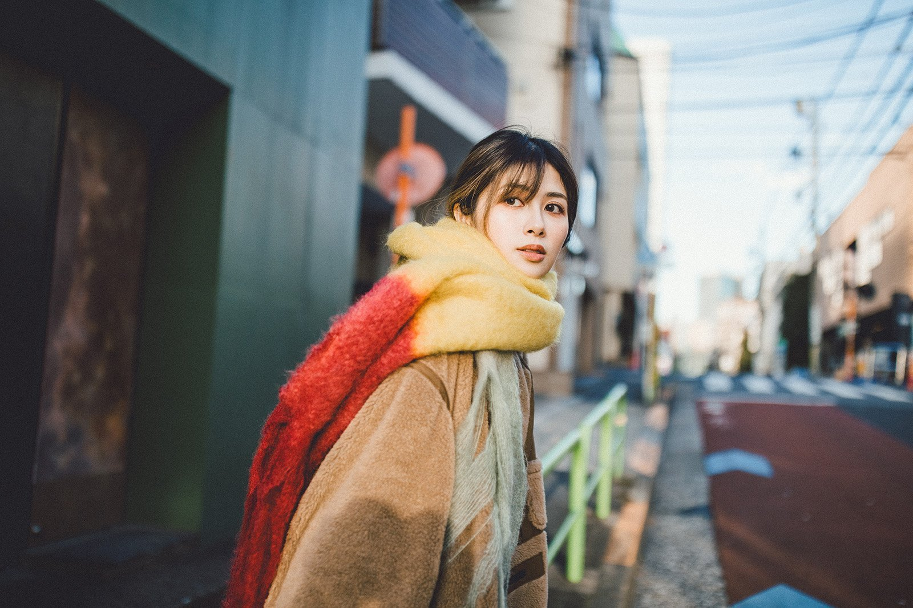

# Master-Level Black-and-White Pen Figure Sketch

**中文标题：** 大师级黑白钢笔人物手稿  
**ID:** `gi25-x-724` · **Mode:** `edit`  
**Categories:** `character-consistency`, `edit-change-preserve`  
**Tags:** `x-twitter`, `community`, `gpt-image-2.5`, `x-direct`, `zh`



### Master-Level Black-and-White Pen Figure Sketch

```text
以参考图人物为原型，保留五官特征、神态、服饰与身体姿态，去除原始背景，重新创作成大师级黑白钢笔人物手稿。采用精湛的传统钢笔绘画技法，以灵动流畅的墨线、细密交叉排线、自然断笔与大胆留白塑造人物的立体感和艺术张力。面部精细刻画，服饰线条疏密有致，局部保留起稿痕迹与随性的未完成笔触，呈现真实艺术家亲笔创作的质感。暖象牙色复古素描纸，清晰可见纸张纤维与细腻墨迹，黑白灰层次丰富。极简艺术画册排版，大面积留白，角落点缀手写签名与创作日期。整体优雅、自由、富有艺术收藏价值，拒绝数字描摹与AI滤镜感，9:16竖版高清构图。
```

- **Recommended model:** `gpt-image-2.5-sunburst`
- **Settings:** _(defaults)_
- **Source:** [community](https://x.com/MrGafish/status/2108104473235341588) — @MrGafish
- **License note:** Original public X post; quoted with attribution — remix with attribution
- **Notes:** Collected directly from X; original post https://x.com/MrGafish/status/2108104473235341588; post text names GPT Image 2.5; discovered via Bin0754/gpt-image-gallery index, prompt re-verified against the original X post; verified=True
- **Preview:** `previews/gi25-x-724.jpg`
