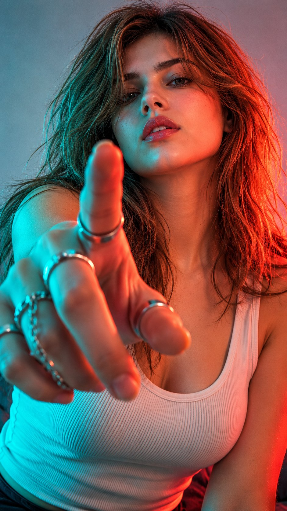

# Netflix-Style Neon Close-Up Portrait from Reference

**中文标题：** 参考图→Netflix 风霓虹特写人像  
**ID:** `gi25-x-731` · **Mode:** `edit`  
**Categories:** `character-consistency`, `edit-change-preserve`  
**Tags:** `x-twitter`, `community`, `gpt-image-2.5`, `x-direct`, `en`



### Netflix-Style Neon Close-Up Portrait from Reference

```text
Hyper-realistic IMAX-level Netflix-style cinematic neon close-up portrait, 9:16 vertical. Use the uploaded image as the primary visual reference and preserve the exact facial identity, proportions, and defining features. Create a woman wearing a fitted white sleeveless top with a simple scoop neckline, complemented by multiple silver rings with delicate chain details. She leans slightly toward the camera, extending her right hand directly into the foreground with fingers loosely curled and the index finger raised, creating dramatic foreshortening as the hand dominates the frame. Her face sits behind the hand, tilted slightly upward, with one eye partially obscured by shadow, relaxed brows, softly parted lips and an intense, confident gaze directed toward the lens. Her long, dark-brown hair falls loosely around her shoulders with a subtle side part and natural, slightly tousled waves. Fair luminous porcelain skin with a bright ivory to light beige tone and natural texture, tinted by the coloured lighting. Use an uncluttered pale background that falls softly out of focus. Strong red-orange light illuminates one side of her face, hair and shoulder, while saturated teal-cyan light washes across the hand, opposite side of her face and top, creating a bold two-tone contrast. Apply gritty cinematic colour grading with deep blacks, rich teal shadows, fiery red highlights, restrained background detail, shallow depth of field and visible fine film grain. Keep the foreground hand sharply dominant while the face remains softly focused behind it, preserving the moody, edgy editorial atmosphere. 
Negative prompt: distorted fingers, extra fingers, malformed rings, incorrect hand perspective, altered identity, plastic skin, flat lighting, text, watermark.
```

- **Recommended model:** `gpt-image-2.5-sunburst`
- **Settings:** _(defaults)_
- **Source:** [community](https://x.com/imGopalTiwari/status/2109267428387717579) — @imGopalTiwari
- **License note:** Original public X post; quoted with attribution — remix with attribution
- **Notes:** Collected directly from X; original post https://x.com/imGopalTiwari/status/2109267428387717579; post text names GPT Image 2.5; discovered via Bin0754/gpt-image-gallery index, prompt re-verified against the original X post; verified=True
- **Preview:** `previews/gi25-x-731.jpg`
