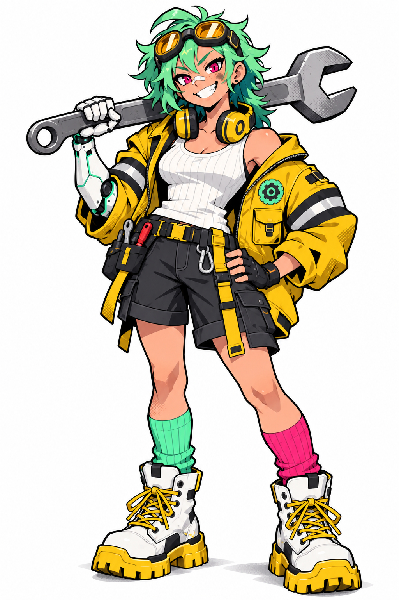

# Anime Character Design Sheet (Full Body)

**中文标题：** 动漫角色设计全身稿  
**ID:** `gi25-x-741` · **Mode:** `generate`  
**Categories:** `character-consistency`  
**Tags:** `x-twitter`, `community`, `gpt-image-2.5`, `x-direct`, `en`



### Anime Character Design Sheet (Full Body)

```text
Professional anime character design illustration. One single character, full body, standing in a relaxed three-quarter front view on a pure flat white background, the entire figure visible from the top of the head to the soles of the boots with generous white margins. Front-facing enough that the face reads clearly.

Original character "Rivet": a 19-year-old scrapyard mechanic and robot builder, tomboyish, confident, with a big crooked grin.

HEAD: a messy short wolf-cut in bright mint green with a darker teal underlayer and a few spiky flyaway strands; oversized chunky welding goggles with round amber lenses and a thick black strap pushed up on her forehead; big over-ear headphones in hazard yellow resting around her neck.
FACE: warm light skin, a constellation of freckles across the nose, a small white band-aid on the bridge of her nose, large sharp eyes with hot-pink irises, thick confident eyebrows, a wide toothy grin with one small fang, a little grease smudge on one cheek.
OUTFIT: a huge boxy padded work jacket in hazard yellow, worn slipping off her left shoulder, two horizontal black-and-silver reflective tape stripes around each sleeve, chunky utility pockets, a round mint patch with a simple gear icon on the chest; underneath a white ribbed tank top; charcoal-grey cargo shorts with yellow webbing straps and a tool belt with a few small tools; her right forearm and hand are a sleek mechanical prosthetic in glossy white ceramic panels with thin mint seam lines and black joints; a black fingerless glove on the left hand; mismatched knee socks, one mint and one hot pink; very chunky white high-top work boots with thick yellow treaded soles and fat yellow laces.
POSE: weight on one leg, left hand on hip, the white mechanical right hand resting a big oversized steel wrench on her shoulder, a slight lean toward the viewer, cocky and friendly.

STYLE: top-tier professional character designer's key illustration, the quality of a premium action game's character reveal art. Bold graphic urban anime style: thick confident black ink outlines with varied weight, flat cel colours with crisp two-tone shading, small halftone dot accents inside the shadows, sharp angular shape language, a very strong readable silhouette. Strict limited palette: hazard yellow, mint green, clean white and charcoal grey, with hot pink as the single accent. Clean, crisp, high resolution. No text, no letters, no logo, no brand marks, no signature, no watermark, no background objects, only a faint soft contact shadow under the boots.

2. Redesign
Prompt (GPT Image 2.5 Sunburst, image 1 = the design, image 2 = a Krea 2 Medium version for style):
Final redesign pass by a top professional character designer. Image 1 is the design and anatomy of Rivet: keep her pose, proportions, mint wolf-cut, amber goggles, yellow headphones, boxy hazard-yellow work jacket with reflective sleeve stripes and mint gear patch, white tank top, charcoal cargo shorts with yellow straps and tool belt, white mechanical right arm with mint seams, fingerless glove, mismatched mint and pink socks, chunky white work boots with yellow soles and laces, the big wrench on her shoulder. Image 2 is the rendering style to adopt: thick confident black ink outlines, flat bold colour fills, crisp two-tone cel shadows, small halftone dot accents, graphic poster-like shapes.

Redraw image 1 in the style of image 2. One single full-body character on a pure flat white background, three-quarter front view, the whole figure visible with white margins.

Improvements:
- Warm, saturated hazard yellow on the jacket (not neon lime), clean flat fills, no dirt texture on clothes; only one small grease smudge on her cheek.
- Face: extremely appealing and charismatic, large sharp hot-pink eyes with bright highlights, freckles, the white band-aid across her nose, a big confident toothy grin with one fang.
- Slightly stylized proportions: a touch larger head and hands, chunky boots, strong readable silhouette.
- Lineart with real weight variation, like a professional illustrator's finished character reveal art.

Strict palette: hazard yellow, mint green, clean white, charcoal grey, hot pink accent. No text, no letters, no logos, no brand marks, no watermark, only a faint contact shadow.

3. Close-up
Prompt (GPT Image 2.5 Sunburst, image 1 = the redesign):
Using image 1 as the exact character design and art style, draw a waist-up portrait of the same character, Rivet, as an animation close-up reference sheet. Front view, facing the viewer directly and making eye contact, centered, on a pure flat white background. Landscape framing: the top of her messy mint hair and the amber goggles near the top edge, cut at the waist at the bottom. Both hands held open in front of her chest, palms up, as if about to offer something: the glossy white mechanical right hand with mint seams and the left hand in a black fingerless glove; nothing in them. No wrench.

The face is large, clear and extremely charismatic: big sharp hot-pink eyes with bright highlights, thick expressive eyebrows, freckles, the white band-aid across her nose, a big confident toothy grin with one fang, a single small grease smudge on her cheek. Mint wolf-cut with teal underlayer, amber goggles pushed up on her forehead, hazard-yellow headphones around her neck, boxy hazard-yellow work jacket slipping off one shoulder with black-and-silver reflective sleeve stripes and the mint gear patch, white ribbed tank top.

Same thick black ink outlines, flat bold colour fills, crisp two-tone cel shadows and small halftone accents as image 1, professional illustrator quality. No text, no letters, no logos, no watermark.
```

- **Recommended model:** `gpt-image-2.5-sunburst`
- **Settings:** _(defaults)_
- **Source:** [community](https://x.com/Scenario_gg/status/2107487152187589002) — @Scenario_gg
- **License note:** Original public X post; quoted with attribution — remix with attribution
- **Notes:** Collected directly from X; original post https://x.com/Scenario_gg/status/2107487152187589002; post text names GPT Image 2.5; discovered via Bin0754/gpt-image-gallery index, prompt re-verified against the original X post; verified=True; post names GPT Image 2.5 Sunburst; first of the author's three passes (design pass)
- **Preview:** `previews/gi25-x-741.jpg`
