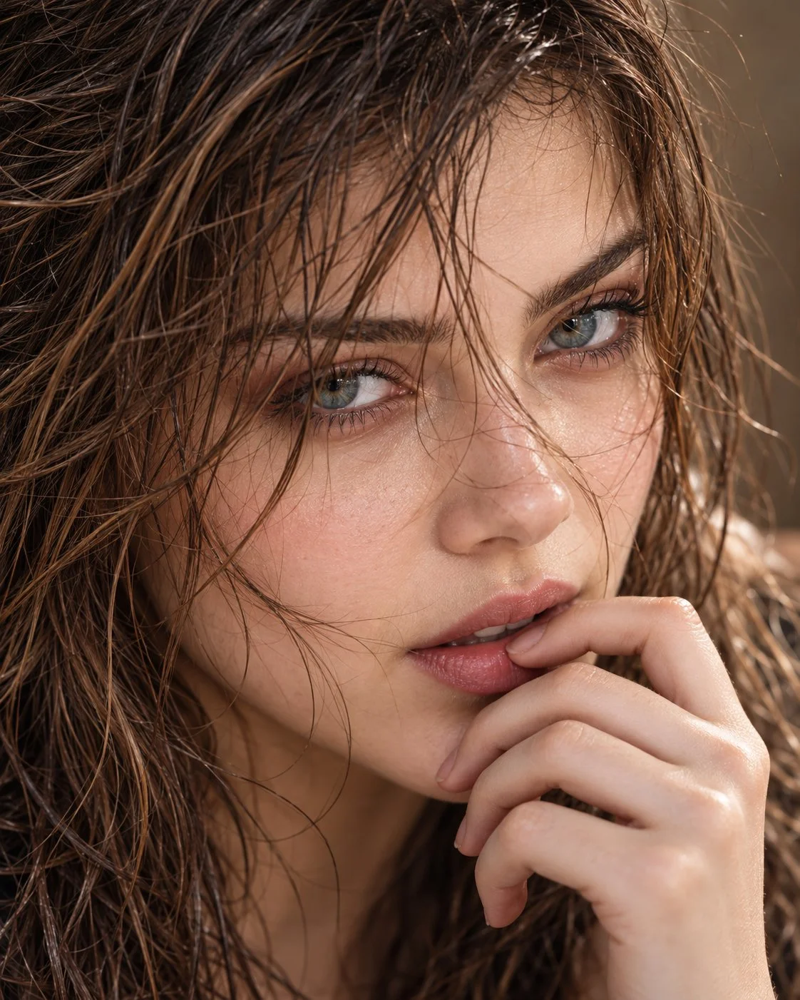

# Netflix-Style Extreme Close-Up Beauty Portrait from Reference

**中文标题：** 参考图→Netflix 风极致特写美妆人像  
**ID:** `gi25-x-753` · **Mode:** `edit`  
**Categories:** `character-consistency`, `edit-change-preserve`  
**Tags:** `x-twitter`, `community`, `gpt-image-2.5`, `x-direct`, `en`



### Netflix-Style Extreme Close-Up Beauty Portrait from Reference

```text
Hyper-realistic IMAX-level Netflix-style cinematic extreme close-up beauty portrait, 4:5 vertical. Use the uploaded image as the primary visual reference and preserve the exact facial identity, proportions, and defining features. Create a woman with her face filling almost the entire frame, her head tilted slightly downward and turned subtly sideways while her gaze lifts directly toward the camera. Her fingertips rest gently against her lower lip and chin, with naturally curved fingers. Her blue-green eyes are sharply focused and slightly narrowed beneath relaxed, defined eyebrows, framed by muted rose-red eyeshadow and softly darkened lash lines; her lips are slightly parted with a dusty-rose tint, conveying a quiet, intense, contemplative mood. Her long, dark chestnut-brown hair is visibly wet and tousled, with numerous thin, separated strands clinging to her forehead and crossing both eyebrows, partially veiling her eyelids, running over the bridge of her nose and trailing across her cheeks and lips; damp strands frame both sides of her face while heavier wet sections fall along her temples. Fair luminous porcelain skin with a bright ivory to light beige tone, neutral-cool undertones, visible natural pores and delicate moisture highlights. Soft directional light from the upper left illuminates the eyes, nose and cheekbones, while gentle shadows deepen the opposite side of her face against a blurred warm taupe background. Use muted beige skin tones, dusty rose makeup, deep chocolate-brown hair, restrained saturation and rich yet natural contrast, with subtle film grain and an intimate, moody editorial finish. Keep the eyes and wet hair strands crisp while allowing the outer edges to fall softly out of focus. Negative prompt: altered identity, dry hair, neatly arranged hair, missing facial strands, obscured eyes, unnatural eyes, plastic skin, distorted fingers, excessive sharpening, text, watermark.
```

- **Recommended model:** `gpt-image-2.5-sunburst`
- **Settings:** _(defaults)_
- **Source:** [community](https://x.com/imGopalTiwari/status/2109518829705740320) — @imGopalTiwari
- **License note:** Original public X post; quoted with attribution — remix with attribution
- **Notes:** Collected directly from X; original post https://x.com/imGopalTiwari/status/2109518829705740320; post text names GPT Image 2.5; discovered via Bin0754/gpt-image-gallery index, prompt re-verified against the original X post via api.fxtwitter.com; verified=True
- **Preview:** `previews/gi25-x-753.webp`
