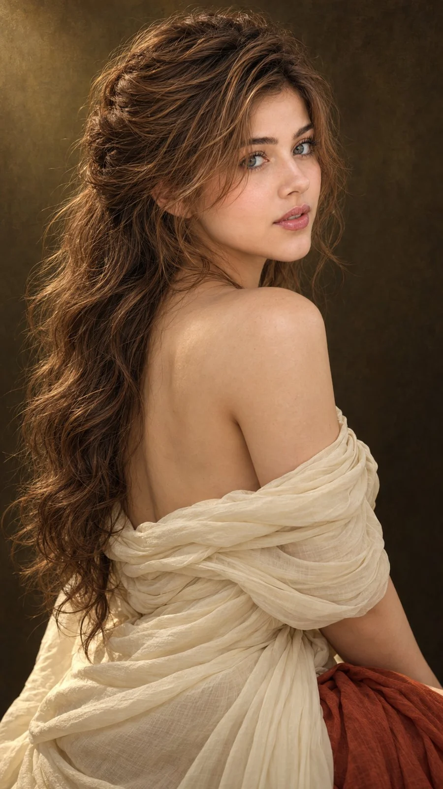

# Netflix-Style Over-the-Shoulder Fine-Art Portrait

**中文标题：** Netflix 风回眸艺术人像  
**ID:** `gi25-x-755` · **Mode:** `edit`  
**Categories:** `character-consistency`, `edit-change-preserve`  
**Tags:** `x-twitter`, `community`, `gpt-image-2.5`, `x-direct`, `en`



### Netflix-Style Over-the-Shoulder Fine-Art Portrait

```text
Hyper-realistic IMAX-level Netflix-style cinematic fine-art portrait, 9:16 vertical. Use the uploaded image as the primary visual reference and preserve the exact facial identity, proportions, and defining features. Create a woman wrapped in an ivory off-shoulder fabric dress, loosely draped around her upper arms and gathered across her torso, with a small glimpse of rust-red fabric near the bottom. Her body is turned three-quarters away from the camera, one bare shoulder and her upper back visible, while she turns her head back over her shoulder to look directly toward the viewer. Her green-hazel eyes are wide and steady beneath softly defined brows, her lips gently closed with a natural fullness, and her expression is quiet, introspective and slightly wistful. Her long, voluminous dark chestnut-brown hair is loosely swept back into a relaxed half-up arrangement, with abundant natural waves cascading down her back and fine tendrils framing her cheeks and neck. Fair luminous porcelain skin with a bright ivory to light beige tone, subtle rosy warmth, delicate natural texture and soft highlights. Set against a plain, deep olive-brown background with no distractions. Soft directional light from the upper left illuminates her face and shoulder, creating gentle chiaroscuro shadows and warm highlights in her hair. Apply a muted old-master colour grade with earthy olive shadows, antique gold highlights, restrained saturation, warm cream fabric, rich brown hair and subtle canvas-like painterly texture, preserving delicate facial details and a timeless oil-painted atmosphere. 

Negative prompt: altered identity, incorrect three-quarter pose, misplaced shoulder, distorted eyes, deformed anatomy, plastic skin, harsh saturation, text, watermark.
```

- **Recommended model:** `gpt-image-2.5-sunburst`
- **Settings:** _(defaults)_
- **Source:** [community](https://x.com/imGopalTiwari/status/2109723283876880409) — @imGopalTiwari
- **License note:** Original public X post; quoted with attribution — remix with attribution
- **Notes:** Collected directly from X; original post https://x.com/imGopalTiwari/status/2109723283876880409; post text names GPT Image 2.5; discovered via Bin0754/gpt-image-gallery index, prompt re-verified against the original X post via api.fxtwitter.com; verified=True
- **Preview:** `previews/gi25-x-755.webp`
