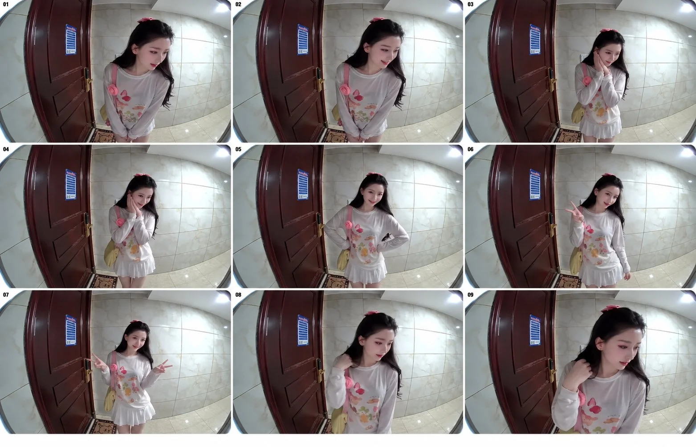

# 3×3 Photoreal Storyboard Contact Sheet from Opening Frame

**中文标题：** 首帧图→3×3 写实分镜联系表  
**ID:** `gi25-x-757` · **Mode:** `edit`  
**Categories:** `character-consistency`  
**Tags:** `x-twitter`, `community`, `gpt-image-2.5`, `x-direct`, `en`



### 3×3 Photoreal Storyboard Contact Sheet from Opening Frame

```text
Create a photorealistic 3×3 storyboard contact sheet containing exactly nine panels. Each panel is a landscape frame with an approximately 1.547:1 aspect ratio. Use narrow white gutters and small labels 01–09. Read panels left to right, top to bottom.
REFERENCE AND CHARACTER
Use the supplied opening frame as the primary reference for the same clearly adult woman, approximately 25 years old. Preserve her facial features, natural proportions, long black half-up hair and small pink bow at the crown. She wears an oversized pale gray-white long-sleeved cartoon-print shirt and a short white pleated skirt. A pink strap with a round pink accessory rests on her right shoulder, on screen-left, supporting a pale yellow bag at her right hip. Keep the face, hairstyle, clothing, skirt, strap and bag consistent in all nine panels.
CAMERA AND SETTING
Every panel comes from the same fixed, slightly elevated doorbell camera looking mildly downward. Preserve realistic wide-angle barrel distortion along the door edges and tile lines. A dark reddish-brown paneled door occupies screen-left, with a brass-colored handle and a small blue notice containing indistinct white lines. Cream marble-patterned tiles cover the wall behind her. Retain the pale floor, small cartoon doormat and ordinary upper-right ceiling light.
Use natural phone-video realism: slightly soft detail, mild compression, ordinary cool-neutral hallway lighting and broad depth of field. Keep the camera position, background geometry and lighting unchanged. Her apparent size changes only because she moves closer or farther away.
NINE PANELS
01 — Opening lean. She stands close to the camera, leaning slightly forward with relaxed shoulders and both hands loosely together low in front of her skirt. Her head and eyes angle toward screen-right; lips are gently parted.
02 — Small smile. Keep nearly the same pose and framing. A subtle friendly smile appears as she shifts her weight slightly backward. Both hands remain low.
03 — Palms beside cheek. She stands slightly farther back and brings both palms softly together beside her right cheek, on screen-left. Tilt her head gently toward the joined hands. Elbows point down, fingers align naturally, and her expression stays playful but restrained.
04 — Hold the cheek pose. Keep both palms together beside her right cheek, with a small head tilt and gentle smile. She is a little farther from the camera, revealing the white pleated skirt. No exaggerated bending or facial expression.
05 — Hands on hips. She lowers and separates her hands, placing each on its corresponding hip. Elbows open outward naturally. Her head and upper body tilt slightly toward her left, screen-right. She gives the camera a small smile.
06 — One peace sign. Her right hand, on screen-left, forms a clear V sign beside her right shoulder. The left arm rests down. Keep a slight head tilt and friendly expression. Preserve correct finger anatomy.
07 — Two peace signs. Both hands form V signs beside her upper torso, elbows softly bent and palms angled toward the camera. She faces the lens more directly with a small natural smile. Hands stay apart and do not cover the face.
08 — Shoulder touch and approach. Lower both V signs. Her right hand moves to her right shoulder and the side of her neck, lightly touching the strap or nearby hair. The left hand lowers. She begins moving closer while looking toward screen-right.
09 — Close ending pose. Her face and torso are larger because she has stepped closer and slightly toward screen-right. The right hand remains near the right shoulder or neck. Her left arm begins reaching toward something beyond the right edge. Her gaze follows that direction and her lips are slightly parted. Preserve natural near-field lens distortion.
CONTINUITY AND EXCLUSIONS
Exactly nine photographic panels showing consecutive moments of one continuous scene. Maintain the same adult identity, outfit, bag placement and room in every panel. Keep natural anatomy and five fingers per hand. No camera-angle changes, cinematic lighting, shallow-focus glamour photography, illustration, exaggerated expressions, extra people, duplicated limbs, outfit changes or floating objects. No social-media interface, playback controls, timestamps, watermarks or captions. Only the small panel numbers 01–09 may appear in the gutters.
```

- **Recommended model:** `gpt-image-2.5-sunburst`
- **Settings:** _(defaults)_
- **Source:** [community](https://x.com/listudio/status/2109501586385031567) — @listudio
- **License note:** Original public X post; quoted with attribution — remix with attribution
- **Notes:** Collected directly from X; original post https://x.com/listudio/status/2109501586385031567; post text names GPT Image 2.5; discovered via Bin0754/gpt-image-gallery index, prompt re-verified against the original X post via api.fxtwitter.com; verified=True; author used it to produce first-frame and storyboard images for video; preview is image 2 (the storyboard)
- **Preview:** `previews/gi25-x-757.webp`
