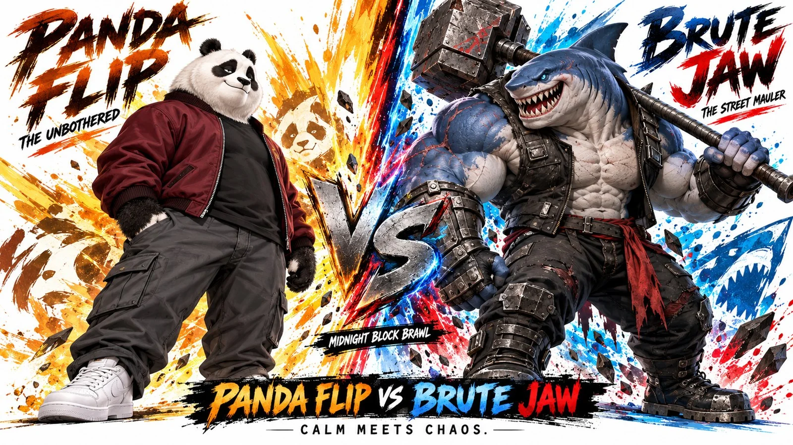

# Two-Character VS Cinematic Character Bible Sheet

**中文标题：** 双角色对决电影感角色设定表  
**ID:** `gi25-x-758` · **Mode:** `generate`  
**Categories:** `character-consistency`  
**Tags:** `x-twitter`, `community`, `gpt-image-2.5`, `x-direct`, `en`



### Two-Character VS Cinematic Character Bible Sheet

```text
Create a 16:9 premium cinematic character bible sheet for two completely original characters: PANDA FLIP and BRUTE JAW.
LAYOUT:
Create a premium split-screen VS composition with both characters in one combined image. Two halves separated by a bold dramatic central divider. Show one massive hero portrait of each character from approximately mid-thigh upward, facing slightly toward each other. Clean white background, explosive graphic splashes, beautiful character proportions, and strong visual contrast.
STYLE:
Premium cinematic cel-shaded 3D anime, Unreal Engine-quality rendering, thick expressive black outlines, bold flat color blocking, hard-edge shadows, subtle hand-painted textures, strong stylized 3D depth, vibrant but controlled colors, and cinematic fighting-game character design. Characters should feel physically dimensional with clean surfaces, exaggerated expressions, and striking silhouettes. Not photorealistic, not flat 2D, not Disney or Pixar styling.
LEFT SIDE, PANDA FLIP:
Design a lovable but surprisingly tough anthropomorphic panda with a naturally cool and laid-back personality. He has a large rounded panda head, expressive black eye patches, small rounded ears, a chunky but athletic body, slightly broad shoulders, and a relaxed confident smirk. His eyes are half-open, giving him a permanently unbothered expression. His design should be simple, memorable, and visually appealing, with a believable balance between soft, adorable features and physical strength.
OUTFIT:
Panda Flip wears a simple, slightly oversized dark burgundy bomber jacket, left unzipped over a plain black T-shirt, relaxed charcoal-gray cargo pants with minimal pocket detailing, and clean white sneakers. His outfit should feel modern, comfortable, and effortlessly stylish without looking flashy or overly decorated. No jewelry, sunglasses, hats, backpacks, excessive layers, or complicated accessories. His natural black-and-white fur pattern remains clearly visible around his face, hands, and neck.
POSE:
Panda Flip stands casually with relaxed shoulders, one hand resting inside his trouser pocket and the other hanging naturally. His posture suggests confidence without aggression. A subtle amused smile communicates that he is completely unafraid of his much larger opponent. His rounded silhouette should immediately contrast with the shark's intimidating physique.
BACKGROUND:
Behind Panda Flip, a dramatic splash of rich orange and warm golden-yellow brushstroke energy radiates outward, creating an energetic but clean composition.
Large bold brushstroke text at the top left: PANDA FLIP
Smaller text below: THE UNBOTHERED
RIGHT SIDE, BRUTE JAW:
Design a completely original giant humanoid shark brute with an enormous oversized shark head and an exceptionally broad, expressive face. His massive head should be the most defining feature of his silhouette, with an exaggerated wide jaw, thick neck, pronounced brow structure, small piercing icy-blue eyes, and a huge mouth filled with sharp triangular teeth. His expression is furious and theatrical, with a menacing grin that makes him instantly recognizable.
His body is towering and heavily muscular, featuring enormous shoulders, thick arms, a barrel-shaped torso, powerful legs, and a heavyweight fighter's physique. Deep steel-blue skin covers his head and upper body, transitioning into pale silver-gray around his jaw, chest, and abdomen.
ANATOMY:
Brute Jaw has a fully humanoid lower body with two muscular legs and two arms. His enormous shark head connects naturally to his thick neck and shoulders. He has no shark tail, no rear appendage, and no additional fins extending from his hips or lower back. Maintain a cohesive bipedal character silhouette.
OUTFIT:
Brute Jaw wears a dark sleeveless armored combat vest, heavy industrial forearm guards, rugged black trousers, and reinforced boots. A short crimson cloth accent hangs from his waist. His outfit is practical, intimidating, and battle-worn, emphasizing his enormous physique instead of covering it with excessive armor.
WEAPON:
An enormous industrial demolition sledgehammer with a long gunmetal handle and a heavy rectangular steel head. This is his only signature weapon. Its proportions should feel massive, heavy, and powerful.
POSE:
Brute Jaw stands in an aggressive forward-leaning fighting stance, gripping the giant sledgehammer over one shoulder. His enormous shark face is turned toward Panda Flip, mouth open in an intimidating tooth-filled grin. His expression conveys overwhelming arrogance and explosive aggression.
BACKGROUND:
Behind Brute Jaw, an explosive splash of deep ocean blue, crimson, and electric cyan energy radiates outward with subtle metallic fragments.
Large bold brushstroke text at the top right: BRUTE JAW
Smaller text below: THE STREET MAULER
CENTER:
A huge dramatic metallic VS emblem separates both characters, surrounded by stylized sparks and contrasting color streaks.
Small subtitle underneath: MIDNIGHT BLOCK BRAWL
BOTTOM CENTER:
Large bold title: PANDA FLIP VS BRUTE JAW
Smaller tagline: CALM MEETS CHAOS.
OVERALL ART DIRECTION:
Create a high-end cinematic character matchup poster with premium anime fighting-game aesthetics, striking graphic composition, bold stylized shading, crisp black outlines, polished three-dimensional characters, and vivid but balanced color grading. Panda Flip should appear relaxed, slightly chunky, approachable, and effortlessly cool, while Brute Jaw should feel enormous, aggressive, and terrifyingly powerful.
Keep both characters visually simple enough for consistent 3D animation across multiple camera angles. Every costume element, facial feature, body proportion, and weapon must remain easily recognizable. Beautiful cinematic lighting, premium stylized materials, subtle film grain, and sharp 4K-quality presentation.
```

- **Recommended model:** `gpt-image-2.5-sunburst`
- **Settings:** _(defaults)_
- **Source:** [community](https://x.com/HeyAbhishek/status/2109631228039344139) — @HeyAbhishek
- **License note:** Original public X post; quoted with attribution — remix with attribution
- **Notes:** Collected directly from X; original post https://x.com/HeyAbhishek/status/2109631228039344139; post text names GPT Image 2.5; discovered via Bin0754/gpt-image-gallery index, prompt re-verified against the original X post via api.fxtwitter.com; verified=True
- **Preview:** `previews/gi25-x-758.webp`
