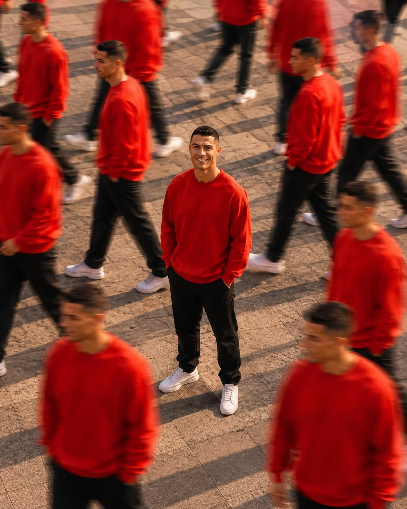

# Clone-Crowd Urban Plaza Editorial Photo

**中文标题：** 城市广场分身人群编辑大片  
**ID:** `gi25-x-773` · **Mode:** `edit`  
**Categories:** `character-consistency`  
**Tags:** `x-twitter`, `community`, `gpt-image-2.5`, `x-direct`, `en`



### Clone-Crowd Urban Plaza Editorial Photo

```text
Create a photorealistic cinematic editorial photograph of a young adult man standing confidently at the exact center of a large outdoor urban plaza with tiled pavement. He has short dark hair, a clean-shaven face, a subtle natural smile, and is looking directly at the camera. He is wearing a simple bright red crewneck sweatshirt, loose black pants, and clean white sneakers, with both hands casually inside his pockets.
Surround the central man with multiple identical versions of the same man wearing the exact same red sweatshirt, black pants, and white sneakers. The surrounding duplicates are walking naturally in different directions, captured with realistic motion blur, while the central subject remains completely sharp and perfectly in focus.
Create a convincing long-exposure / time-slice photography effect, as if many versions of the same person are moving around one stationary subject. Keep the central person's face, hairstyle, clothing, body proportions, and facial features consistent with the reference image.
Camera positioned at a slightly elevated overhead angle, centered composition, realistic perspective, warm late-afternoon sunlight, natural shadows, detailed tiled pavement, cinematic depth of field, subtle film grain, professional fashion photography, ultra-realistic skin and fabric textures, realistic motion blur, 4K detail.
Important: The central subject must remain sharp and unobstructed. Every surrounding duplicate should clearly appear to be the same person. No distorted faces, extra arms, extra legs, fused bodies, warped clothing, unnatural poses, or duplicated body parts. Vertical 4:5 composition.
```

- **Recommended model:** `gpt-image-2.5-sunburst`
- **Settings:** _(defaults)_
- **Source:** [community](https://x.com/Alina_with_Ai/status/2100904099961274384) — @Alina_with_Ai
- **License note:** Original public X post; quoted with attribution — remix with attribution
- **Notes:** Collected directly from X; prompt posted as the author's reply https://x.com/Alina_with_Ai/status/2100904099961274384 to https://x.com/Alina_with_Ai/status/2100904092621328893, which carries the images and names GPT Image 2.5; discovered via Bin0754/gpt-image-gallery index, prompt re-verified against the original X post via api.fxtwitter.com; verified=True; this is the author's second prompt in the thread (male version) — preview is image 2
- **Preview:** `previews/gi25-x-773.webp`
