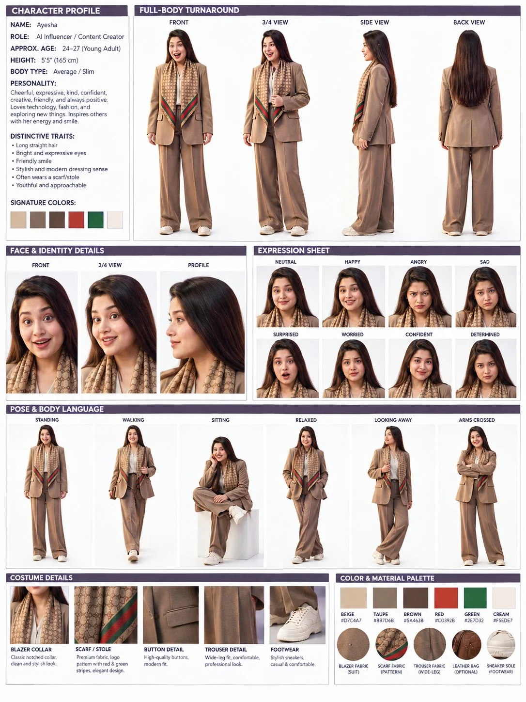

# Female Character Profile & Turnaround Sheet from Reference

**中文标题：** 参考图→女性角色档案与转面设定表  
**ID:** `gi25-x-774` · **Mode:** `edit`  
**Categories:** `character-consistency`  
**Tags:** `x-twitter`, `community`, `gpt-image-2.5`, `x-direct`, `en`



### Female Character Profile & Turnaround Sheet from Reference

```text
Create a professional high-resolution female character profile and turnaround sheet based on the reference image. Keep the same young woman’s facial features, long straight dark hair, expressive eyes, friendly smile, body proportions, beige/taupe oversized suit, cream top, patterned scarf with red and green stripes, and white sneakers consistent across every panel.
Include full-body front, 3/4, side and back views, face details from front/3/4/profile, an expression sheet with neutral, happy, angry, sad, surprised, worried, confident and determined expressions, plus poses including standing, walking, sitting, relaxed, looking away and arms crossed.
Add detailed costume close-ups of the blazer, scarf, buttons, trousers and shoes, followed by a color and material palette matching beige, taupe, brown, red, green and cream. Clean white background, professional grid layout, thin borders, elegant purple headers, realistic 3D character rendering, consistent identity, sharp details, cinematic studio lighting, premium character-design concept sheet, 4K.
```

- **Recommended model:** `gpt-image-2.5-sunburst`
- **Settings:** _(defaults)_
- **Source:** [community](https://x.com/Adnan_Ai2/status/2102721002644148474) — @Adnan_Ai2
- **License note:** Original public X post; quoted with attribution — remix with attribution
- **Notes:** Collected directly from X; prompt posted as the author's reply https://x.com/Adnan_Ai2/status/2102721002644148474 to https://x.com/Adnan_Ai2/status/2102720999066329349, which carries the images and names GPT Image 2.5; discovered via Bin0754/gpt-image-gallery index, prompt re-verified against the original X post via api.fxtwitter.com; verified=True; first of the author's prompts in the thread (Prompt1)
- **Preview:** `previews/gi25-x-774.webp`
