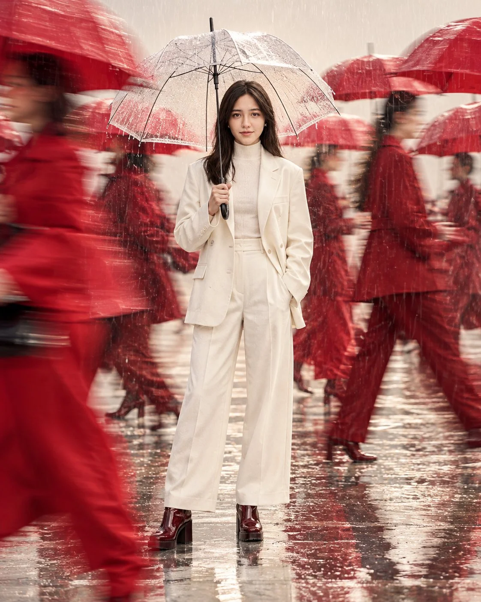

# Rainy-Day Luxury Fashion Editorial (JSON Prompt)

**中文标题：** 雨天奢华时装大片（JSON 提示词）  
**ID:** `gi25-x-780` · **Mode:** `edit`  
**Categories:** `character-consistency`  
**Tags:** `x-twitter`, `community`, `gpt-image-2.5`, `x-direct`, `en`



### Rainy-Day Luxury Fashion Editorial (JSON Prompt)

```text
"task": "image_generation",
"style": "Ultra-photorealistic luxury fashion editorial, cinematic rainy-day photography, slow-shutter motion photography",
"aspect_ratio": "4:5",

"scene": {
"environment": {
"location": "Minimalist ivory-white fashion photography studio with a realistic rainy atmosphere",
"background": "Seamless warm off-white backdrop with subtle cool-gray haze",
"floor": "Pale ivory floor covered with a thin layer of rainwater and delicate reflections",
"atmosphere": "Elegant, cinematic, surreal, sophisticated and contemporary",
"color_palette": [
"Ivory white",
"Warm cream",
"Crimson red",
"Deep burgundy",
"Cool gray",
"Transparent glass"
]
},

"main_subject": {  
  "subject": "Young adult woman",  
  "position": "Standing upright precisely in the center of the frame",  
  "pose": "Confident natural standing pose with both feet firmly planted on the wet floor, legs slightly apart, shoulders relaxed and back straight",  
  "expression": "Serious, composed and quietly confident",  
  "gaze": "Direct eye contact with the camera",  
  "movement": "Completely motionless while the crowd moves around her",  

  "hair": {  
    "color": "Dark brown",  
    "style": "Straight, sleek, center-parted bob ending at the jawline",  
    "details": "Natural individual strands with subtle highlights"  
  },  

  "outfit": {  
    "jacket": "Oversized ivory-white structured blazer with a high stand collar and elegant beige buttons",  
    "innerwear": "Simple high-neck ivory top",  
    "trousers": "Loose cream tailored trousers with realistic fabric folds",  
    "boots": "Glossy deep burgundy-red ankle boots with chunky platform soles",  
    "styling": "Sophisticated minimalist luxury fashion with no visible logos"  
  },  

  "umbrella": {  
    "type": "Large transparent dome umbrella",  
    "material": "Crystal-clear waterproof canopy with a slim black frame",  
    "position": "Held naturally overhead in one hand",  
    "angle": "Slightly tilted forward to protect her from the rain",  
    "details": "Clearly visible individual raindrops on the canopy, realistic water trails, delicate droplets along the edges and soft reflections of studio lighting",  
    "visibility": "The transparent canopy must remain visible without covering or distorting her face"  
  },  

  "body_details": {  
    "posture": "Fully upright with anatomically correct proportions",  
    "hands": "Natural realistic fingers holding the umbrella handle, free hand relaxed at her side",  
    "feet": "Both boots fully visible and touching the floor",  
    "focus": "Face, clothing, hands and umbrella handle remain sharply detailed"  
  }  
},  

"background_models": {  
  "quantity": "Six adult fashion models",  
  "action": "Walking briskly in opposite directions through the rain around the central woman",  
  "wardrobe": [  
    "Vivid crimson-red trench coats",  
    "Burgundy tailored suits",  
    "Scarlet oversized outerwear",  
    "Deep-red flowing fashion outfits",  
    "Muted charcoal-gray coats"  
  ],  

  "umbrellas": {  
    "style": "Large vivid crimson-red and deep-burgundy umbrellas",  
    "quantity": "Several umbrellas distributed throughout the moving crowd",  
    "details": "Realistic wet fabric, visible umbrella ribs and subtle rain reflections",  
    "movement": "Umbrellas tilt naturally as people walk, creating diagonal red shapes across the composition"  
  },  

  "motion_effect": "Pronounced horizontal and diagonal long-exposure motion blur across moving models and red umbrellas",  
  "movement_pattern": "Some figures cross from left to right while others move in the opposite direction, creating layered motion trails",  
  "rain_effect": "Fine visible rain streaks with realistic direction, varying lengths and delicate highlights",  
  "foreground": "One red umbrella and a crimson-clad passerby sweep across the lower-left foreground in strong motion blur",  
  "background_depth": "Several additional blurred silhouettes and umbrellas recede into the soft gray atmosphere",  
  "contrast": "The central woman remains perfectly still and sharply focused while all surrounding people appear in motion"  
}

},

"composition": {
"framing": "Full-body vertical fashion editorial portrait",
"camera_angle": "Straight-on at standing eye level",
"subject_scale": "The central woman occupies approximately 75 percent of the image height",
"composition": "Balanced symmetrical central framing",
"negative_space": "Generous clean ivory space around the central figure",
"foreground": "Blurred red umbrella partially entering the lower-left edge",
"background": "Layered crimson umbrellas and moving figures at different distances",
"visual_hierarchy": "The white-clad woman and transparent umbrella form the sharp central focal point",
"color_contrast": "Crisp ivory clothing contrasts strongly against vivid red umbrellas",
"footwear_visibility": "Show the complete subject from the top of her head to the soles of both boots",
"reflection_details": "Subtle reflections of red umbrellas and moving silhouettes on the wet floor"
},

"lighting": {
"setup": "Large diffused professional studio softbox",
"direction": "Soft frontal illumination with gentle side lighting",
"quality": "Creamy high-key light mixed with cool rainy-day ambience",
"highlights": "Delicate highlights on raindrops, transparent umbrella, white blazer and glossy burgundy boots",
"shadows": "Natural contact shadows beneath both boots",
"reflections": "Realistic but subtle wet-floor reflections",
"exposure": "Bright and controlled, preserving fine details in white clothing",
"color_separation": "Accurate crimson-red umbrellas against a neutral ivory environment"
},

"camera": {
"type": "Professional full-frame camera",
"lens": "50mm lens",
"aperture": "f/2.8",
"shutter_effect": "Cinematic slow-shutter exposure with strong motion blur on moving background models while preserving sharp focus on the central woman",
"focus": "Tack-sharp focus on the woman's eyes, face and clothing",
"depth_of_field": "Shallow depth of field with natural optical separation",
"rendering": "Realistic rain streaks, natural motion trails and subtle cinematic film grain"
},

"quality": {
"resolution": "4K",
"realism": "Ultra-photorealistic",
"textures": "Detailed skin pores, natural hair strands, woven fabric, transparent wet umbrella, water droplets and polished leather",
"anatomy": "Natural human proportions and anatomically correct hands",
"finish": "Premium international luxury fashion magazine campaign"
},

"negative_prompt": [
"Sitting",
"Crouching",
"Kneeling",
"Chair",
"Pedestal",
"Cropped feet",
"Floating boots",
"Opaque umbrella",
"Umbrella covering the face",
"Deformed umbrella",
"Floating umbrella",
"Unrealistic rain",
"Excessive water splashes",
"Cartoon",
"Anime",
"Illustration",
"CGI appearance",
"Plastic skin",
"Over-smoothed face",
"Distorted anatomy",
"Extra fingers",
"Malformed hands",
"Duplicated central woman",
"Sharp background models",
"White umbrellas dominating the crowd",
"Red outfit on the central woman",
"Overexposed white clothing",
"Excessive saturation",
"Unnatural motion blur",
"Messy composition",
"Text",
"Watermark",
"Logos",
"Low resolution"
]
}
```

- **Recommended model:** `gpt-image-2.5-sunburst`
- **Settings:** _(defaults)_
- **Source:** [community](https://x.com/AiwithLariab/status/2109602487179133355) — @AiwithLariab
- **License note:** Original public X post; quoted with attribution — remix with attribution
- **Notes:** Collected directly from X; prompt posted as the author's reply https://x.com/AiwithLariab/status/2109602487179133355 to https://x.com/AiwithLariab/status/2109602481198305536, which carries the images and names GPT Image 2.5; discovered via Bin0754/gpt-image-gallery index, prompt re-verified against the original X post via api.fxtwitter.com; verified=True; structured JSON prompt
- **Preview:** `previews/gi25-x-780.webp`
