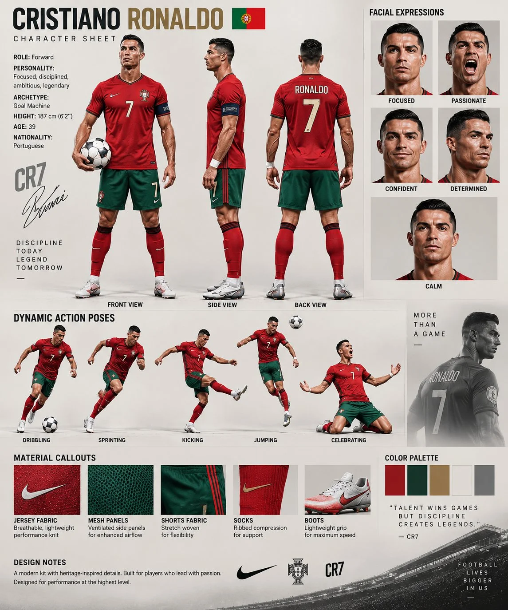

# Cristiano Ronaldo Cinematic Character Bible Sheet

**中文标题：** C罗电影感角色设定圣经表  
**ID:** `gi25-x-782` · **Mode:** `edit`  
**Categories:** `character-consistency`  
**Tags:** `x-twitter`, `community`, `gpt-image-2.5`, `x-direct`, `en`



### Cristiano Ronaldo Cinematic Character Bible Sheet

```text
Create an ultra-realistic, professional cinematic CHARACTER REFERENCE SHEET featuring ONLY Cristiano Ronaldo as the main subject.

Use the uploaded reference image as the PRIMARY SOURCE OF TRUTH for Cristiano Ronaldo’s appearance and identity. Preserve his recognizable facial structure, hairstyle, skin tone, athletic body proportions, and overall appearance consistently across every panel.

CHARACTER:
Name: Cristiano Ronaldo
Age: 39
Nationality: Portuguese
Height: 187 cm (6'2")
Position: Forward
Archetype: Goal Machine
Personality: Focused, disciplined, ambitious, competitive, legendary

IDENTITY LOCK:
The same Cristiano Ronaldo must appear in every panel.
Maintain consistent face, eyes, eyebrows, nose, lips, jawline, hairstyle, skin texture, muscular athletic physique and age.
No identity drift, no different person, no altered facial structure.

OUTFIT:
Use a realistic modern Portugal national football kit:
- Red short-sleeve football jersey
- Green football shorts
- Red knee-high football socks
- White professional football boots with subtle blue/red details
- Jersey number 7
- Captain's armband
- Authentic football fabric, stitching, mesh panels and realistic clothing texture

MAIN CHARACTER TURNAROUND:
Show ONLY Cristiano Ronaldo in three full-body views:
1. Front view holding a football naturally in one hand
2. Left side profile
3. Back view showing "RONALDO" and number "7"

All three views must show the exact same person, outfit, hairstyle, body proportions and facial identity.

FACIAL EXPRESSIONS:
Add five close-up portraits of Cristiano Ronaldo:
- Focused
- Passionate / shouting
- Confident smile
- Determined
- Calm

Every facial portrait must clearly remain the same Cristiano Ronaldo.

DYNAMIC FOOTBALL POSES:
Add realistic action panels showing Cristiano Ronaldo:
- Dribbling with a football
- Sprinting at full speed
- Powerful shot/kick
- Jumping for a header
- Iconic goal celebration with arms extended

Keep anatomy realistic, athletic and physically believable.

EQUIPMENT / MATERIAL CALLOUTS:
Include small professional detail panels showing:
- Red jersey fabric
- Ventilated mesh panels
- Green shorts fabric
- Ribbed football socks
- White football boots
- Match football

COLOR PALETTE:
Red, deep green, white, gold, black and neutral gray.

DESIGN:
Premium professional football character-development sheet.
Warm off-white studio background.
Clean editorial grid.
Professional labels.
Elegant typography.
Fine divider lines.
Subtle Portuguese football/stadium elements.
Cinematic studio lighting.
Soft realistic shadows.
Photorealistic skin texture.
Visible pores.
Detailed hair strands.
Accurate hands and fingers.
Realistic fabric folds.
Ultra-sharp details.
High dynamic range.
8K photorealistic quality.

IMPORTANT:
Do NOT include Elena Moretti.
Do NOT include any female character.
Do NOT create a two-character comparison.
Do NOT split the sheet between two people.
The entire character sheet must be dedicated ONLY to Cristiano Ronaldo.

FINAL RESULT:
A premium AAA-game-quality Cristiano Ronaldo football character reference sheet combining:
full-body turnaround + facial expressions + football action poses + equipment details + material callouts + color palette + professional character information.

Make it look like an authentic high-end professional sports character bible, not a generic AI collage.
```

- **Recommended model:** `gpt-image-2.5-sunburst`
- **Settings:** _(defaults)_
- **Source:** [community](https://x.com/Alina_with_Ai/status/2101991381413892150) — @Alina_with_Ai
- **License note:** Original public X post; quoted with attribution — remix with attribution
- **Notes:** Collected directly from X; prompt posted as the author's reply https://x.com/Alina_with_Ai/status/2101991381413892150 to https://x.com/Alina_with_Ai/status/2101991375806038065, which carries the images and names GPT Image 2.5; discovered via Bin0754/gpt-image-gallery index, prompt re-verified against the original X post via api.fxtwitter.com; verified=True; verified reply text (gallery had a longer concatenated variant)
- **Preview:** `previews/gi25-x-782.webp`
