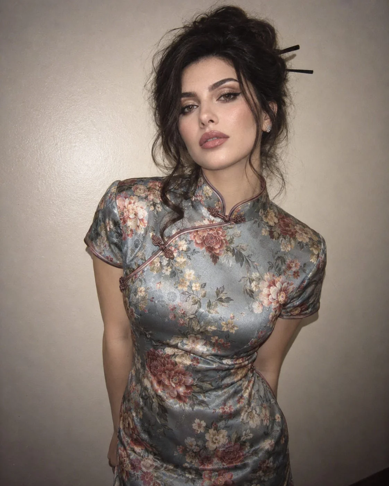

# Ultra-Realistic Nostalgic Portrait — Exact Girl Preserved

**中文标题：** 超写实怀旧人像（精确保留女孩身份）  
**ID:** `gi25-x-787` · **Mode:** `edit`  
**Categories:** `character-consistency`, `edit-change-preserve`  
**Tags:** `x-twitter`, `community`, `gpt-image-2.5`, `x-direct`, `en`



### Ultra-Realistic Nostalgic Portrait — Exact Girl Preserved

```text
Ultra-Realistic Nostalgic Portrait — Preserve the Exact Girl from the Reference Photo

Use the uploaded reference photo as the exact identity reference for the girl. Preserve her original face, facial structure, eye shape and color, eyebrows, nose, lips, skin tone, freckles (if present), natural skin texture, and all distinctive facial features. Keep her instantly recognizable as the same person. Do not change her identity, beautify her into a different person, or replace her face with a generic East Asian model. Adapt only the hairstyle, outfit, pose, lighting, and photographic aesthetic described below.

Create an ultra-realistic candid portrait of the same girl photographed indoors with a nostalgic early-2000s digital-camera aesthetic. She stands against a simple, warm off-white wall, looking slightly downward and toward the camera with a calm, soft, dreamy expression.

HAIRSTYLE

Style her hair into an elegant, traditional-inspired high updo, with voluminous hair gathered at the back and secured with two simple dark hair sticks extending horizontally. Add loose, softly curled tendrils framing both sides of her face, along with delicate flyaways around the crown and temples. Preserve her recognizable hairline and natural facial proportions. Render individual strands, realistic shine, and slight imperfections for an authentic personal-photograph appearance.

MAKEUP

Use refined, feminine makeup with softly defined brows, subtle warm-brown eyeshadow, delicate eyeliner, naturally flushed cheeks, and glossy muted-rose lips. Keep the girl's original eye shape, eye color, facial features, and skin tone unchanged. Retain realistic pores, natural texture, and subtle imperfections. Avoid excessive smoothing or artificial beauty filters.

OUTFIT

Dress her in a beautifully tailored, vintage-inspired Chinese floral qipao (cheongsam) in muted dusty blue-gray. The dress should feature:

- A delicate Mandarin collar and modest curved neckline.
- Short, fitted sleeves and a flattering, elegant silhouette.
- Traditional diagonal front closure with subtle decorative frog buttons.
- Soft satin-like fabric with realistic folds and gentle flash reflections.
- An intricate multicolored floral pattern featuring peonies, roses, and smaller blossoms in dusty pink, burgundy, cream, pale yellow, sage green, and muted coral.

The garment should feel authentic, sophisticated, and vintage-inspired, with realistic fabric construction rather than a theatrical costume.

POSE AND EXPRESSION

She stands naturally with both arms relaxed alongside her body. Her shoulders are slightly angled away from the camera, while her head tilts subtly downward and to one side. Her gaze meets the camera with a quiet, composed, introspective expression. Her lips remain naturally relaxed, without an exaggerated smile.

Keep her posture anatomically natural and believable, with realistic shoulders, arms, hands, and body proportions.

LIGHTING AND ENVIRONMENT

Recreate the appearance of a compact digital camera using direct on-camera flash in a dim indoor environment. The flash softly illuminates her face, creates natural catchlights in her eyes, highlights the satin fabric, and casts a subtle shadow onto the plain wall behind her. Use slightly cool flash illumination against the warmer ivory background, with gentle light falloff toward the edges.

Avoid professional studio lighting, dramatic cinematic spotlights, or overly polished fashion photography.

PHOTOGRAPHIC AESTHETIC

Authentic early-2000s personal digital-camera photography, 35mm-equivalent lens, slight wide-angle perspective, direct flash, subtle digital noise, mild highlight bloom, gentle lens softness, slightly muted colors, modest chromatic aberration, and imperfect exposure. Maintain crisp facial identity and convincing anatomical detail while preserving the imperfect, nostalgic quality of an old personal photograph.

COMPOSITION

Vertical 4:5 portrait, framed from approximately the hips upward. Position her slightly off-center, leaving generous negative space around her head and shoulders. Keep the simple warm off-white wall visible, allowing the colorful floral dress and elegant dark hairstyle to stand out naturally.

COLOR PALETTE

Dusty blue-gray, muted burgundy, faded rose pink, cream, sage green, pale yellow, deep black hair, and warm ivory.

FINAL RESULT

An incredibly realistic, candid portrait of the exact same girl from the uploaded reference photo, styled in an elegant traditional-inspired floral qipao with a graceful updo. The image should feel like a genuine photograph discovered in a personal photo archive from the early 2000s: feminine, romantic, nostalgic, quietly mysterious, and naturally imperfect.

STRICT NEGATIVE CONSTRAINTS: Do not change the girl's identity or facial features. No face replacement, no different person, no artificial facial reconstruction, no plastic skin, no excessive retouching, no exaggerated makeup, no distorted hands, no extra fingers, no malformed limbs, no unrealistic fabric, no cartoon effects, no CGI appearance, no studio-campaign aesthetic, and no artificial AI-generated look.
```

- **Recommended model:** `gpt-image-2.5-sunburst`
- **Settings:** _(defaults)_
- **Source:** [community](https://x.com/mehvishs25/status/2110026202903888256) — @mehvishs25
- **License note:** Original public X post; quoted with attribution — remix with attribution
- **Notes:** Collected directly from X; original post https://x.com/mehvishs25/status/2110026202903888256; post text names GPT Image 2.5; discovered via Bin0754/gpt-image-gallery index, prompt re-verified against the original X post via api.fxtwitter.com; verified=True
- **Preview:** `previews/gi25-x-787.webp`
