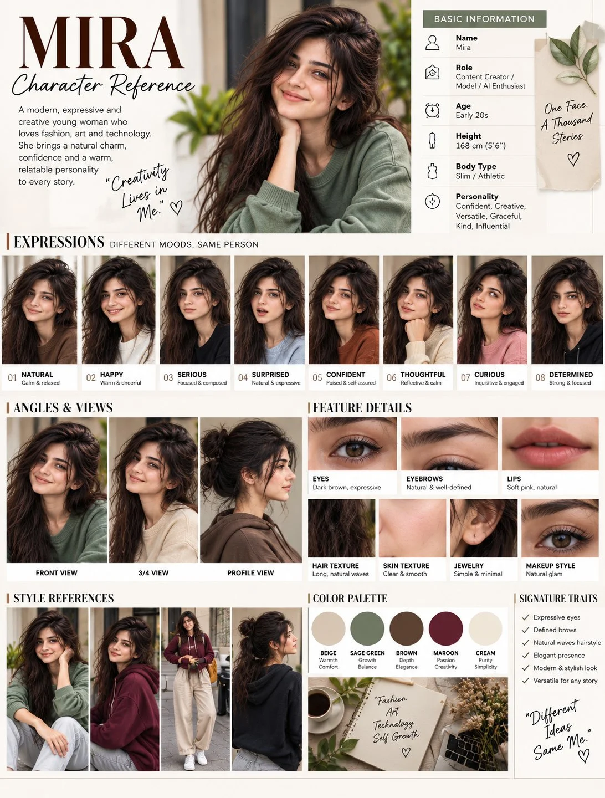

# “MIRA” Premium AI Character Reference Sheet

**中文标题：** 「MIRA」高端 AI 角色参考设定表  
**ID:** `gi25-x-789` · **Mode:** `generate`  
**Categories:** `character-consistency`  
**Tags:** `x-twitter`, `community`, `gpt-image-2.5`, `x-direct`, `en`



### “MIRA” Premium AI Character Reference Sheet

```text
Create a premium, highly detailed AI character reference sheet for a young woman named “MIRA”.

Character:
A modern, expressive and creative young woman in her early 20s, with a natural, elegant and relatable appearance. She has long dark brown naturally wavy hair, expressive dark brown eyes, naturally defined eyebrows, soft pink natural lips, clear smooth skin, and a slim/athletic body type. Height approximately 168 cm (5'6"). Her overall personality is confident, creative, versatile, graceful, kind and influential.

Main portrait:
Show a beautiful realistic portrait of Mira wearing a sage-green oversized knit sweater. She is sitting comfortably, resting one hand gently under her chin, looking toward the camera with a warm subtle smile. Natural soft daylight, cozy modern interior, shallow depth of field, realistic skin texture, cinematic photography, premium editorial aesthetic.

Create a complete professional CHARACTER REFERENCE SHEET with a clean luxury editorial layout, warm cream/off-white background, elegant typography, subtle beige and sage-green accents.

Top section:
Large title:
“MIRA”
Subtitle:
“Character Reference”

Include a short character description:
“A modern, expressive and creative young woman who loves fashion, art and technology. She brings a natural charm, confidence and warmth, relatable personality to every story.”

Add a handwritten-style quote:
“Creativity Lives in Me.”

Basic Information:
Name: Mira
Role: Content Creator / Model / AI Enthusiast
Age: Early 20s
Height: 168 cm (5'6")
Body Type: Slim / Athletic
Personality: Confident, Creative, Versatile, Graceful, Kind, Influential

Add the phrase:
“One Face, A Thousand Stories.”

Expressions section:
Create 8 consistent head-and-shoulder portraits of the SAME woman, preserving identical facial identity, hairstyle, facial proportions and features, but showing different moods:

01 Natural — Calm & relaxed
02 Happy — Warm & cheerful
03 Serious — Focused & composed
04 Surprised — Natural & expressive
05 Confident — Poised & self-assured
06 Thoughtful — Reflective & calm
07 Curious — Inquisitive & engaged
08 Determined — Strong & focused

Angles & Views section:
Show the same character from:
1. Front View
2. 3/4 View
3. Profile View

Keep her facial identity perfectly consistent across all views.

Feature Details section:
Create realistic close-up detail panels showing:
- Eyes: Dark brown, expressive
- Eyebrows: Natural & well-defined
- Lips: Soft pink, natural
- Hair Texture: Long, natural waves
- Skin Texture: Clear & smooth
- Jewelry: Simple & minimal
- Makeup Style: Natural glam

Style References section:
Show Mira in several different outfits and environments while maintaining the exact same face and identity:
- Sage-green sweater
- Burgundy hoodie
- Burgundy hoodie with cream wide-leg pants and white sneakers
- Black hoodie
Use realistic fashion photography, modern streetwear, cozy lifestyle styling and elegant casual looks.

Color Palette:
Beige — Warmth / Comfort
Sage Green — Growth / Balance
Brown — Depth / Elegance
Maroon — Passion / Creativity
Cream — Purity / Simplicity

Signature Traits:
✓ Expressive eyes
✓ Defined brows
✓ Natural waves hairstyle
✓ Elegant presence
✓ Modern & stylish look
✓ Versatile for any story

Add a handwritten-style closing quote:
“Different Ideas, Same Me.”

Visual style:
Photorealistic, cinematic, premium fashion editorial, professional character design board, realistic photography, natural skin pores and texture, soft warm lighting, subtle shadows, sophisticated composition, clean magazine layout, high-end branding, consistent facial identity, extremely detailed, sharp focus, elegant typography, balanced spacing, polished presentation.

Important:
The woman must be the EXACT SAME PERSON in every panel. Preserve identical face shape, eyes, eyebrows, nose, lips, skin tone, hairstyle and overall identity across all expressions, angles, close-ups and outfit references. No duplicate faces, no distorted features, no extra fingers, no extra limbs, no text errors, no watermark.
```

- **Recommended model:** `gpt-image-2.5-sunburst`
- **Settings:** _(defaults)_
- **Source:** [community](https://x.com/mehwishkiran07/status/2108378073498571029) — @mehwishkiran07
- **License note:** Original public X post; quoted with attribution — remix with attribution
- **Notes:** Collected directly from X; prompt posted as the author's reply https://x.com/mehwishkiran07/status/2108378073498571029 to https://x.com/mehwishkiran07/status/2108378068771537181, which carries the images and names GPT Image 2.5; discovered via Bin0754/gpt-image-gallery index, prompt re-verified against the original X post via api.fxtwitter.com; verified=True; verified reply text (gallery had a longer concatenated variant)
- **Preview:** `previews/gi25-x-789.webp`
