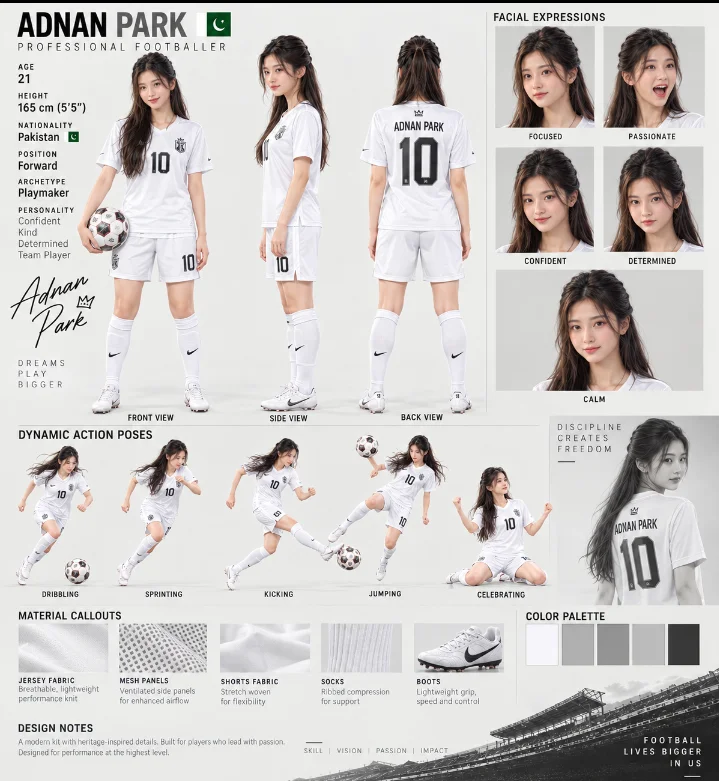

# Female Footballer Character Profile Sheet (ADnan Park)

**中文标题：** 女足球运动员角色档案表（ADnan Park）  
**ID:** `gi25-x-793` · **Mode:** `edit`  
**Categories:** `character-consistency`  
**Tags:** `x-twitter`, `community`, `gpt-image-2.5`, `x-direct`, `en`



### Female Footballer Character Profile Sheet (ADnan Park)

```text
1️⃣ Ladki wali — ADnan Park
Create a premium professional footballer character profile sheet using the provided female reference image as the facial and appearance reference. Preserve her recognizable facial features, long dark hair, natural skin tone and overall elegant appearance, but transform her into a professional female football player named “ADNAN PARK”.

Design a highly detailed professional football scouting and character presentation board, similar to a high-end football game character sheet. Show the same female player in multiple views: full-body front view, side profile, and back view, all with consistent face, hairstyle, body proportions and identity.

She is wearing a completely WHITE professional football uniform: clean white short-sleeve jersey, white football shorts, white knee-high football socks and premium white football boots. The jersey should have a simple professional number “10” on the front and shorts. On the back, clearly display “ADNAN PARK” above the number “10”. Keep the kit elegant, realistic, modern and athletic, without unnecessary colorful patterns.

Include several realistic facial-expression portraits on the right side: focused, passionate, confident, determined and calm. Every portrait must maintain the exact same character identity and facial structure.

Below the main character views, include dynamic football action poses: dribbling with a football, sprinting, powerful kicking, jumping for the ball and celebrating after scoring. Make the movements realistic, athletic and cinematic, with natural body anatomy and consistent clothing.

Create a professional information panel with:
ADNAN PARK
PROFESSIONAL FOOTBALLER
Position: Forward / Attacking Midfielder
Archetype: Playmaker
Personality: Confident, Focused, Determined, Disciplined

Add material close-up panels showing white jersey fabric, breathable mesh panels, white shorts fabric, ribbed white socks and premium football boots. Add a clean white, silver-gray and black color palette.

Use a sophisticated editorial sports-design layout with thin dividing lines, clean typography, subtle shadows, realistic studio lighting and a premium football academy presentation aesthetic. Add a subtle stadium photograph along the bottom section.

Make the entire image photorealistic, highly detailed, sharp, realistic skin texture, realistic hair strands, realistic fabric folds, professional sports photography, consistent character identity across every panel, clean composition, high-end football video-game character concept art, ultra-detailed, 4K quality, vertical poster format.

Do not include any unrelated people, no male player, no extra character, no social-media logos, no watermark, no random text, and no distorted anatomy.
```

- **Recommended model:** `gpt-image-2.5-sunburst`
- **Settings:** _(defaults)_
- **Source:** [community](https://x.com/Adnan_Ai2/status/2103091624918270120) — @Adnan_Ai2
- **License note:** Original public X post; quoted with attribution — remix with attribution
- **Notes:** Collected directly from X; prompt posted as the author's reply https://x.com/Adnan_Ai2/status/2103091624918270120 to https://x.com/Adnan_Ai2/status/2103091620132573617, which carries the images and names GPT Image 2.5; discovered via Bin0754/gpt-image-gallery index, prompt re-verified against the original X post via api.fxtwitter.com; verified=True; verified reply text — first prompt in thread
- **Preview:** `previews/gi25-x-793.webp`
