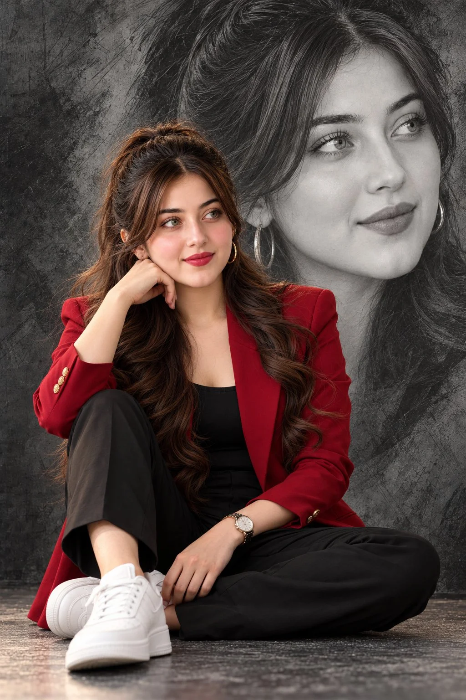

# Cinematic Double Portrait Collage — Male & Female

**中文标题：** 电影感双人拼贴肖像（男&女）  
**ID:** `gi25-x-796` · **Mode:** `edit`  
**Categories:** `character-consistency`, `poster-typography`  
**Tags:** `x-twitter`, `community`, `gpt-image-2.5`, `x-direct`, `en`



### Cinematic Double Portrait Collage — Male & Female

```text
CINEMATIC DOUBLE PORTRAIT COLLAGE — ULTRA-REALISTIC MALE & FEMALE EDITORIAL PHOTOSHOOT

Create an ultra-realistic, high-end cinematic portrait collage featuring a handsome young man or a beautiful young woman as the main subject, with a large monochromatic pencil-sketch-style portrait of the exact same person filling the background. The composition must look like a luxury fashion magazine photoshoot.

1. FACE & CHARACTER CONSISTENCY

Use the uploaded reference image as the primary identity reference. Preserve the subject’s exact facial identity, facial proportions, eye shape, nose, lips, jawline, skin tone, hairstyle, and natural features. The foreground subject and oversized background portrait must clearly depict the same person.

2. FOREGROUND POSE & COMPOSITION

The subject is sitting casually on a studio floor with one leg crossed and the other knee slightly raised. One arm rests naturally on the raised knee, while the other hand rests elegantly near the crossed leg. The body is slightly angled, and the subject gazes thoughtfully toward the right side of the frame with a calm, confident, sophisticated expression.

For the male version, dress him in a fitted black button-up shirt with rolled-up sleeves, slim-fit black trousers, clean white minimalist sneakers, and a premium silver wristwatch with a dark dial.

For the female version, dress her in a luxurious deep-crimson red blazer over a fitted black top, elegant black trousers, clean white minimalist sneakers, gold hoop earrings, and a premium wristwatch. Her long, voluminous dark brown hair falls in soft waves, styled half-up with loose strands framing her face.

3. OVERSIZED BACKGROUND PORTRAIT

Behind the seated subject, create an enormous, ultra-detailed monochromatic grayscale portrait of the same person. The face should occupy most of the upper and right portions of the frame, with the head turned slightly toward the right and a thoughtful editorial expression.

Render the background portrait in realistic graphite pencil and charcoal textures, with delicate sketch marks, fine hair details, natural facial shading, and subtle artistic imperfections. Blend it seamlessly into a textured charcoal-gray studio wall.

4. BACKGROUND & ENVIRONMENT

Use a dark charcoal-gray textured wall with artistic scratches, subtle abstract brushstrokes, smoky gradients, and a matching studio floor. Create a cinematic, sophisticated atmosphere with depth and a premium editorial aesthetic.

For the female version, preserve the deep-crimson red blazer as the dominant accent color against the monochromatic background. For the male version, use an elegant black outfit with natural skin tones and subtle neutral highlights.

5. LIGHTING & CAMERA

Professional softbox lighting, soft directional key light, gentle rim lighting around the hair and shoulders, realistic skin texture, natural shadows, detailed fabric folds, accurate hands, anatomically correct proportions, and cinematic depth.

Shot on a professional full-frame camera with a 50mm portrait lens, shallow depth of field, premium fashion photography, balanced exposure, and realistic perspective.

6. VISUAL STYLE

Ultra-photorealistic, luxury fashion editorial, cinematic double-exposure-inspired composition, oversized grayscale pencil portrait, full-color foreground subject, sophisticated neutral grading, highly detailed hair, realistic skin pores, natural anatomy, 8K-quality detail, professional magazine-cover aesthetic.

7. COMPOSITION RULES

- Vertical 2:3 portrait composition.
- The seated subject occupies the lower-left and central portion of the frame.
- The oversized monochromatic portrait dominates the upper and right background.
- Keep the foreground subject in full natural color.
- Keep the background portrait strictly grayscale.
- Maintain consistent facial identity between both portraits.
- Ensure the face, hands, legs, and footwear are anatomically correct.
- Create a seamless, artistic blend between the two portraits.
- No text, no typography, no watermark, and no logo.

NEGATIVE PROMPT: Cartoon, anime, plastic skin, excessive retouching, distorted face, inconsistent facial identity, asymmetrical eyes, extra fingers, missing fingers, deformed hands, incorrect anatomy, unnatural pose, duplicate foreground subject, blurry face, low resolution, oversaturated colors, messy composition, text, watermark, logo.

FINAL RESULT: A premium, photorealistic cinematic portrait collage featuring one seated full-color subject and one enormous grayscale artistic portrait of the same person, with dramatic visual depth and luxury editorial quality.
```

- **Recommended model:** `gpt-image-2.5-sunburst`
- **Settings:** _(defaults)_
- **Source:** [community](https://x.com/Enaya_ai/status/2109995156686692469) — @Enaya_ai
- **License note:** Original public X post; quoted with attribution — remix with attribution
- **Notes:** Collected directly from X; prompt posted as the author's reply https://x.com/Enaya_ai/status/2109995156686692469 to https://x.com/Enaya_ai/status/2109995151213076729, which carries the images and names GPT Image 2.5; discovered via Bin0754/gpt-image-gallery index, prompt re-verified against the original X post via api.fxtwitter.com; verified=True
- **Preview:** `previews/gi25-x-796.webp`
