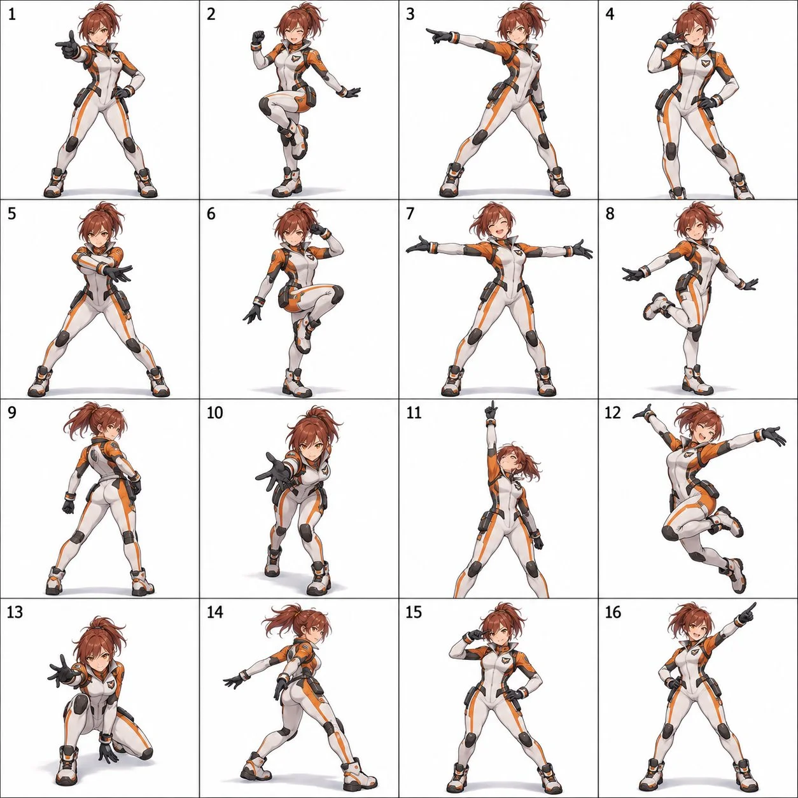

# 4×4 Original Character Dance Pose Sheet

**中文标题：** 原创角色 4×4 舞蹈姿势表  
**ID:** `gi25-x-802` · **Mode:** `generate`  
**Categories:** `character-consistency`  
**Tags:** `x-twitter`, `community`, `gpt-image-2.5`, `x-direct`, `en`



### 4×4 Original Character Dance Pose Sheet

```text
Create a 4×4 dance pose sheet featuring one original character, with exactly 16 equally sized panels in one square image.

CHARACTER DESIGN
Design a confident mecha pilot with a short auburn ponytail, sharp amber eyes, a fitted white-and-orange flight suit with panel seams and a squadron emblem on the chest, a popped collar, and reinforced boots. Keep her exact face, hairstyle, colors, proportions, outfit, and accessories fully consistent across all 16 panels — no redesigns, recolors, or costume changes between panels.

ART STYLE
Render in 2D anime, crisp mechanical linework, with crisp outlines and consistent lighting across every panel.

CHOREOGRAPHY
Design a cohesive 16-pose dance sequence with a clear beginning, build-up, climax, and ending, ordered left to right, top to bottom. Include: an opening pose that establishes personality; a small rhythmic step with a coordinated arm gesture; a side step with one arm extended; a compact expressive gesture near the face; a grounded stance with arms crossing or sweeping inward; a knee lift or weight shift; an open expansive pose with arms spread; a playful balance pose; a turning pose showing a three-quarter rear view; a forward-reaching diagonal lean; a strong upward-reaching accent; a climactic jump (or full-body extension if jumping doesn't suit the character); a lowered stance with a forward gesture; a dynamic side-facing transition; a signature gesture unique to the character; and a confident final pose with a clear finishing silhouette.

COMPOSITION
Use a clean white background, thin grid lines, and small readable numbers 1–16 in the upper-left corner of each panel. One full-body depiction of the character per panel, consistent scale, camera distance, lighting, and rendering style throughout. Fixed camera angle while the character turns naturally. Keep the entire character — hair, hands, feet, wings, tails, and accessories — inside each panel with comfortable margins, with subtle ground shadows and natural secondary movement in hair and fabric.

AVOID
Repeated or near-identical poses, identity drift, costume changes, inconsistent proportions, extra or missing limbs, malformed hands, cropped body parts, overlapping panels, additional characters, motion trails, background scenery, unlisted props, speech bubbles, and watermarks.

Final output: one polished square image, a clearly organized 4×4 grid of 16 distinct, character-appropriate dance poses.
```

- **Recommended model:** `gpt-image-2.5-sunburst`
- **Settings:** _(defaults)_
- **Source:** [community](https://x.com/MahnoorAi12/status/2099099834867134695) — @MahnoorAi12
- **License note:** Original public X post; quoted with attribution — remix with attribution
- **Notes:** Collected directly from X; prompt posted as the author's reply https://x.com/MahnoorAi12/status/2099099834867134695 to https://x.com/MahnoorAi12/status/2099099830236684757, which carries the images and names GPT Image 2.5; discovered via Bin0754/gpt-image-gallery index, prompt re-verified against the original X post via api.fxtwitter.com; verified=True
- **Preview:** `previews/gi25-x-802.webp`
