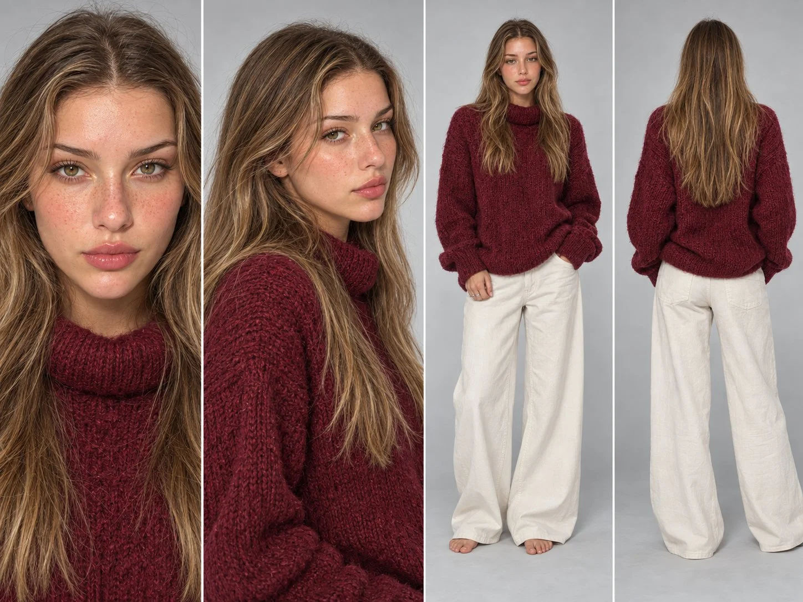

# Young-Woman Photoreal Character Reference Sheet

**中文标题：** 年轻女子写实角色参考设定表  
**ID:** `gi25-x-804` · **Mode:** `generate`  
**Categories:** `character-consistency`  
**Tags:** `x-twitter`, `community`, `gpt-image-2.5`, `x-direct`, `en`



### Young-Woman Photoreal Character Reference Sheet

```text
SCENE CONTEXT
A photoreal character reference sheet of one young woman, built from the attached first-frame selfie, for identity lock in a UGC try-on video.

SUBJECT
A young woman in her mid-twenties, slim build. Face: fair skin with a warm golden undertone and a soft capillary flush across the cheeks and nose, dense natural freckles scattered across the nose bridge, both cheeks and the upper lip area, hazel-green almond eyes with a warm golden ring around the pupil, thick natural brows with a fairly straight line and a soft arch at the tail, straight narrow nose with a slight sun-lit sheen on the bridge, full lips in a glossy rose-nude with a defined cupid's bow, dewy bare skin with no visible foundation. Hair: long layered light-brown hair with caramel and honey-blonde balayage streaks, a clean center part, slightly piecey loose waves, soft face-framing strands falling past the collarbones. Hands: short soft almond nails in a sheer nude, two thin stacked silver band rings on the ring finger. Outfit: an oversized burgundy chunky-knit funnel-neck sweater in a fuzzy mohair-blend yarn with a soft halo of fibres, cream relaxed wide-leg trousers, bare feet. 100% matches the reference.

LAYOUT
Four panels side by side, 100% consistent across all 4 shots: face close-up at 18° FOV looking to the lens, head and shoulders three-quarter left at 29° FOV, full body front at 47° FOV, full body back at 47° FOV.

OPTICS
Natural perspective, deep focus, high micro-contrast, fine skin texture preserved.

CAMERA
Eye level, subject centred in each panel, straight rectilinear framing.

BACKGROUND
Seamless neutral light-grey cyclorama, soft contact shadow at the feet.

LIGHTING
Even soft studio softbox key from the front-upper, gentle fill, WB 5200K, freckles and skin texture fully readable.

MATERIAL
Pore-level realism: vellus hair along the jaw and hairline, asymmetric freckles, capillary flush, wet living eyes with catch-lights. Fuzzy knit halo and individual yarn loops readable on the sweater.

STYLE
Photoreal editorial studio photography, 8K, no 3D render.

POSITIVE LOCKS
Single subject, no extra people, no text overlays, no watermark. Face, freckles, eye colour, brows, lips and hair identical in all four panels. Eyes stay natural, no eye glow.SCENE CONTEXT
A photoreal character reference sheet of one young woman, built from the attached first-frame selfie, for identity lock in a UGC try-on video.

SUBJECT
A young woman in her mid-twenties, slim build. Face: fair skin with a warm golden undertone and a soft capillary flush across the cheeks and nose, dense natural freckles scattered across the nose bridge, both cheeks and the upper lip area, hazel-green almond eyes with a warm golden ring around the pupil, thick natural brows with a fairly straight line and a soft arch at the tail, straight narrow nose with a slight sun-lit sheen on the bridge, full lips in a glossy rose-nude with a defined cupid's bow, dewy bare skin with no visible foundation. Hair: long layered light-brown hair with caramel and honey-blonde balayage streaks, a clean center part, slightly piecey loose waves, soft face-framing strands falling past the collarbones. Hands: short soft almond nails in a sheer nude, two thin stacked silver band rings on the ring finger. Outfit: an oversized burgundy chunky-knit funnel-neck sweater in a fuzzy mohair-blend yarn with a soft halo of fibres, cream relaxed wide-leg trousers, bare feet. 100% matches the reference.

LAYOUT
Four panels side by side, 100% consistent across all 4 shots: face close-up at 18° FOV looking to the lens, head and shoulders three-quarter left at 29° FOV, full body front at 47° FOV, full body back at 47° FOV.

OPTICS
Natural perspective, deep focus, high micro-contrast, fine skin texture preserved.

CAMERA
Eye level, subject centred in each panel, straight rectilinear framing.

BACKGROUND
Seamless neutral light-grey cyclorama, soft contact shadow at the feet.

LIGHTING
Even soft studio softbox key from the front-upper, gentle fill, WB 5200K, freckles and skin texture fully readable.

MATERIAL
Pore-level realism: vellus hair along the jaw and hairline, asymmetric freckles, capillary flush, wet living eyes with catch-lights. Fuzzy knit halo and individual yarn loops readable on the sweater.

STYLE
Photoreal editorial studio photography, 8K, no 3D render.

POSITIVE LOCKS
Single subject, no extra people, no text overlays, no watermark. Face, freckles, eye colour, brows, lips and hair identical in all four panels. Eyes stay natural, no eye glow.SCENE CONTEXT
A photoreal character reference sheet of one young woman, built from the attached first-frame selfie, for identity lock in a UGC try-on video.

SUBJECT
A young woman in her mid-twenties, slim build. Face: fair skin with a warm golden undertone and a soft capillary flush across the cheeks and nose, dense natural freckles scattered across the nose bridge, both cheeks and the upper lip area, hazel-green almond eyes with a warm golden ring around the pupil, thick natural brows with a fairly straight line and a soft arch at the tail, straight narrow nose with a slight sun-lit sheen on the bridge, full lips in a glossy rose-nude with a defined cupid's bow, dewy bare skin with no visible foundation. Hair: long layered light-brown hair with caramel and honey-blonde balayage streaks, a clean center part, slightly piecey loose waves, soft face-framing strands falling past the collarbones. Hands: short soft almond nails in a sheer nude, two thin stacked silver band rings on the ring finger. Outfit: an oversized burgundy chunky-knit funnel-neck sweater in a fuzzy mohair-blend yarn with a soft halo of fibres, cream relaxed wide-leg trousers, bare feet. 100% matches the reference.

LAYOUT
Four panels side by side, 100% consistent across all 4 shots: face close-up at 18° FOV looking to the lens, head and shoulders three-quarter left at 29° FOV, full body front at 47° FOV, full body back at 47° FOV.

OPTICS
Natural perspective, deep focus, high micro-contrast, fine skin texture preserved.

CAMERA
Eye level, subject centred in each panel, straight rectilinear framing.

BACKGROUND
Seamless neutral light-grey cyclorama, soft contact shadow at the feet.

LIGHTING
Even soft studio softbox key from the front-upper, gentle fill, WB 5200K, freckles and skin texture fully readable.

MATERIAL
Pore-level realism: vellus hair along the jaw and hairline, asymmetric freckles, capillary flush, wet living eyes with catch-lights. Fuzzy knit halo and individual yarn loops readable on the sweater.

STYLE
Photoreal editorial studio photography, 8K, no 3D render.

POSITIVE LOCKS
Single subject, no extra people, no text overlays, no watermark. Face, freckles, eye colour, brows, lips and hair identical in all four panels. Eyes stay natural, no eye glow.
```

- **Recommended model:** `gpt-image-2.5-sunburst`
- **Settings:** _(defaults)_
- **Source:** [community](https://x.com/abxxai/status/2107847875250274784) — @abxxai
- **License note:** Original public X post; quoted with attribution — remix with attribution
- **Notes:** Collected directly from X; original post https://x.com/abxxai/status/2107847875250274784; post text names GPT Image 2.5; discovered via Bin0754/gpt-image-gallery index, prompt re-verified against the original X post via api.fxtwitter.com; verified=True
- **Preview:** `previews/gi25-x-804.webp`
